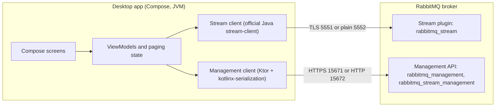

# Caerbannog – KMP Compose Desktop Plan

> Tagline: "behind the rabbit". Started on 2026-11-03 from the living plan doc: https://claude.ai/artifact/6ZMxom32HjSEDEzm4Xyhnh. This file is now the source of truth; the doc is a snapshot. UX sources live in `docs/ux/`.

## Goals and scope

Caerbannog ("behind the rabbit") is a free, desktop-only "Kafka UI for RabbitMQ Streams": connect to a broker, list streams, and page through messages by offset or timestamp. It also covers quorum queues (topology and statistics, plus a read-only peek at their messages that always requeues them, never consuming), MQTT sessions and publishing, and live monitoring views. It is a Kotlin Multiplatform project using Compose Multiplatform, but v1 ships only the JVM desktop target and supports RabbitMQ 4.x and later. RabbitMQ 3.x is supported only as a read-only source for migrating to 4.x (M8, see "Migrating from RabbitMQ 3.x (M8)"); no other feature is built or tested against 3.x.

**v1 features**

- Stream list with stats: message count, first/last offset, retention, publishers and consumers; super streams appear as one entry with their partitions. Size in bytes is not available from the broker (M2-02 spike); the Size column is shown blank until M3 (product decision N1 (c), 2026-11-04). First offset is shown in M2 (decision D5 (b)).
- Publishers and consumers per stream: who is connected, consumer offsets and how far behind they are, and publisher message counters, read from the management API.
- Message browser with paging: start from first, last, a numeric offset or a timestamp; page size; next, previous and jump to offset.
- Search and filter plus payload viewer: text, JSON (pretty-printed) and hex views; filter by properties and application properties.
- Publish and manage: publish a test message to any stream, exchange or queue; create and delete streams, view consumer offsets.
- Quorum queue topology and statistics: list queues, exchanges and bindings; see message counts, consumers, leader and members. The Topology screen is read-only (owner decision Q15, 2026-11-15): topology is changed with a plan in the Topology planner (M9, see "Topology planner (M9)"), saved as a versioned JSON migration and applied from the Migrations screen where the connection's permissions allow; migrations can also be exported and imported as JSON.
- Migrate from RabbitMQ 3.x (M8): analyse a 3.x topology (live connection or exported `definitions.json`), review a compatibility report with proposed 4.x equivalents, write the accepted fixes as a normal migration, and forward the messages of a 3.x queue with a broker-side dynamic Shovel. See "Migrating from RabbitMQ 3.x (M8)".
- Global search: one box that finds streams, queues and exchanges by name (substring or regex), with the type of each result; names only, never message contents.
- MQTT (M6): the broker's MQTT clients and subscriptions on a Topology tab, and a Publish MQTT dialog with topic, QoS 0/1/2, retain, payload and headers (MQTT 5 user properties). See "MQTT support".
- Queue message inspection (M7-08): peek at the first messages of a queue without consuming them. See "Queue message inspection".
- Live monitoring views (M7): stream log tape, rolling sparklines and lag trends, end-to-end pipeline graph with inbound routes, super stream partition balance. See "Monitoring views".
- Topology planner (M9, PLANNED 2026-11-15, not built, the owner's questions answered the same day): build a topology change step by step in a wizard-like form (queues, exchanges, bindings, streams with an optional response stream and optional MQTT routes for answers and requests, policies, dead-lettering for a queue, MQTT routes), review the result as a read-only graph, check it against the broker, save it as an ordinary migration and apply it with the existing Apply. The user no longer writes migration JSON. See "Topology planner (M9)".

**Non-goals for v1**

- Android, iOS and Web targets (the stream client is JVM-only; these need a backend, see Architecture).
- Consuming messages from quorum or classic queues, or acknowledging, deleting or purging them, in the app's own process. The only way the app shows queue messages is the requeue peek (see "Queue message inspection"); anything in the app that would remove or settle a message stays out of scope. One accepted exception (product decision 2026-11-09, M8): the app may configure a broker-side dynamic Shovel that moves the messages of a queue to another broker; the broker moves them, the app never touches a message. See "Forwarding messages with a dynamic Shovel".
- Writing to a RabbitMQ 3.x broker, or using 3.x for anything except reading its topology and statistics as a migration source.
- Live tailing at high throughput; v1 browses, it does not replace a consumer.

**Quality requirement**

- Every feature is built test-first (TDD), and its behavior is also written as BDD scenarios in plain Given/When/Then language that run automatically. See Testing.

## Architecture

The app talks to RabbitMQ directly over two channels, with no backend of our own.



The stream protocol (default port 5551 with TLS, 5552 without) carries message reads, publishes and stream create/delete. The management HTTP API (default port 15671 over HTTPS, 15672 over plain HTTP) supplies the stream list, message counts, publishers and consumers, plus all quorum queue topology and statistics. First offsets come only from the stream protocol (`queryStreamStats`); there is no byte size per stream anywhere (see "Management API facts").

**Why JVM-only:** the official RabbitMQ stream client is a Java library, so it runs on desktop JVM (and Android) but not on iOS or in a browser. Adding those later means a small Ktor gateway that holds the stream connection and exposes a paged REST API; the UI and view models stay shared.

**Broker versions (product decision 2026-11-09, M8):** the app is built and tested for RabbitMQ 4.x and later. RabbitMQ 3.x is accepted only as a read-only migration source: the app reads its definitions (and queue statistics) through the management API, writes nothing to it and offers no other feature on it (see "Migrating from RabbitMQ 3.x (M8)"). The stream plugin is not needed on a 3.x source.

**Broker requirements:** the `rabbitmq_stream` and `rabbitmq_stream_management` plugins must be enabled, TLS is on by default and a profile can turn it off (decision D9a); with it off the user's password and all messages travel in clear text, and the app says "Not encrypted" wherever the connection is shown. The app never falls back from TLS to plain or the other way: the profile switch is the only source of the mode. For browsing, use a dedicated user with read-only permissions where possible.

## Connection lifecycle (M2 decisions D1, D2, D6, D7)

"Connected" means an explicit, held connection (product decision D1 (b), 2026-11-04). The user presses Connect and Disconnect; Connect opens and holds the broker clients, Disconnect closes them. Rules:

- **State per connection:** Disconnected, Connecting, Connected, Failed(reason). Disconnect is immediate (clients are closed in the background), so there is no visible Disconnecting state.
- **One held connection at a time.** Connect on another profile disconnects the held one first. The held connection is the session's current connection; a profile that is only selected in the edit panel is not held. Reason: one set of clients, one stream `Environment`, no hidden connections to other brokers, and the permission rules stay per current environment.
- **Connect = select, permission check, then open the clients.** The permission check of M2-01 runs first and is part of Connect. Connect fails (Failed(reason)) when the broker cannot be used: not reachable, TLS refused (only with TLS on), no stored password. An Unreadable permission result that only means "a non-admin cannot read permissions" is the normal case and still ends Connected in safest mode. A stream-protocol failure does not fail Connect: first offsets become "unavailable". A management 401 whose reason is exactly `Not management user` ends Connected with visibility NONE (message, no lists, decision S3a); any other 401 on `/api/whoami` or `/api/overview` is Failed("Credentials were refused") (the two bodies differ, see "Management API facts", M2-03a).
- **Who owns the clients:** a per-connection holder in `data-rabbit`, created on Connect. It holds the management HTTP client (profile CA, host name not verified, see D7), the stream `Environment` (created lazily on the first first-offset call) and the password, read from `SecretStore` once when the holder is created (D6) and kept only in the holder's memory; it never enters `SessionState`, logs or error strings. `core` sees only interfaces (`ConnectionGateway.open(profile)` returning a held connection that exposes `StreamCatalog` and `StreamOffsets` and can be closed); the composition root wires the `data-rabbit` implementation.
- **Closed when:** the user presses Disconnect; Connect on another profile; the profile is deleted; the profile is edited or renamed (the holder has the old host, CA or password, so it is closed and the state is Disconnected with the note "Connection settings changed. Connect again."; the permission check runs again as before); the window closes (composition root, `onCloseRequest`); a Connect fails (partial clients closed). Closing is idempotent.
- **Lost connection (D2, decided 2026-11-04):** a data call that fails with unreachable or timeout moves the state to Failed("Connection lost") and closes the clients; the screen keeps the last rows, marks them stale and offers Retry (Connect again). No automatic reconnect in M2. A 401 on a data call is Failed("Credentials were refused").
- **Idle connections and what "unreachable" means (M2-16, architect 2026-11-15):** RabbitMQ 4's management listener closes a keep-alive connection after 5 s idle (measured: a second request 4.8 s after the first is answered, 5.0 s after it is dropped), and the default refresh interval is 5 s, so a refresh can land on a connection the broker is closing (CI run 43640828120: the clients tab went to Failed("Connection lost") for good). The JDK `HttpClient` retries a failed GET once, on the next pooled connection, and never retries a POST, PUT or DELETE (JDK 21 `MultiExchange`); with two or more idle pooled connections the retry meets a dead one too. Rules, so that "unreachable" keeps meaning "the broker did not answer a fresh attempt": (1) `ManagementHttp` tries a GET once more when it fails with a dropped connection (an `IOException` that is not a timeout, a TLS failure, a refused connection or an unknown host), at most two attempts, never a loop, same method and URL; (2) a POST, PUT or DELETE is sent once, never twice (a lost answer may hide an applied change); (3) the JDK client's idle timeout is set below the broker's (`jdk.httpclient.keepalive.timeout` = 2 s, set once by `TlsSupport`, the only place that creates a JDK client; the property is JVM-global and read once by the JDK, so it must be set before the first client), so the JDK drops an idle connection after about 1 to 3 s (JDK 21: the pool truncates the expiry to whole seconds, purges on its selector loop, which wakes at least every 3 s, and does not check a connection's age when it reuses one: "about", never "exactly 2 s"), well before the broker's 5 s. That removes the edge for every verb, including the ones rule 2 cannot retry. Rule 1 covers up to four dead pooled connections (the JDK's own single retry inside each of the two attempts); rule 3 keeps a client from holding that many, so a client with five or more dead idle connections, which would still be reported, is practically unreachable. D2 is unchanged: one data call that the broker did not answer, on a fresh connection, is still a lost connection, and a broker that is really gone is still reported at once. Tolerating a failed poll or reconnecting by itself would be a new product decision, not part of this fix.
- **TLS switch (D9a, product owner 2026-11-05):** each connection profile has a "Use TLS" switch, default on, that can be turned off for any host (no localhost-only rule, no confirmation dialog; the warning is visible only). With it off: plain stream protocol (default port 5552), plain HTTP management (default port 15672), the CA is ignored (the saved path is kept but unused), and the panel, the app bar chip and the chip popup row say "Not encrypted". The ports follow the switch while the user has not edited them. `connections.json` always writes `"tls"`; a file without the key, or with a value that is not a boolean, loads as TLS on. This replaces the earlier rule "TLS only". **Connect hint (M2-14c, 2026-11-05):** with TLS on, a Connect that fails because the broker does not answer the TLS handshake (a plain broker; classified as an `SSLException` without a `CertificateException` in its cause chain) says "The broker did not answer the TLS handshake. It may not use TLS; turn off 'Use TLS' in this connection's settings if that is intended." (one shared constant with the Check text). A certificate failure keeps "The certificate was not trusted" and a host name mismatch is not a failure (D7). The hint only tells: the app never turns TLS off, never retries without TLS and sends no credential before the handshake.
- **With TLS on (D7 (a)):** the CA is honoured; the host name is not verified (same as the M1 probe). Management (corrected 2026-11-05, M2-14c): `endpointIdentificationAlgorithm = ""` on the JDK HttpClient has NO effect (the client forces its own host name check; measured on JDK 21), so the management client gets a trust manager that validates the chain against the profile CA only and skips the host name check (an `X509ExtendedTrustManager` wrapping the default one, in `TlsSupport`); no JVM flag, no new dependency. The reachability check's stream-port `SSLSocket` honours the empty algorithm and keeps it. Stream client (M2-03a, verified): `Environment.builder().tls().sslContext(SslContextBuilder.forClient().trustManager(<TrustManagerFactory over a KeyStore holding only the profile CA>).endpointIdentificationAlgorithm(null).build())`. The explicit `endpointIdentificationAlgorithm(null)` is kept as the intent and as protection against a future default: Netty 4.2 verifies the host name by default, but on stream-client 1.12.0 dropping the call was not observable in any test (M2-03 verification, mutation b, equivalent), so do not rely on it alone; `StreamHostNameToleranceTest` pins the observable behaviour. A wrong CA is still refused with verification off, so this is not trust-all. No extra dependency (Netty comes with the stream client). The connection panel shows the one-line note "Host name is not verified." A per-profile "Verify host name" switch is the M5 task `M5-verify-host-name`.
- **Interim Connect button (M2-01):** the edit-panel Connect calls `ConnectionsViewModel.connect(name)` (select plus check); under this model it also opens the clients and disconnects the previously held connection. The edit panel's "Check connection" stays a check only (holds nothing). In M2-05 the edit-panel Connect is removed and the connection control below takes over.
- **Connection control (UX1, product owner 2026-11-04, M2-05):** a fixed chip at the right end of the app bar on every screen shows the current connection's name, state (No connection, Connecting, Connected, Failed, Disconnected) and the permission pill; it opens a popup listing the saved connections with state and Connect, Disconnect or Retry, the stream list refresh interval (D3), "Refresh now" and "Updated N s ago". It replaces the drawer's Connection card (removed) and the sidebar picker idea. Design in `docs/tasks/M2-05-stream-list-screen.md`, mockup `docs/ux/Streams.dc.html`.
- **Stream list refresh (D3, decided by the product owner 2026-11-04):** the interval is in seconds and set in the connection control, next to manual Refresh. Allowed values: Off, 5, 10, 30, 60 seconds. Scope: per app, kept in `settings.json` next to the profiles file (key `streamListRefreshSeconds`; 0 = Off; a missing file, a missing key or an unknown value reads as the default) behind an `AppSettings` interface in `core` (file implementation in `data-rabbit`, M2-05). The default interval is 5 seconds (decided by the product owner 2026-11-04: "try with that, after we can change"; one constant, to be revisited after trying it). With the default, polling starts once connected and the list is shown, so each connected user costs one list call plus the statistics calls every 5 s. See `docs/tasks/M2-04-stream-list-core.md`.

## Module layout and tech stack

One Gradle project (Kotlin Multiplatform and Compose Multiplatform Gradle plugins, one `build.gradle.kts` per module — see Packaging below for why Gradle over Kotlin Toolchain) with a shared core and a thin desktop app, so Android or iOS can be added later without rewriting logic.

| Module | Source set | Holds |
| --- | --- | --- |
| `core` | commonMain | Domain models (Stream, Page, StreamMessage), paging logic, repository interfaces, view models |
| `data-rabbit` | jvmMain | Stream client wrapper, management API client, connection profile storage |
| `ui` | commonMain | Compose screens, theme, payload viewers (text, JSON, hex) |
| `desktopApp` | jvmMain | `main()`, window, menus, packaging |
| `mcp-server` | jvmMain | Headless Model Context Protocol (MCP) server over stdio for AI agent tool integrations |

| Concern | Choice |
| --- | --- |
| UI | Compose Multiplatform (Desktop) with Material 3 |
| Async and state | Kotlin coroutines, `StateFlow`, unidirectional data flow |
| Stream access | `com.rabbitmq:stream-client` (official Java client) |
| Management API | Ktor client with kotlinx-serialization |
| Navigation | A simple sealed-class screen stack to start; Decompose only if it grows |
| Settings and secrets | Connection profiles in a JSON file; passwords in the OS keychain via `com.github.javakeyring:java-keyring` — a write/read/delete round trip passed on macOS in the M1 spike; Windows is unverified until run on Windows hardware or CI |
| Packaging | Gradle with the Compose Multiplatform Gradle plugin (`org.jetbrains.compose`); `./gradlew :desktopApp:run` opens the window and `:desktopApp:packageDmg` / `:desktopApp:packageMsi` (jpackage under the hood) are the installer tasks — chosen over Kotlin Toolchain because the M1 spike found the installed CLI has no `new`, `run` or `package` subcommands at all (see `docs/tasks/M1-01-skeleton-and-spike.md`'s Status section for the captured command output). `packageRpm` (Fedora) and `packageDeb` (Ubuntu/Debian) are also configured (Linux icon, MIT license file); jpackage cannot cross-build, so each runs on its own OS. `packageDmg` produced a working installer on macOS (M5-06). `packageRpm` and `packageDeb` were built in clean `fedora:42` and `ubuntu:24.04` containers (aarch64, 2026-11-09; the Fedora build also needs `java-21-openjdk-jmods`) but not yet installed or launched. `packageMsi` has never been built and stays unverified until run on Windows or in CI. `.github/workflows/package.yml` builds all four on native runners |
| Testing | JUnit 5 (+ `kotlinx-coroutines-test` once there is async code to test) for TDD, Cucumber-JVM (`cucumber-junit-platform-engine`) with Kotlin step definitions for Gherkin scenarios, Testcontainers for a real broker, Compose Multiplatform UI test API — all four wired and proven together in the M1 spike |
| Local dev commands | `Taskfile.yml` at the repo root (go-task, https://taskfile.dev) wraps the Gradle and container commands above — `task test`, `task test:broker` (`task test:broker:podman` / `task test:broker:docker`), `task test:keychain`, `task test:screenshots`, `task run`, `task package:dmg`, `task package:msi`, `task dev:up` (`podman compose` by default on Linux and `docker compose` on macOS/Windows via `CONTAINER_ENGINE`, plus explicit `task dev:up:podman` / `task dev:up:docker`), `task dev:seed`, `task dev:seed:plain`, `task dev:reset` (`task dev:reset:podman` / `task dev:reset:docker`) — as thin aliases (`task test:keychain` touches the real OS keychain and may prompt, so it is run on demand: before a release, or after changing `JavaKeyringSecretStore`, on a machine with an unlocked keychain; the default `task test` never touches it; `task test:screenshots` writes Connections screen PNGs to `ui/build/screenshots/` for a by-eye comparison with the UX mockup and is excluded from `task test`), so developers do not need to recall exact `./gradlew` invocations. `task test` must run every module's fast tests, including the Kotlin Multiplatform modules `core` and `ui` (their tests are `jvmTest`; a `test` task registered in each of those modules delegates to `jvmTest`, so plain `./gradlew test` reaches them; see `M1-TASKFILE-02-test-task-runs-all-modules`). Installed separately (e.g. `brew install go-task` on macOS, `sudo dnf install go-task` on Fedora — see `docs/DEVELOPING_ON_FEDORA.md` and `docs/DEVELOPING_ON_WINDOWS.md`); not used by any CI pipeline, since none exists yet (project is local-development-only for now) |

The `data-rabbit` module sits behind repository interfaces in `core`, so a future gateway-backed implementation can replace it without touching the UI.

### Model Context Protocol (MCP) server & architectural rule

The `:mcp-server` module exposes Caerbannog's connection profiles, stream catalogs, and topology inspection to external AI developer agents (such as Antigravity and Claude Code) via the Model Context Protocol over `stdio`.

**Architectural rule:** For every new capability introduced to the product (such as browsing messages in M3, payload inspection in M4, or publishing and migrations in M5), the **solution architect is responsible for evaluating** whether the capability should be exposed to AI agents as an MCP tool. If yes, the architect must specify the tool schema, permissions, and safety scenarios in the task brief; if no, the brief must explicitly record why. The MCP server must always uphold Caerbannog's safety rules: no consuming, acknowledging, deleting or purging of queue messages (the MCP server does not expose queue inspection at all today, and no tool creates or removes a Shovel, M8), ephemeral stream reads, and no secret leakage.

**Recorded evaluations:** M8 in "Migrating from RabbitMQ 3.x (M8)", "MCP evaluation (architectural rule)". M9 Topology planner: **no MCP tool** (owner decision 2026-11-15, "no MCP"); the reason and what an agent can still do with a saved plan are in "Topology planner (M9)", "MCP evaluation".

## Paging model

Streams have no random-access API, so each page is a short-lived read: open an unnamed consumer at a start offset, collect up to the page size, then close it. An unnamed consumer stores no offset, so browsing never affects real consumers. **Safety rule (M2-02c):** the browsing consumer must be unnamed, or named with `noTrackingStrategy()`. A named consumer with the client's default or manual tracking makes the client write an offset tracking chunk into the stream (the manual strategy's safety net stores a default offset about 1 s after consuming): that changes the stream's `messages`, takes an offset, and can reset a real consumer's resume point if the reference is reused. That would break "browsing never changes anything on the broker". A test must assert `tracking.offsets` stays empty and `messages` unchanged after a browse. `queryStreamStats` is a read query; the M2-03 test must confirm it writes nothing.

1. Ask the broker for the stream's bounds (`queryStreamStats`: first offset and committed offset).
2. Resolve the start: `first`, `last page`, a typed offset, or a timestamp (`OffsetSpecification.timestamp`).
3. Open the consumer at that offset; collect messages until the page is full or a short idle timeout (about 2 s) passes.
4. Close the consumer and render the page with each message's offset and timestamp.

**Next** starts at the last offset shown plus one. **Previous** starts at the first offset shown minus the page size, clamped to the first offset. **Jump to offset** and **Jump to time** restart at step 2.

**Caveats to design for**

- Delivery is chunk-based, so a read may begin before the requested offset; the app drops messages below the start offset.
- Retention can move the first offset while a user is paging; the app re-reads the bounds and shows a notice instead of failing.
- Message count is the management API's `messages` (exact for the stream's offsets, M2-02 spike; it includes the tracking entries of other applications' named consumers, which is the cause of the `@gate-M2` tolerance), not committed minus first plus one: `committedChunkId` is the start offset of the last chunk, so that formula undercounts when messages were published in batches. The count can exceed the number of user messages, because offset tracking entries occupy offsets in the stream; RabbitMQ's own Management UI shows the same number. The app still labels it approximate (statistics refresh about every 5 s).
- Search and filter run client-side over a bounded scan (for example the next 10,000 messages) with a visible scan limit and a Cancel button; v1 does not rely on broker-side filtering.
- Exchange and routing key (verified live, `RealBrokerStreamExchangeAnnotationsTest`, RabbitMQ 4): a message routed into a stream through an exchange carries the `x-exchange` and `x-routing-key` message annotations, which the reader surfaces as `StreamMessage.exchange` and `routingKey`. A message published straight to the stream has neither, so the details rows stay hidden.
- Super streams: each partition is a regular stream, so the browser reads one partition at a time. Order exists only within a partition, so v1 does not merge partitions into one sequence.

## Management API facts (M2-02 spike)

Measured on RabbitMQ 4.4.0 (single node, TLS fixture, `rabbitmq_stream` and `rabbitmq_stream_management` enabled) by `StreamManagementApiSpikeTest` (tag `broker`). Full detail, field tables and the unanswered items are in `docs/tasks/M2-02-management-api-spike.md` (Status). Real bodies for fakes and parser tests are in `data-rabbit/src/test/resources/fixtures/m2-02/`. Everything here was measured on one node and one version; it is not verified on clusters, other 4.x versions or 3.x.

| Need | Source | Notes |
| --- | --- | --- |
| Stream list | `GET /api/queues` (also `/api/queues/{vhost}`, `/api/queues/{vhost}/{name}`) | No stream-specific listing (`/api/streams` is 404). A stream is a queue with `type` `stream`. Without paging parameters the body is a bare array; with `page` it is an object `{items, page, page_size, page_count, item_count, filtered_count, total_count}` |
| Fields per stream | `name`, `vhost`, `type`, `state` (strings); `messages`, `messages_ready`, `consumers`, `segments`, `first_timestamp` (ms), `memory` (numbers); `arguments`, `leader`, `node`, `members`, `online` | `messages` may be missing for about 5 s after creation. `arguments.x-max-age` is a string and comes back exactly in the form the stream was created with: "7D" when declared as text (management API or `x-max-age` argument), `604800s` when created through the stream client with `maxAge(Duration)` (M2-03 build); the app shows it in the compact natural form (D9: `604800s` as `7D`, the largest whole unit in Y, M, D, h, m, s; a value that does not divide evenly keeps the smaller unit), and the data layer keeps the broker text unchanged; `x-max-length-bytes` and `x-stream-max-segment-size-bytes` are numbers. `policy` only in the single-queue call or with `columns=policy` (null when none) |
| Absent for streams | `message_bytes`, `publishers`, any first, last or committed offset, any last-message timestamp | There is no size in bytes. `memory` is Erlang process memory, not disk size |
| Message count | management `messages` | Exact; includes offset tracking entries |
| First offset | stream protocol `queryStreamStats` only (`firstOffset`) | Management has none. Last written offset = first offset + `messages` - 1 (next offset to be written = first + `messages`). Never use `committedChunkId` as the last offset |
| Publishers | `GET /api/stream/publishers[/{vhost}[/{stream}]]` | Row (right after a client attaches, `connection_details` is `{}` and the counters are zero for some seconds, M2-03 build: the connection name is then unknown, not an error): `reference`, `publisher_id`, `published`, `confirmed`, `errored`, `queue{name,vhost}`, `connection_details{name,node,user,peer_host,peer_port}`. 200 `[]` when none. The queue object has no publisher count |
| Consumers | `GET /api/stream/consumers[/{vhost}]` | Row: `subscription_id`, `consumed`, `credits`, `offset`, `offset_lag`, `active`, `activity_status`, `properties` (consumer reference in `properties.name`), `queue`, `connection_details`. No per-stream path (400): filter on `queue.name`. `offset_lag` counts the tracking entries written after the consumer's position: 1 in one case, 2 and 3 for a consumer that stored 3 times (M2-06 spike S-A, first statistics window); no per-consumer store count in the API. **Corrected 2026-11-15 (M2-17, measured again by the test developer, 8 of 8 runs, and by a throwaway probe of the architect):** the earlier "0 for unnamed and non-storing consumers even when another application stores" holds only in the first statistics window. About 5 s after the consumers attach, every consumer that has read to the end of a stream shows the same lag, whether it stores offsets or not, because the stored offsets of every application occupy offsets after the last message: 0 on a stream where nobody stored an offset (an unnamed and a named consumer, 2 runs, with a named or unnamed producer); 4 with one auto-tracking consumer that stored 10 times (1 run); 2 with that consumer plus another application's three manual stores (8 of 8 runs of the test developer, 1 of 1 of ours). The number varies and is not derivable. `offset` shows the next offset (100 for 100 messages) with lag 0 (the other application's consumer: 101 and 1) until the first stats refresh, then the last delivered one (99) with the steady lag: wait for the refresh. A named client consumer writes a tracking entry (the Java client's manual tracking stores 0 when the app never stored); an unnamed or no-tracking consumer writes none (M2-02c). **Presence of `offset_lag` and `offset` (M2-17c probe S-D, measured 2026-11-15 on `rabbitmq:4-management`, raw reads of the endpoint, 25 samples over 12 s from the moment the consumers attach):** `offset_lag` was a JSON whole number in every row read, 125 of 125, in three states: a stream with 100 messages (an unnamed and a named consumer), an empty stream (one named consumer) and a single-active group of two consumers with one standby (`active` false), including the rows with an empty `connection_details` in the first seconds; no row without the number was seen, so a missing or non-numeric `offset_lag` is not expected on 4.x and the tab shows one as updating (see the tab paragraph below). `offset` was always present too, but is not always a number: for the rows of the single-active group it was the text "first" in the first seconds (20 of 50 reads of that group, 4 of them after `connection_details.name` was already set), which the parser reads as 0 |
| Tracking | `GET /api/stream/{vhost}/{stream}/tracking` | `{writers:{ref:n}, offsets:{ref:n}}` |
| Plugin missing | `GET /api/stream/publishers` (or consumers, connections) | 404 `{"error":"not_found","reason":"Not Found"}`. Per-stream paths give 400 with an empty body, so use only the top-level paths as the detection call. The 400 of the per-stream consumers path is not a plugin signal: `/api/stream/consumers/{vhost}/{stream}` answers 400 with an empty body on a healthy broker too (it does not exist; confirmed again on the dev broker, F-E spike), whereas `/api/stream/publishers/{vhost}/{stream}` answers 200. `/api/extensions` lists `stream_management` when on |
| Search | `GET /api/queues?name=..&use_regex=true\|false&page=..&page_size=..&sort=..&columns=..` | Name only, server side. Max `page_size` 500 (501, 0 and `page=0` give 400; a page past `page_count` gives 400 `page_out_of_range`); an invalid regex gives 200 and no match; `type=stream` is ignored, so a page can hold fewer streams than `page_size`. Case-sensitivity of `name` not tested |
| Super stream | exchange of type `direct` with `arguments.x-super-stream` = true; bindings from `GET /api/exchanges/{vhost}/{name}/bindings/source` | Partitions are the binding destinations (`<name>-0..` or `<name>-<binding key>`), ordered by `arguments.x-stream-partition-order`. The partition queues carry no marker, so grouping a flat queue list needs extra calls; do not infer from names. **M2-07 (spikes S-A and S-B, built and verified 2026-11-05):** the layout is read with `GET /api/exchanges/{vhost}` (unpaged plain array, `arguments` on every exchange, marker is the JSON boolean `true` on a `direct` exchange; `false`, the string `"true"` and a `fanout` exchange are not super streams) and, only when a marker exchange exists, `GET /api/bindings/{vhost}` (all bindings of the vhost in one unpaged call, same fields as the per-exchange path), so 1 call per full load without super streams and 2 with (55 calls per tick on 1000 queues with one, 54 without). The broker lists bindings by destination name, not by order, so `x-stream-partition-order` must be read (numbered first, numerically; a non-number counts as none; then routing key, then destination; a queue bound twice appears once). `monitoring` and `management` users see all exchanges and bindings of a vhost they may use; a user without a management tag gets 401. The grouping call is a GET, and a failure never fails the stream list or counts as a lost connection (the last grouping is kept, or the list is flat with a notice) |
| Statistics lag | management stats interval, default 5 s | Observed 0.8 s to 4.7 s after a publish. Tests poll on the value (bounded), never sleep |
| Idle keep-alive | the management listener (RabbitMQ 4, Cowboy) | Closes a keep-alive connection that has been idle for 5 s, with no bytes sent (the client sees `HTTP/1.1 header parser received no bytes`). Measured by the test developer 2026-11-14: a second request after 4.8 s is answered, after 5.0 s it is not; with the broker limited to 0.3 CPU the race showed in 10 of 30 runs of the clients view model test. The JDK `HttpClient` keeps idle connections for 30 s by default (`jdk.httpclient.keepalive.timeout`, a `static final` read once); its pool truncates an entry's expiry to whole seconds and purges on its selector loop (JDK 21.0.5 source read by the architect 2026-11-15; test developer's one-off with the property at 2: a new connection after a 4 s wait in 10 of 10 tries, after 3 s in 9 of 10). The M2-16 re-run of the original two-poller clients test at 0.3 CPU passed 12 of 12 on the code before the fix, so the 10 of 30 above was not reproduced; the proof of the fix is the deterministic `ManagementHttpClosedConnectionTest` (real sockets). Rules in "Connection lifecycle" (M2-16) |

**Visibility by user tag (S3, measured with throwaway users that have permissions on one vhost).** No tag: HTTP 401 `Not management user` on everything, including `/api/overview`. `monitoring`: all queues and streams of the vhosts where the user has any permission (name patterns do not hide anything), stream publishers, consumers and connections of the whole broker; `/tracking` needs permission on the stream (401 otherwise); a stream in a vhost without permission looks like 404. `management`: the same queue visibility, but stream publishers, consumers and connections only on the user's own connections. Stream protocol (M2-03a, real broker 4.4.0): a user with no tag can connect and call `queryStreamStats` on a stream it has read permission on, same as `monitoring` and `management`; without permission on the stream the call fails with `com.rabbitmq.stream.StreamException` "Error while querying stream stats: 16 (ACCESS_REFUSED)." and the `Environment` stays usable. Browsing for a no-tag user is not tested (M3). Decided 2026-11-04 (S3a, S3b): a user without the management tag gets a clear message ("This user cannot read stream statistics. Ask for the monitoring tag.") and no lists; a user with only the `management` tag gets the publishers and consumers lists with a fixed notice that they cover only the user's own connections (the tag is read from `GET /api/whoami`). **Virtual host list (M2-08a spike S-E, `GET /api/vhosts`, dev broker 4.4.0):** an administrator or `monitoring` user is listed every virtual host, including ones it has no permission on (those answer 404 on queues, exchanges and bindings); `management` and one-vhost users are listed only their permitted virtual hosts; a user with no tag gets 401. The app cannot tell the first group's unpermitted virtual hosts apart in advance, so the switch does not mark them; the 404 text explains.

**Publishers and consumers tab (decided in the M2-06 brief, 2026-11-05).** Opened from the stream list (the name cell is a link); it polls with the app-wide refresh interval (D3) only while the tab is shown. "Messages behind" is `offset_lag` as the broker reports it; "Caught up" only at 0 behind; above 0 the status reads "N behind" (the broker's number, neutral style) with a tooltip that stored offsets count towards the number: every stored offset (tracking entry) occupies an offset, so a consumer that has read everything can read a few behind (real broker: 2 and 3 for three stores in the M2-06 spike, varying between runs, not derivable from the API; no tolerance constant, no subtraction). **Corrected 2026-11-15 (M2-17):** the lag is the same for every consumer of the stream once the broker's second statistics refresh has run, whether the consumer stores offsets or not (see the Consumers row above), so on a stream where any application stores offsets every consumer reads "N behind" even when all have read everything, and "Caught up" shows on streams without stored offsets. The rule (the broker's number as reported, "Caught up" only at 0) is unchanged. **Tooltip wording decided (M2-17b, owner 2026-11-15, option A):** the tooltip of "N behind" reads "Stored offsets count as messages, so any consumer of a stream where offsets are stored can read a few behind when it has read everything." It replaces "a consumer that stores its offset can read a few behind", which was true but suggested that a consumer that never stores is exempt. Only that sentence changes in the tooltip (hover text and accessible description): the number, "Caught up" only at 0 and the neutral style stay (`docs/tasks/M2-17b-lag-hint-wording.md`). **Footnote wording decided (M2-17b addendum, owner 2026-11-15, answer "F1"):** the footnote under the consumers table had the same flaw ("can be higher than the real distance for a consumer that stores its offset") and now reads "Read from the management API (rabbitmq_stream_management). Messages behind comes from the broker and can be higher than the real distance on a stream where offsets are stored (each stored offset counts). Caught up only at 0." Only the fragment "on a stream where offsets are stored" is new; the tooltip and the footnote are the only two texts of this wording decision, and the rule (the broker's number as reported, "Caught up" only at 0, the neutral style) stays. A row with an empty `connection_details` (a client that has just attached) shows the connection as "unknown" and its counters, offset, behind and status as "updating", never as 0. The same holds for a consumer row for which the broker sent no whole number in `offset_lag` (absent, null or text; M2-17c, not seen on RabbitMQ 4): it reads as updating (connection "unknown", offset, behind and status "updating"), never as 0 and never as Caught up, and it adds no point to the lag trend. The connection cell is `connection_details.name` with the user; no second broker call for a client-provided name (decision D10 in `docs/tasks/README.md`). The jump to a consumer's offset in the browser is M3. **Connection cell (D10, product owner 2026-11-05, decided (a)):** the socket pair (`connection_details.name`) with the user under it; no client-provided name, no extra call per tick, no name-on-request. Revisit name-on-request in M3 or M4 only if the owner's own services set connection names.

**Definitions files (M2-12 spike, measured on `rabbitmq:4-management`).** A super stream can be declared completely in a definitions file: a direct exchange with argument `x-super-stream: true`, the partition streams (`x-queue-type: stream`), and bindings with `routing_key` N and argument `x-stream-partition-order` N; the stream client treats it as a super stream (publishing through `superStream(...)` spread messages over the partitions). `load_definitions` accepts a directory and loads its files in sorted file-name order; each file may be a partial document. A user may carry a plain `password` (the broker hashes it). When definitions load, the broker creates no `guest` user and no `/` vhost, so the first file must define them. Definitions are re-applied on every boot.

**Stream client in production.** `com.rabbitmq:stream-client:1.12.0` is in `data-rabbit` test scope only. Its transitive tree is about 14.8 MB of jars (zstd-jni 7 MB, snappy 2.4 MB, lz4, Netty 4.2.19, proton-j, gson); licences Apache 2.0, MPL 2.0 (dual), BSD 2-Clause. No clash with Ktor 3.0.3, coroutines 1.9.0 or serialization 1.7.3. Product decision D5 (b), 2026-11-04: the M2 stream list shows first offset, so the stream client is a production `implementation` dependency from M2-03. The version must pass the two-week age rule when added (1.12.0 was accepted for the spike; 1.13.1 was published 2026-11-03, re-check the age when M2-03 starts). Cost: about 10 MB of compression jars in the installer, and one `queryStreamStats` call per visible row. Verified by M2-03a: any user with read permission on the stream may call it, and it writes nothing (20 calls from 4 users left `messages` and `/tracking` unchanged); when the call fails or is denied, the row keeps its counts and the first and last offset cells read "unavailable".

**Stream client facts (M2-03a spike, `docs/tasks/M2-03a-stream-stats-permissions.md` Status; `rabbitmq:4-management` floated to 4.4.0, stream-client 1.12.0).**

| Topic | Fact |
| --- | --- |
| `queryStreamStats` outcomes | Permitted stream: `StreamStats` (3 messages published as 3 chunks gave `firstOffset` 0, `committedChunkId` 2). Denied: `StreamException` "...: 16 (ACCESS_REFUSED)." at the call. Missing stream: `StreamDoesNotExistException` ("does not exist"). Empty stream: the call returns, but `firstOffset()` throws `NoOffsetException` ("No first offset for stream <name>"): call the accessors inside the try and map this to "empty" (no first offset yet), not to unavailable and not to a failure |
| Writes nothing | Messages and `/tracking` unchanged after 20 calls (control: one extra publish moves `messages` by exactly one). A management publish leaves one `tracking.writers` entry per publish, so "writers empty" is not a baseline; compare before and after. `messages` is absent on a brand-new stream until the first stats tick |
| Credentials, stream client | Wrong password or unknown user: `AuthenticationFailureException` "... 8 (AUTHENTICATION_FAILURE)" thrown by `Environment.build()`, no password in the chain. A no-tag user does not fail |
| Credentials, management | `/api/whoami` and `/api/overview` 401 bodies differ: no management tag `{"error":"not_authorised","reason":"Not management user"}`; wrong password or unknown user `{"error":"not_authorized","reason":"Not_Authorized"}` (note the spelling). Match on the `reason`. The permissions endpoint answers `Access refused.` for both (M1-03), so it cannot tell them apart |
| Unreachable | Closed port: `ConnectionStreamException` (package-private, match by class name; it is a `StreamException`) thrown by `Environment.build()` after about 1.1 s, cause `ConnectException`. The builder has no connect timeout; `rpcTimeout` default 10 s; Netty's connect timeout default is 30 s (`TimeoutStreamException` after 30000 ms on a non-routable address). Set it explicitly: `.netty().bootstrapCustomizer { it.option(ChannelOption.CONNECT_TIMEOUT_MILLIS, n) }`; at 1000 ms a non-routable address failed after about 2.1 s (two attempts, so budget about twice the value) |
| One Environment | `build()` connects the locator (17-32 ms); 20 sequential calls 0.45-2 ms each; 20 calls on 4 threads 4-7 ms total. After the broker connection is closed (`DELETE /api/connections/{name}`) the same `Environment` answers over a new connection: it reconnects on demand |
| Not covered | A host name mismatch with a DNS SAN (only an IP SAN mismatch was exercised); the TLS proofs (a) and (b) skip on machines with no second reachable name; the virtual host the `Environment` uses (default `/`; a stream in another vhost needs an `Environment` built with that vhost, see M2-03); the floating image tag |

**Testcontainers.** The warning is the Kotlin compiler's "'fun withPluginsEnabled(vararg p0: String!): RabbitMQContainer!' is deprecated. Deprecated in Java." (compile time, not runtime; the Javadoc says use `execInContainer`). Trial of 2.0.5 (scratch, discarded): artifacts renamed, all then-existing broker tests passed and the `api.version` pin was unnecessary, but 2.x deprecates the class we use too (more warnings, not fewer). Conclusion: no bump now; a 2.x move is its own small optional task (`docs/tasks/M2-10-testcontainers-2x-migration.md`).

## Screens and UX

Four screens cover v1's core flow, laid out like Kafka UI: a left sidebar for connections and streams, a main pane for the selected stream. Static Material 3 mockups of every screen are in `docs/ux/`.

| Screen | What the user does |
| --- | --- |
| Connections | Add, edit and test broker profiles: host, stream port, management port, vhost, user, TLS settings (TLS switch, default on), and a permission check that runs before the first connection |
| Stream list | Sort and filter streams (name, and kind chips All, Streams, Super streams); see first and last offset, approximate message count, publishers, consumers (Size column left blank until M3, no data source); a super stream is one entry (M2-07) with summed messages, publishers and consumers (attachments, not distinct clients), retention `mixed` when its partitions differ, no offsets, expandable to its partitions, each a normal row that opens its own Publishers and consumers tab; a plain stream and a super stream may share a name and are two entries; create or delete a stream |
| Message browser | Pick start (first, last page, offset, timestamp) and page size; use next, previous and jump; filter within a bounded scan |
| Message detail and publish | Side panel with offset, timestamp, properties, application properties and the body as text, pretty JSON or hex; a dialog to publish a test message to any stream, exchange or queue. The details sheet also shows exchange and routing key when the message carries them, and a compact icon toolbar copies body, offset or metadata (M7-09); the table cell tooltip shows a bounded body preview (`BodyPreview`) |
| Migrate from 3.x (M8, mockup `docs/ux/Migrate3x.dc.html`, written 2026-11-10, owner review pending) | Choose a definitions file (a live 3.x connection later), name the virtual host of a one-vhost export, read the compatibility report (message-loss block first, severity chips with counts, groups by rule, lazy list, passwords hashes shown only as "hash hidden"), decide each item that needs a decision (accept with the ordering tick, choose an alternative, skip, replace with own migration actions; a skipped item moves to a separate "Skipped by you" group where it can be un-skipped, owner decision 2026-11-10), see "N items need a decision", generate the migrations into the migrations folder (one file per source virtual host; saved files are never overwritten or deleted; a partial save says which file was saved; generating again after files were saved asks first and writes new versions), export the report. Works with no connection and sends nothing to any broker. Built in slices `M8-06a` (file source and report), `M8-06b` (review and generate), `M8-06c` (live source, with `M8-02`), `M8-06d` (access, with `M8-12`) |
| Topology and queues | List quorum queues, exchanges and bindings with statistics (messages, consumers, leader, members). The screen is read-only and stays so (owner decision Q15, 2026-11-15): queues, exchanges, bindings and policies are changed with a plan in the Topology planner (M9, mockup `docs/ux/Planner.dc.html`), which saves a migration; migrations are applied, exported and imported on the Migrations screen. **M2 (task M2-08, read only, decided by the product owner 2026-11-05):** three tabs (Queues, Exchanges, Bindings) for one virtual host at a time, chosen with a virtual host switch that starts on the connection's own and offers the virtual hosts the broker lists for the user (`GET /api/vhosts`); no control that changes anything (no row menu, edit, delete, bind, add to migration or new migration), no control that gets, consumes or purges queue messages (the requeue peek of M7-08 was added later, see "Queue message inspection"); a banner says why the screen is read-only (no configure permission on the connection's virtual host, declared but not confirmed, the connection's level is Read-only, or permissions only checked on another virtual host); one virtual host's data refreshes while the screen is shown (D3) and stays stale on a lost connection (D2); a virtual host that answers 404 reads "Virtual host <name> is not available to this user. It may have been deleted, or the user may have no permission on it."; a user without a management tag gets "This user cannot read topology. Ask for the management tag."; bindings are a table with the default exchange hidden behind a switch, and a graph view is planned (M2-08d, design and drawing approach open: hand-drawn, no dependency) |
| Topology planner (M9, mockup `docs/ux/Planner.dc.html`, written 2026-11-15 and updated for the owner's answers the same day, the mockup review pending, not built) | Opened from the Migrations screen ("New plan", "Continue plan", "Edit steps" on a pending file). Add steps with a wizard (choose a kind, fill the form, read the summary; the stream form offers an optional response stream with optional MQTT routes), see the steps in plain words, reorder, edit and remove them, pick a naming style and read its hints, review the result as a read-only graph with the new parts marked, check the plan against the connected broker (will be created, already there, exists with different settings, blocked, needs something missing, could not be checked), save it as the next migration and apply it from the Migrations screen, or dismiss the draft. States: empty plan, read-only level, no configure permission, RabbitMQ 3.x connection (no planner), no connection, no folder, read-only folder, unreadable draft. Nothing on this screen changes the broker. See "Topology planner (M9)" |
| Publishers and consumers | Tab on the stream detail screen: publishers with connection and message counters; consumers with connection, offset and messages behind; jump the browser to a consumer's offset |
| Global search | Search box at the top of the sidebar opens a search view: results grouped as streams, queues and exchanges, filter chips with counts, a regex toggle, Enter opens the first result. Queue and exchange lookups use the management API's server-side name filter with paging (default 100 per page, maximum 500, confirmed on RabbitMQ 4.4.0 by the M2-02 spike: 501 gives HTTP 400). Streams are queues with `type` `stream`, so the same call finds them; the server has no streams-only filter, so the app filters on `type` itself |

**UX rules**

- Destructive actions (delete stream) need the stream name typed to confirm.
- Every read shows what it did: "offsets 1,200 to 1,299 of about 48,000".
- The body viewer never assumes UTF-8: detect text or JSON, fall back to hex, and cap very large bodies with a "show all" action.
- Copy buttons for offset, body and a ready-made consumer snippet.

## MQTT support (M6)

Optional: a profile has an `mqttPort` (null means no MQTT; the form validates it). With the `rabbitmq_mqtt` plugin enabled:

- **Topology, MQTT tab:** the broker's MQTT client sessions and their subscriptions with QoS, read from the management API (read-only).
- **Publish MQTT dialog:** topic (no wildcards), QoS 0, 1 or 2, retain, payload and headers. The payload opens with an editable sample message, not a placeholder. Headers are MQTT 5 user properties (key and value rows, rows without a key are ignored, keys may repeat). The warning banner names the broker.
- **Engine:** `RabbitMqMqttPublisher` connects with the Eclipse Paho MQTT 5 client (RabbitMQ 4 and later), publishes once and disconnects; plain or TLS follows the profile. A broker refusal (not authorized, bad credentials) is a Refused outcome, an unreachable broker or timeout a Failed one.
- **From a stream:** messages sent to a topic that an `amq.topic` binding routes into a stream appear in that stream. The stream screen suggests the topic of an inbound route and opens the dialog with it. Verified live in `RealBrokerM5GateTest` and `RealBrokerMqttHeadersTest` (headers arrive on the stream message).
- **MCP:** `caerbannog_list_mqtt_clients` and `caerbannog_publish_mqtt` (with an optional `headers` object of string values).

## Queue message inspection (M7-08)

A queue detail can show the first messages of the queue (default 10, at most a bounded maximum; bodies truncated at 64 KB) through the management API `POST /api/queues/{vhost}/{name}/get`. The request is always sent with `ackmode = ack_requeue_true`, so the messages go back to the queue and are never acknowledged, deleted or purged; every row and the section header say "Not acknowledged (requeued)". A user without read access to the queue gets a refusal message, an unknown queue "not found". Rows show properties and headers; "Copy metadata" copies them. There is no MCP tool for it. M8 adds a second, different thing that moves messages, a broker-side Shovel, which is not an inspection path and has its own rules (see "Forwarding messages with a dynamic Shovel").

Verified on a live RabbitMQ 4 broker (`RealBrokerM7GateTest`, `@gate-M7`): inspection does not count toward a quorum queue's delivery limit. A queue with `x-delivery-limit` 2 was inspected 8 times and a queue with the default limit 30 times; no message was dropped, the order and bodies were identical each time, the queue kept its message count, and a consumer afterwards still received every message.

## Monitoring views (M7)

All computed in `core` as pure functions and drawn in `ui`; none of them adds a broker call beyond the existing refresh loop.

- **Stream log tape (M7-01):** in the message browser, a diagram of the stream's offsets: truncated history before the first offset, the active retention window, the retention danger zone, the page being shown, the selected message and pins for consumers.
- **Sparklines and lag trends:** a bounded ring buffer of values per stream, publisher or consumer, filled on each refresh tick. A tiny line and a badge show direction: throughput ("+45/s") or consumer backlog ("Draining" or "Growing", with the change per tick).
- **Pipeline graph:** on the stream screen, three layers: ingress (exchange and MQTT bindings such as `amq.topic --[sensors.#]--> stream`, and stream-protocol publishers), the stream with its head offset, and the consumers with live offset and lag health. The "Inbound routes" bar above it lists the routes (scrolls horizontally with a scrollbar when they overflow) with a button that opens the Publish MQTT dialog for an MQTT route.
- **Bindings graph (M2-08d):** the Topology Bindings tab has a view toggle between the table and a drawn graph.
- **Super stream partition balance (M7-07):** each partition of an expanded super stream shows its message share. A partition is "hot" when its share is above 1.5 times the even share (and at least 50 percent), and "orphaned" when it has no consumer while a sibling partition has one.

## Topology migrations and permission guardrails

Topology changes are versioned JSON files applied in order, like a database migration tool, and each connection is its own environment (one broker, one user and one default virtual host: the stream list, the stream screen, test publishing and, from M5, topology changes work on the connection's virtual host; the read-only Topology screen may show any other virtual host the user can see): before the first connection the app checks what the connection's user may do, and limits itself to that. On top of that broker-read check, the user also sets their own ceiling for the connection — a self-constraint level — and the app enforces whichever of the two is stricter.

A migration lists the changes to make: streams, super streams, quorum queues, exchanges, bindings and policies. The app applies pending files in version order, tracking applied versions per machine and per connection profile, and can export a broker's current topology as a new file, so one format covers both apply and export/import. The format below is a proposal to refine. M8 reuses it to carry a reviewed 3.x to 4.x conversion (see "Migrating from RabbitMQ 3.x (M8)").

```json
{
  "version": "0003",
  "description": "Add orders queue and binding",
  "up": [
    { "action": "declareQueue", "vhost": "/", "name": "orders", "type": "quorum" },
    { "action": "declareBinding", "vhost": "/", "exchange": "events", "queue": "orders", "routingKey": "order.created" }
  ]
}
```

### Format additions for converted topology (M8-04)

The format grows additively; a file without the new keys parses to the same actions and keeps its checksum (the checksum is computed over the raw text and never over the parsed form). New optional keys, each omitted when it has its default: `declareQueue` `autoDelete` (default false) and `arguments`; `declareExchange` `autoDelete` (false), `internal` (false) and `arguments`; `declareBinding` `destinationType` (`queue` or `exchange`, default `queue`; the destination name stays in `queue`, `destination` is accepted as a synonym) and `arguments`; `declarePolicy` `definition` (object), `applyTo` (`all` default, `queues`, `classic_queues`, `quorum_queues`, `streams`, `exchanges`; only `all` and `queues` are measured, the rest is checked by the M8-04 live test) and `priority` (default 0); a new action `declareOperatorPolicy` with the same keys as a policy (the broker accepts only limit keys there, S-E). Argument and definition values are typed JSON (text, whole number, decimal number, boolean, null, list, object, nested at most 32 levels): numbers stay numbers on the wire. `x-queue-type` is not allowed inside the `arguments` of `declareQueue` (the queue type is the `type` key). A JSON `null` for the whole `arguments` or `definition` value means none. Typing of plain fields (M8-04 review): a JSON `null` means the key is absent; `version` may be a string or a number (its text is kept); every other text field (action, name, type, vhost, exchange, queue, destination, routingKey, pattern, description, applyTo, destinationType) must be a JSON string and every flag (`durable`, `autoDelete`, `internal`) a JSON boolean or the string `true` or `false` (as before); any other type is refused with the fixed message `the value of "<key>" has the wrong type` (the key is one of the fixed names above, never input; an object, array, number or boolean in `applyTo`, `destinationType` or `priority` gets this message, while a string `priority`, an unknown `applyTo` or `destinationType` string and a non-object `arguments` or `definition` keep their own fixed messages). A name, vhost, exchange, queue or destination that is exactly `.` or `..` is refused (`a name must not be "." or ".."`): it would become a dot segment in a management URL. A duplicate key in the file: the last one wins (the checksum covers the raw text, so the raw view shows it). No Shovel action exists and none will (a `declareShovel` action is rejected as unknown). Note: before M8-04 the parser ignored an `arguments` or `definition` key; such keys in an old hand-written file now become part of the parsed action, the checksum does not change.

### Running migrations for real (M5-08, owner decisions 2026-11-09)

- **Where files live.** The app asks the user for the migrations folder the first time the Migrations screen is opened (a native directory chooser) and remembers it per machine in `settings.json` (one folder for every connection, because a migration file is applied to several brokers). The folder may be a git repository. If it later disappears or cannot be read, the screen says so with the path and a fixed reason and offers "Try again" and "Choose another folder"; nothing is created, copied or overwritten. A read-only folder can be read but not written (import and export are disabled). A file in the folder that is not a valid migration is listed as invalid and never changed or deleted.
- **Where history lives.** Applied versions and checksums are machine state, per connection profile, in the app's own data (`~/.caerbannog/migration-history.json`), never in the user's folder; renaming a profile moves its history entries to the new name (replacing any leftover under that name) and deleting a profile removes them, so a new profile never inherits the statuses of an old one. An unreadable history file blocks applying (message with the path), is never overwritten, and can be moved aside by an explicit "Start with an empty history" action after a confirmation that names the new file name.
- **Failure rule (option A).** The runner applies the actions of a migration in file order and stops at the first action that fails; it reports which action and a fixed reason (never the broker's text) and does not record the migration as applied.
- **Rerun is safe by design.** Per action kind: a declared queue or exchange that exists with the same settings is a no-op (204), with other settings the broker answers 400 and the run fails with "<name> exists with different settings", nothing is deleted or recreated; a binding is identified by source, destination, routing key and arguments, so a repeat is a no-op (measured on 4.x: a repeated `POST` answers 201, like the first); a binding is deleted by reading the binding list and sending the broker's own `properties_key` as the last path segment with each `%` written as `%25` (measured: the verbatim key deletes the wrong binding or none; the whole list is read back and a different binding vanishing fails the run); a policy or operator policy is read first: equal is a no-op without a request, absent is created, different is the same conflict failure and is never overwritten; a stream that exists is a no-op; a delete of something that is already gone (404) is a no-op. After every declare the resource is read back and a missing or different one fails the run ("<name> was not found after it was declared"). The app never deletes anything on its own: a delete happens only for an explicit delete action of a migration, with the Full control level. A migration file may not declare and delete the same resource (it would not be rerun-safe): the parser refuses it. So a rerun after a failure at action k repeats actions 1 to k-1 as no-ops, retries action k, and records the migration only when all actions have passed; a rerun after a success is not offered (it is recorded) and, if forced, changes nothing; a rerun after the broker changed in between fails at the changed resource; a rerun after a restart reads the same history from disk.
- **Guards.** The runner blocks an action whose virtual host differs from the connection's (V1), and uses the connection's real self-constraint level. Only the migration executor may send management PUT or DELETE requests, with a path allow-list (queues, exchanges, bindings, policies, operator policies) and never a path containing `/get`, `/contents` or `/purge`; a 3.x source has no executor.

### Self-constraint level

Each connection profile carries its own `topologyControlLevel`, a ceiling the user sets explicitly for that connection, independent of what the broker would otherwise allow. It defaults to Read-only for every new profile, so a freshly added connection never unlocks topology changes by surprise. Three levels, each strictly containing the one before it:

| Level | What the app allows on this connection, regardless of broker permission |
| --- | --- |
| Read-only (default) | No topology changes at all: no declare, no edit, no delete, no migration applied. Topology and statistics stay readable. |
| Declare and edit | Declare new topology (streams, super streams, queues, exchanges, bindings, policies) and edit existing items (policies, bindings); deleting is still blocked. |
| Full control | Everything Declare and edit allows, plus delete; migrations may include destructive actions. |

The level is chosen on the connection form, both when the profile is created and when it is edited, and applies when the form is saved. Choosing Full control asks for a confirmation first (a dialog stating that this is the user's own ceiling and that the broker's permissions still apply); cancelling keeps the previous selection. The confirmation is a UI step only and is not part of the stored profile.

This is the app's own rule, layered on top of the broker's. It resolves what was previously an open question: RabbitMQ's configure permission covers both creating and deleting, so a broker-only check cannot allow one without the other — the self-constraint level is where the app draws that line instead, by reserving delete for Full control specifically.

### Broker-read permission

Before the first connection, and again whenever the profile is saved with changes, the app reads the connection user's permissions on the virtual host from the management API (`GET /api/permissions/{vhost}/{user}`, HTTPS with TLS on, port 15671; HTTP, port 15672 with TLS off). The answer is an object with `configure`, `write` and `read` patterns; an empty pattern (`""`) means no permission, any non-empty pattern counts as permission present (the broker has the final say, so `^$` also counts as present). **Per virtual host (decision V1, 2026-11-05):** the check reads the permission on the connection's own virtual host only, and configure permission is per virtual host. So a result says nothing about any other virtual host: the read-only Topology screen shows another virtual host with the note that permissions were checked on the connection's virtual host only, and from M5 topology changes (declare, edit, delete, migrations) are limited to the connection's own virtual host.

| Permission found for the connection's user | What the broker-read half allows |
| --- | --- |
| Configure permission on the virtual host | Declare, edit and delete topology, apply migrations |
| No configure permission | Read topology and statistics; edit, validate and export migration files; no topology changes |
| No write permission | Test publishing is disabled |

**Who can read permissions (spike result, real RabbitMQ 4 broker, `docs/tasks/M1-03-permission-check.md` Status).** Only an administrator can. Users with no tag, `management` or `monitoring` get 401 on `GET /api/permissions/{vhost}/{user}` and `GET /api/users/{user}/permissions`; `GET /api/whoami` works for `management` and `monitoring` but returns only name and tags, no permissions, and gives 401 for a user with no tag. So the check returns "could not be read" for almost every real stream user, and a 401 cannot tell "not an administrator" from "wrong password".

**Safest mode (default).** If permissions cannot be read, the app falls back to topology locked, test publishing disabled, streams still listable and browsable (see `tests/bdd/features/02_permission_check.feature`, "Permissions cannot be read for this user"). A new profile has no declaration, so it always starts in safest mode.

**Declared permissions (product decision D).** So that a non-administrator stream user is not locked out, the profile may carry an optional declaration of what the user may do: configure yes/no and write yes/no (read is not needed, reading is always allowed). The declaration is the user's own claim; the app cannot verify it and the broker still enforces every action (see "The broker has the final say"). Rules:

- The real check always runs first. When it can read the permissions, the broker's answer wins and the declaration is ignored, even if it claims more (or less).
- The declaration applies only when the result is "could not be read", for any cause except a missing stored password (without a password nothing can connect, so the app stays in safest mode).
- A declaration can claim more than the safest mode (unlock topology, enable publishing) or less (for example declare no write to keep publishing off).
- The result says where it came from: read from the broker, or declared by the user after the read failed. The UI must show which, in plain words ("You declared that svc-explorer can change topology; the broker could not confirm it and still enforces its own permissions"), and must never present a declared result with the same wording or "verified" styling as a broker-read result.
- Wording and colour (product decision, task `M1-07`): the connection pill reads "Can change topology" (green) or "Topology locked" (red) for a broker-read result, "Can change topology (declared)" or "Topology locked (declared)" (warning colour) for a declared one, "Topology locked" (red) when nothing could be read, and "Not checked" (neutral) before any check. When the broker answered although the profile has a declaration, the panel shows the verified banner plus one dim line: "Your declaration is not used, because the broker answered."
- The declaration is independent of the self-constraint level; the effective permission below still takes the stricter of the self-constraint level and this half. No additional secret or credential is asked for.
- Stored on the connection profile in the profile JSON as an optional field; a file without it loads as "no declaration" (see task `M1-06`).

### Effective permission

An action is allowed only when both halves allow it — the stricter of the self-constraint level and the broker-read permission wins:

- **Declare or edit:** needs self-constraint at Declare and edit or above, and the broker's configure permission.
- **Delete:** needs self-constraint at Full control, and the broker's configure permission.
- **Apply a migration:** each action inside it is checked individually against the same two rules; a migration that only reads (dry run, export) never needs either.
- **Test publishing:** governed solely by the broker's write permission. The self-constraint level is topology-only and has no effect on it.

## Migrating from RabbitMQ 3.x (M8)

**Status 2026-11-12: built and accepted by the owner, hand trial partly done (see "Milestone status").** Planned and spiked 2026-11-09 (decisions P1 to P16, spike results in `docs/tasks/M8-00-spike-results.md`), built 2026-11-10 and 2026-11-11 as `M8-01` to `M8-12`. The planning text below is kept as the record of the decisions. (Earlier status: paused 2026-11-09, no product code written.) Suggested next steps, in order: (1) the file-based first slice `M8-01`, `M8-03`, `M8-04`, `M8-05` (with `M8-12` for access actions); (2) the UX mockup `docs/ux/Migrate3x.dc.html`, reviewed by the owner, before `M8-06` and `M8-09`; (3) `M8-02` live source, then the Shovel track `M8-07`, `M8-08`, `M8-09`; (4) `M8-10` MCP tools and the `M8-11` gate; (5) the remaining spikes of `M8-13` as their results are needed (S-O needs the approved `amqp-client` test dependency).

Planned 2026-11-09 at the product owner's request: the owner runs several RabbitMQ 3.x brokers with classic queues and other 3.x topology, and has to move to 4.x, where most of that topology is not acceptable as it is and where the messages of the old queues must be carried over. The spike (`M8-00`, S-N) also found that an in-place upgrade of a 3.13 data directory straight to RabbitMQ 4.3 or later silently empties every classic queue that still uses the old (version 1) queue index, which is the 3.13 default (see Risks). That is why the recommended path is blue-green: migrate the topology to a new 4.x broker, then Shovel the messages. Briefs: `docs/tasks/M8-00` to `M8-12`. Scenarios: `tests/bdd/features/16_migrate_from_3x.feature` (sources, report, review, MCP, gate) `17_forward_messages_with_shovel.feature` and `18_migrate_access_from_3x.feature`.

### Goals and non-goals

Goals: (1) read a 3.x topology; (2) list every incompatibility with 4.x, with a severity and a proposed 4.x equivalent; (3) let the user review each item and write the result as a normal migration (M5-04 format) that can be applied or exported; (4) forward the messages of a 3.x queue into a 4.x queue with a broker-side Shovel.

Non-goals: writing anything to a 3.x broker; upgrading a broker in place; computing, generating or storing passwords (hashes are only passed through from the export, see "Users, virtual hosts and permissions in the migration"); migrating federation, exchange-to-exchange shovels or other plugins' parameters (listed as "not covered"); the app consuming messages itself; any 3.x feature other than this one (stream browsing, publishing, topology edits on 3.x are not supported).

### Product decisions (owner, 2026-11-09)

1. **Source, both ways.** A live 3.x connection profile (management API only, `GET /api/definitions`; the stream plugin is not needed) or an imported `definitions.json` exported from 3.x. One parser, one analysis, same report.
2. **Conversion.** Analyse, propose fixes, the user reviews each item (accept, change, skip), then the app writes a versioned 4.x migration in the existing migrations format that can be applied or exported. A compatibility report lists every incompatibility with severity and proposed 4.x equivalent.
3. **Forwarding messages.** Broker-side dynamic Shovel only. The app configures it through the management API (`PUT /api/parameters/shovel/{vhost}/{name}`, value `{src-protocol, src-uri, src-queue, dest-protocol, dest-uri, dest-queue, src-delete-after, ack-mode, reconnect-delay}`; status `GET /api/shovels`; removal `DELETE /api/parameters/shovel/{vhost}/{name}`; needs the `policymaker` tag and the plugins `rabbitmq_shovel` and `rabbitmq_shovel_management`; verified by the owner on rabbitmq.com/docs/shovel-dynamic). The broker moves the messages; the app never consumes queue messages itself.

4. **Shovel credentials (P1, owner 2026-11-09).** The Shovel reuses the connection profile's user. The confirmation dialog must say explicitly that the broker stores these credentials until the Shovel is removed. A credential-free local destination URI is preferred if spike S-F proves it works.
5. **`src-delete-after` default (P5, owner 2026-11-09).** `queue-length` (the Shovel and its stored credentials disappear after the messages that were present have moved); `never` is offered only with a warning.
6. **Users, vhosts and permissions are part of the generated migration (P2, owner 2026-11-09, against the architect's first recommendation).** The 4.x migration declares the 3.x virtual hosts, users (with the exported password hash and tags) and permissions, including topic permissions. Design and risks in "Users, virtual hosts and permissions in the migration".

7. **Owner accepted the architect's recommendations (2026-11-09):** P3 one topology migration per source virtual host; P4 removing a Shovel needs Full control; P6 3.x is detected automatically on Connect (no profile flag); P7 the Shovel runs on the 4.x destination broker (keeps 3.x write-free); P8 the AMQP host and port as the Shovel's broker reaches them are asked in the dialog, prefilled, never saved with a password; P9 `ack-mode` `on-confirm` only in v1; P10 broker-level access actions are exempt from the V1 single-vhost rule and travel in their own access migration, applied from an administrator profile of any virtual host of the 4.x broker; P11 `guest` is skipped by default, accepting it needs an explicit confirmation; P12 a user whose hash algorithm 4.x does not accept is a manual step (no password entry in the app); P13 a migration file that holds hashes is written owner-only where the OS allows and warned about on save and export. The first M8 step is the spike `M8-00` (done 2026-11-09).

12. **P17, per-virtual-host export (owner 2026-11-09, option (b)).** A definitions file that is a per-virtual-host export (the management UI's per-vhost download: no `vhost` key on its entries, no users, virtual hosts, permissions or topic permissions; measured S-A) is accepted. The app asks the user which virtual host name to give its content; until a name is given nothing is analysed (the parser returns a draft type that the analyzer cannot take). The name is checked minimally (not blank, no control characters; RabbitMQ's own name rules are unverified). The resulting document has no virtual host definitions, users or permissions, so its access migration is empty and the report and the migration say why, and that the named virtual host must already exist on the 4.x broker. P3 (one topology migration per source virtual host) takes the virtual host name from the file, or from the user for this kind of file. It is not rejected and not assumed to be `/`.

8. **P14, Shovel source credentials, after the spike (owner 2026-11-09).** The profile's user stays the default. The confirmation says plainly that the source password is stored in clear text on the 4.x broker and that any administrator of that broker can read it until the Shovel finishes or is removed. The dialog also offers "Use another user for this Shovel": name and password typed for this run, held in memory only, never saved anywhere (not in the profile, `SecretStore`, history or logs), so a read-only user created by hand on the 3.x broker can be used. The destination needs no credentials (`amqp://`).
9. **P15, classic to quorum and message order (owner 2026-11-09).** Every classic to quorum conversion needs an explicit tick in the review, "Ordering by priority may change"; it is not a hard block. Queues with `x-max-priority` are proposed to stay classic by default (declarable on 4.4, not replicated), with quorum as the alternative (with the ordering warning).
10. **Test dependency (owner 2026-11-09).** `com.rabbitmq:amqp-client` may be added as a test-only dependency (for spike S-O and later live tests: exclusive queues, redelivery, delivery limit, global QoS). Used under the Apache-2.0 option, never shipped in an installer, listed in `THIRD_PARTY_NOTICES.md`; the licence is to be confirmed against the jar's POM when it is added.

11. **P16, message loss on in-place upgrade (owner 2026-11-09).** The message-loss blocker (a classic queue with the version 1 index on a 3.13 source; 4.3 and later silently empty it) is always the FIRST item of the compatibility report. The recommended path, shown by default, is a new 4.x broker plus topology migration plus Shovel. "Upgrade in place" is never shown as a green option; the other two fixes (policy `queue-version: 2` with a graceful restart, or going through 4.0 to 4.2 first) are secondary options done by hand.

### Facts: verified by the owner, and measured by the M8-00 spike

Verified by the owner (2026-11-09): classic queue mirroring was removed in RabbitMQ 4.0 (deprecated since 2021); classic queues stay as non-replicated queues, quorum queues and streams are the replicated types. Quorum queues are replicated by default, always write to disk. The dynamic Shovel API of decision 3.

**Measured by the spike M8-00 (2026-11-09; RabbitMQ 3.13.7 and 4.4.0 in Docker, aarch64; details, fixtures and the tests `RealBrokerM8Spike*Test` in `docs/tasks/M8-00-spike-results.md`).** Single nodes only; the floating image tag `4-management` may answer differently later, and the spike tests fail on purpose when it does.

| Topic | Measured fact |
| --- | --- |
| Mirroring policies | `ha-mode`, `ha-params`, `ha-sync-mode`, `ha-sync-batch-size`, `ha-promote-on-shutdown`, `ha-promote-on-failure` and `queue-master-locator` are **rejected** (HTTP 400 "not recognised policy settings") on 4.4 when a policy is created or a definitions file is imported. They are not "ignored". A policy already stored by 3.13 survives an in-place upgrade and the node starts; this refutes, for upstream 4.4.0, the Tanzu RabbitMQ 10.x claim that leftover mirroring policies stop the node from starting (that claim stays distribution-specific) |
| Importing a 3.x export as is | Not importable. The import stops at the first rejected policy or parameter and is **not atomic** (vhosts, users, permissions are already created). Queues that are non-durable (transient) or carry `x-queue-master-locator` are **silently skipped with HTTP 204** (only a broker log line). A quorum queue with `x-max-priority` answers 400 with one reason; which valid sibling queues exist afterwards varies. A parameter of a plugin that is off (for example federation) is rejected |
| Quorum queue declaration | Rejected: `x-max-priority`, `x-queue-mode` (any value), `x-queue-master-locator`, `x-queue-version`, `auto_delete`, non-durable. Accepted and kept: `x-single-active-consumer`, `x-message-ttl`, `x-expires`, `x-max-length`, `x-max-length-bytes`, the three `x-overflow` modes, `x-dead-letter-exchange`, `-routing-key`, `-strategy at-least-once`, `x-delivery-limit`, `x-quorum-initial-group-size`, `x-queue-leader-locator`; `x-max-in-memory-length/-bytes` are accepted and echoed on 3.13 and 4.4, with no effect observable through the management API (S-T, M8-13a; information, not a warning). A quorum queue cannot be exclusive (`406 invalid property 'exclusive-owner'`, S-O) |
| Classic on 4.4 | Still declarable with `x-queue-mode`, `x-max-priority`, `x-single-active-consumer`, TTL, limits, overflow, `x-dead-letter-exchange`, `x-queue-version: 2`, durable auto-delete. Rejected on classic: `x-queue-master-locator`, `x-queue-version: 1`, `x-dead-letter-strategy`, `x-delivery-limit`, `x-quorum-initial-group-size`, `x-max-in-memory-*`, and every non-durable queue of any type. So keeping a queue classic is possible except for transient and master-locator queues; converting to quorum is the owner's choice per queue |
| Policy keys accepted on 4.4 | `queue-mode`, `queue-version`, `max-length(-bytes)`, `message-ttl`, `expires`, `overflow`, `dead-letter-exchange`, `-routing-key`, `delivery-limit`, `max-in-memory-*`, `target-group-size`, `alternate-exchange`, `queue-leader-locator` (as operator policy only the limits are accepted; `queue-mode`, `dead-letter-*`, `alternate-exchange`, `queue-leader-locator` are rejected) |
| Classic queue index and in-place upgrade (S-N, `RealBrokerM8SpikeUpgradeTest`) | 3.13 creates classic queues with the **version 1** index by default (`storage_version` 1). **RabbitMQ 4.3 and later cannot recover a version-1 index**: the queue process crashes in `rabbit_classic_queue_index_v2:recover` (`case_clause undefined`) and the queue comes back **running and empty**; only a broker log line shows it, the management API says nothing. A direct jump 3.13.7 to 4.0.9, 4.1.8 or 4.2.9 converts v1 queues and keeps the messages; a direct jump to 4.3.7 or 4.4.0 loses them; 3.13 to 4.0 to 4.4 keeps them. Lost: every v1 classic queue (default, `x-queue-version 1`, lazy, `x-max-priority`, large bodies; empty ones come back empty). Kept: v2 classic queues and quorum queues. Not the feature flags, not the stop mode (kill is the same), not the volume. Transient messages and non-durable queues are lost by any restart. **Detection:** on 3.13 `GET /api/queues/{vhost}` and `/{name}` return `storage_version` (1 or 2) for classic queues, a few seconds after the queue starts (scan with retry); the definitions export does NOT carry it (a queue without `x-queue-version: 2` is version 1). **Conversion:** policy `queue-version: 2` plus a graceful restart of the 3.13 node is reliable. On a running node the policy also converted in time in 6 of 6 follow-up runs (stop after 0, 3 and 10 s, all 3 messages kept on 4.4), but the earlier single loss (stop 3 s after the policy) is unexplained and the management API's `storage_version` lags (still 1 right after the policy and 3 s later, 2 after 10 s), so the API value alone is no proof: verify after a restart (M8-13b). **Follow-ups (M8-13b, `RealBrokerM8SpikeUpgradeFollowUpTest`):** `classic_queue.default_version = 2` makes NEW classic queues version 2 on 3.13 (an explicit `x-queue-version: 1` still wins, existing queues are not converted); on 4.4.0 the default is 2 anyway and `x-queue-version: 1` is refused at declare (400). Messages published over MQTT into a version 1 queue behave like any other: kept on 4.0.9, lost on 4.4.0 (AMQP 1.0 not tested). The 4.3.0 release notes (documentation, fetched) say CQv1 is removed and that upgrades are supported only from 4.2.x. The app can only prevent this loss, never detect it after the upgrade |
| Priority ordering | A 4.4 quorum queue **always orders by message priority**, with no `x-max-priority` argument: with priorities 1,9,2,8,0,5,4,6 the order out was 9,8,6,5,4,2,1,0, and messages with no priority property sort AHEAD of priority 3 (opposite of classic). A classic queue without `x-max-priority` is FIFO and ignores priorities. So classic to quorum can **reorder** messages that carry a priority property, even for queues that never declared priorities |
| Other semantics measured | Per-message TTL (`expiration`) works on both types; `x-max-length` with the default overflow keeps the newest messages on both |
| Shovel | `PUT /api/parameters/shovel/{vhost}/{name}` answers 201 with no validation (a wrong source password still answers 201 and the Shovel turns `terminated` later). `dest-uri: "amqp://"` (local, no credentials) works, so only the source password is stored. **A missing destination queue is created by the Shovel as a durable classic queue.** `GET /api/shovels` fields: `name, vhost, state (running, terminated), pending, remaining, remaining_unacked, forwarded, src_uri (password removed), dest_uri, src_queue, dest_queue, reason` on failure; it needs `monitoring` or administrator, creating needs `policymaker` or administrator, `GET /api/whoami` shows the tags; `GET /api/shovels` is 404 without the plugins. **`GET /api/parameters/shovel[/...]` and `GET /api/definitions` return the source URI password in clear text**; only `GET /api/shovels` redacts it. Body, `message_id`, headers and `delivery_mode` arrive unchanged and FIFO order is kept (priority aside). `src-delete-after: queue-length` moves the messages present when the Shovel connects (126 in one run with 120 present and 20 published right after; nothing lost or duplicated), then the Shovel removes its own parameter, so the stored password disappears. The management queue `messages` counter lags by seconds: judge progress with `forwarded`, not the cached count. Removing the Shovel keeps the source queue |
| Shovel over `amqps` (S-Q, `RealBrokerM8SpikeAmqpsShovelTest`) | A plain `amqps://user:pw@host:5671/vhost` URI (what the product builds) makes the 4.4 Shovel **verify the server certificate** and fails (`terminated`, `reason: "failed to connect to source"`, TLS detail only in the 4.x broker log: `unknown_ca`) against a private CA. URI query options work: `verify=verify_none` (encrypts, no check), `cacertfile=<path ON THE 4.x BROKER>` with `verify=verify_peer`, `server_name_indication=<name in the certificate>` (or `disable`) when the host name does not match. The status gives the same reason for a TLS failure, a wrong password and a wrong port; the broker log line redacts the credentials. `ack-mode`: `no-ack`, `on-publish`, `on-confirm` accepted, others 400; against a destination that refuses publishes `on-confirm` keeps and retries the messages (back on the source when the Shovel is removed), `on-publish` and `no-ack` lose them silently (P9). `src-delete-after` as a JSON number: exact count moved, then the Shovel removes itself; a count above the queue length keeps it running; `0` moves nothing and removes it; a string is 400 |
| `guest` loopback (S-P, `RealBrokerM8SpikeGuestLoopbackTest`) | With the built-in `loopback_users` (the image relaxes it), `guest` from outside the broker host gets management 401 `User can only log in via localhost`, and over AMQP the broker drops the TCP connection after `start-ok` (no close frame; the broker log says `PLAIN login refused: user 'guest' can only connect via localhost`). Any other user is not restricted. Stream and MQTT not exercised |
| Clustered 3.13 export (S-R, `RealBrokerM8SpikeClusterTest`) | Real two-node cluster with HA policies and mirrored queues: `GET /api/queues` has `node`, `policy`, `effective_policy_definition`, `slave_nodes`, `synchronised_slave_nodes`, `recoverable_slaves`, `storage_version`; quorum queues have `members`, `online`, `leader`. `GET /api/definitions` has the same keys as a single node and queue entries without `node`, mirrors or policy name (mirroring is only visible in the `ha-mode` / `ha-params` of the policies; node names appear only inside `ha-params`). The definitions parser and the live analysis cope (mirrored queue flagged, `storage_version` read, `mirroring-in-use`) |
| Definitions export (3.13) | `GET /api/definitions` needs the administrator tag (401 "Not administrator user" for others, also per vhost). Top-level keys `rabbit_version, rabbitmq_version, product_name, product_version, users, vhosts, permissions, topic_permissions, parameters, global_parameters, policies, queues, exchanges, bindings`. **Queue entries have no `type` key** (type only in `arguments.x-queue-type`; missing means classic; 4.x exports add `type`). Operator policies are not a top-level key: they are `parameters` with `component: operator_policy`. Users: `name, password_hash, hashing_algorithm, tags (array), limits`; `guest` is exported. Vhost `metadata` holds `description, tags, default_queue_type`. The per-vhost export holds no users, vhosts or permissions (so M8-12 needs the full export). Parameter values (federation URIs) are exported verbatim with credentials in clear |
| Password hashes | 4.4 accepts `rabbit_password_hashing_sha256`, `sha512` and `md5`, and rejects `bcrypt` and unknown names (400 `unsupported_hashing_algorithm`); 3.13 accepted any name, so a 3.x export can hold a hash 4.x refuses. An imported hash keeps the old password working. A hash sent **without** `hashing_algorithm` is stored but the login then fails: always send the algorithm. A different hash for an existing user is **silently overwritten** (204), so apply must compare first. `GET /api/users/{name}` on 4.4 hides the hash; `GET /api/definitions` on 4.4 still contains it (administrator) |
| Detection and permissions | `GET /api/overview` gives `rabbitmq_version` ("3.13.7", "4.4.0"); `GET /api/whoami` and `GET /api/permissions/...` have the same shape on 3.13 and 4.x, so Connect and the permission check work unchanged on 3.13 (no stream plugin: `/api/stream/...` is 404, already handled). Queues, exchanges, bindings and vhosts endpoints behave alike |
| Deprecated features | `GET /api/deprecated-features` exists on 3.13 and 4.x; **`GET /api/deprecated-features/used` on 3.13 reported `classic_queue_mirroring`** as in use (a live analyzer signal). On 4.4 `queue_master_locator`, `global_qos`, `transient_nonexcl_queues`, `amqp_address_v1` and `amqp_filter_set_bug` are denied by default; `classic_queue_mirroring` and `ram_node_type` are removed. Use of `global_qos` is not detectable from definitions |
| Vhost default queue type | Both versions accept `default_queue_type: quorum` on a vhost; type-less queues then become quorum. The 3.13 export has it at the vhost top level and in `metadata`; 4.4 only in `metadata` |
| Size | 1000 queues: 84 KiB, about 10 ms per vhost; importing them took 0.6 s. No streaming needed |
| Consumer semantics, classic to quorum (S-O, M8-13a, real AMQP consumers, 3.13.7 and 4.4.0) | Exclusive queues are never in an export and are reported non-durable; a quorum queue cannot be exclusive. An exclusive consumer is enforced on classic but **accepted and not enforced** on quorum. Classic redelivers without limit. A 4.4 quorum queue has a default delivery limit of 20 (3.13: none) that **drops the message silently** without a dead-letter exchange (`x-first-death-reason: delivery_limit` with one); `reject`, a closed channel or connection count, but **`nack` with requeue never counts on 4.4** and the default 20 is reported by the 4.4 API as `delivery_limit` only once statistics exist. `basic.qos global=true` is refused on a quorum queue by 3.13 (`540`, connection closed) and **accepted by 4.4 without error, silently per consumer**. Details: `docs/tasks/M8-00-spike-results.md` "S-O" |

**Not measured (follow-up spikes, below):** x86_64, Windows, Podman (S-S, cannot be run on the development machine); stream and MQTT logins of `guest` and a non-container install (S-P measured management and AMQP only); a three-node cluster and a clustered upgrade (S-R). For S-N: a 3.12 to 4.x jump, AMQP 1.0 published messages, a volume copy. (Measured 2026-11-12, see the rows above and `M8-00-spike-results.md`: M8-13a S-O exclusive queues and consumers, delivery limit, global QoS, and S-T `x-max-in-memory-*`; M8-13b `guest` loopback, Shovel over `amqps`, other ack modes, integer `src-delete-after`, the clustered export shape, the 4.3 release notes, `classic_queue.default_version`, MQTT-published messages and the policy timing.) The report must say "unverified" for anything in this list.

### 3.x as a read-only source

- The app detects the broker version on Connect from the management API (`rabbitmq_version` in `GET /api/overview`; measured on 3.13.7, spike S-H; automatic detection, decision P6, 2026-11-09, no profile flag). A connection whose major version is below 4 is a **migration source**: the connection pill says "RabbitMQ 3.x: migration source only", the effective topology level is forced to Read-only, test publishing and every stream feature are disabled, and the only offered action is "Migrate from 3.x". The TLS rules (D9a) are unchanged.
- The version is read once, from the same `GET /api/overview` that decides the migration executor (M5-08a), and kept on the held connection; the permission result of a 3.x connection becomes a `MigrationSource` result (topology locked, publishing off, whatever the profile's level and permissions), which every gate already honours. A version that cannot be read is neither 3.x nor 4.x: no 3.x claim, no executor, and the live read refuses it. The live read (definitions, `storage_version` per classic queue with at most 6 reads one second apart, deprecated features) goes through a GET-only port in `core` (`ThreeXReads`) that `data-rabbit` implements; briefs `M8-02` (parts `a` and `b`).
- The user's own check still runs first. A user who cannot call `GET /api/definitions` (needs the administrator tag, measured) is told so and offered the file import instead.
- Nothing is ever written to a 3.x broker: every request the app sends to it is a GET (a test asserts this). A Shovel is therefore created on the 4.x destination broker (decision P7, 2026-11-09) and pulls from 3.x.
- Secrets in the definitions model (changed 2026-11-09 with P2): the value of every parameter other than `operator_policy` (shovel, federation, any plugin) and every global parameter is dropped by the parser at the earliest point: only the component and name of such a parameter are kept, so the analyzer can list it as "not covered" (task M8-01). A user's `password_hash` is needed for the migration, so it is kept, but only as a pass-through `SecretValue` whose `toString`, serialization to the report and logging redact it; it is never computed, never stored in `SecretStore`, and never appears in the report, the review UI, logs, error strings or MCP output. See "Users, virtual hosts and permissions in the migration".
- Analysis can be run from a held 3.x connection or from a file; the result is an in-memory model that survives switching the held connection, so the user can analyse on 3.x and then connect to the 4.x broker. The one-held-connection rule (D1) is not changed.

### Compatibility report

Pure `core` code (`CompatibilityAnalyzer`, input: the definitions model; output: the report). Rules are data with evidence: each rule names the spike fixture that proves it; a rule without evidence is reported as `unverified`.

| Field | Meaning |
| --- | --- |
| `severity` | `blocker`: will not work on 4.x as it is (rejected, or semantically gone). `warning`: works, or has no effect, but behaviour changes and the user should decide. `info`: nothing to do, or a manual step |
| `vhost`, `kind`, `name` | The item: queue, exchange, binding, policy, operator policy, vhost, user, permission, parameter, global |
| `rule` | Stable id, for example `ha-policy-key` |
| `message`, `why` | What is wrong, and the reason in plain words |
| `proposal` | The proposed 4.x equivalent: `dropKey`, `convertQueueType`, `setArgument`, `removeArgument`, `manual`, or `none`, with the resulting action(s) in the migration format |
| `verified` | true when backed by a spike fixture |

Rules the spike established (each has a fixture in `data-rabbit/src/test/resources/fixtures/m8-00/`): every `ha-*` policy key is a **blocker** (rejected on 4.x), `queue-master-locator` a blocker, transient and non-durable queues a blocker (silently skipped on import), `x-queue-master-locator` blocker, quorum with `x-max-priority`, `x-queue-mode`, `x-queue-version` or auto-delete a blocker for that conversion; every classic to quorum conversion carries a **warning about message ordering by priority** (stronger for queues with `x-max-priority`); `x-max-in-memory-*` a warning (accepted, effect unverified); `queue-mode` policy info; a federation or other plugin parameter not covered; `GET /api/deprecated-features/used` of a live 3.x source (`classic_queue_mirroring`) as an extra signal; global findings "check your clients" for `global_qos`, transient queues and AMQP 1.0 address v1 (from the broker's deprecation list, not from definitions); a **blocker with severity "message loss"** for every classic queue with `storage_version` 1 on a live 3.13 source (and, for a definitions file, which has no version field, a warning for every classic queue without `x-queue-version: 2`, and a blocker for a queue whose `x-queue-version` is 1, which the file does state; a live queue whose version never appears is a blocker reported as unknown): "RabbitMQ 4.3 and later cannot read this queue index; an in-place upgrade would silently empty this queue", with the three fixes (policy `queue-version: 2` plus a graceful restart of the node and a check that the queue shows version 2; upgrade through 4.0, 4.1 or 4.2 first; or, safest and recommended, do not upgrade in place: migrate the topology to a new 4.x broker and move the messages with a Shovel, which does not read the old index). The report never offers "upgrade in place" as a green option, and lists this finding first (decision P16, owner 2026-11-09).

The report also counts the items that need no change ("37 of 52 items are compatible as they are"). It is exportable as JSON (`"schema": "caerbannog.compat-report/1"`) and copyable as plain text. A finding without a proposal is allowed and makes the review ask for a manual decision.

### Review and the generated migration

Every classic to quorum conversion needs an explicit tick "Ordering by priority may change" (decision P15, 2026-11-09). The runner applies action by action and reads back after each (a 4.x import is not atomic and skips some queues silently). The review is per ITEM (queue, exchange, policy, operator policy; decided 2026-11-10, `M8-05`), because several findings of one item combine into one declaration. An item needs a decision when it has a Blocker or Warning finding that always applies and is an incompatibility or a behaviour change; message-loss, not-covered, client-check, access and info findings never need one, and every other item is written as it is. Per item: accept (the default proposals, or a chosen alternative per finding, with the ordering tick where a proposal carries it; refused while a blocker has only a manual fix, for example a non-durable queue until `MakeDurable` is chosen), skip (leave it out; it moves to the "Skipped by you" group of the report and can be un-skipped) or replace (the user's own actions; never a delete). The migration cannot be generated while an item is undecided. Findings of the access class only produce a note here; the access migration is `M8-12`. The output is one ordinary topology migration file per source virtual host (decision P3, 2026-11-09), plus one access migration (below), version = next free number, description "Migrated from RabbitMQ 3.x <source> vhost <name>", in the M5-04 format, parsed back by the same parser as a check. It is applied, dry-run, exported and guarded exactly as any migration: configure permission, self-constraint level, per-virtual-host V1 rule (the connection's own virtual host only, so a source with three vhosts needs one 4.x profile per vhost), idempotent actions. Vhosts, users, passwords hashes and permissions follow the extra rules of the next subsection. A Shovel is **not** a migration action: it moves data, is not idempotent in effect and must never run from "Apply pending". The migration model has to grow (queue arguments with typed values, exchange flags and arguments, policy keys with typed values and `apply-to`, priority, exchange-to-exchange bindings), additively, so existing files keep loading (`M8-04`).

### Users, virtual hosts and permissions in the migration

Decided 2026-11-09 (P2, owner): they are included; P10 to P13 were accepted the same day. Design:

- **New migration actions** in the M5-04 format (`M8-12`): `declareVhost` (name, description, tags, default queue type if S-K allows), `declareUser` (name, `passwordHash`, `hashingAlgorithm`, tags), `setPermissions` (vhost, user, configure, write, read patterns), `setTopicPermissions` (vhost, user, exchange, write, read). Never a delete of a vhost, user or permission. Order inside a file: vhosts, users, permissions, topic permissions.
- **Secrets.** `passwordHash` is a secret: the report shows only the user name, tags, algorithm and "has password hash"; the review UI redacts it ("hash hidden"); dry run, the migrations screen's raw view, history, logs, error strings, the compatibility report and every MCP output never contain a hash. The hash only passes through from the export into the migration file; the app never computes, generates or stores a password or hash. A migration file that holds a hash is a secret file: exporting or saving it shows an explicit warning, and the file is written with owner-only permission where the OS allows (POSIX `0600`; on Windows best effort and UNVERIFIED, P13 decided). History keeps version and checksum only.
- **Guardrails.** Access actions need an administrator-tagged user on the 4.x connection (tags readable from `GET /api/whoami`) and the self-constraint level Full control; each action is checked on its own, the configure permission is not what governs them. A user who lacks either gets the action disabled with the reason. Apply and dry run never need a hash on screen.
- **Where they apply (V1, P10 decided).** V1 limits a migration to the connection's own virtual host, but a vhost has to exist before a profile can use it and users are broker-wide. So the generator writes one separate access migration whose actions are broker-level: they are applied from an administrator profile of any virtual host of the 4.x broker and are exempt from the V1 vhost check (this amends V1 for these four actions only, as decided in P10). Topology migrations stay one per virtual host and V1-bound. The access migration has the lower version so it is applied first.
- **Idempotency and conflicts.** An existing vhost or user with identical settings is a no-op. A user that exists with a different hash or different tags, or a permission that exists with different patterns, is a conflict: apply stops, reports the difference without showing the hash, and nothing is overwritten silently. The existing hash is read with an administrator call (on 4.4 `GET /api/users/{name}` hides the hash, so the comparison reads `GET /api/definitions` of the target through the same redacting parser, which drops every Shovel URI and federation parameter before use) and keeps it only in memory for the comparison. The runner compares before it writes, because 4.4 overwrites a different hash silently, and always sends `hashing_algorithm` with the hash (without it the login fails).
- **`guest` (P11 decided).** The 3.x export normally holds `guest` with the default password. The report warns, and the default decision is skip; accepting it needs an explicit confirmation that the user carries a publicly known password (measured, spike S-P: a plain 4.x install lets `guest` log in only from the broker's own host, refused over the network with `User can only log in via localhost`; the official container image relaxes this). **Narrowed by the owner 2026-11-11 (M8-12, D2):** in v1 `guest` is never generated; it is listed as not migrated, and there is no accept path. Also decided 2026-11-11: access items are not reviewed one by one (D1: all users with a supported hash are generated, the rest is listed); an existing virtual host whose carried description, tags or default queue type differ from the export is a conflict, the default virtual host `/` is exempt (D5); the raw view of a migration file shows "hash hidden" (D4).
- **Hashing algorithms (P12 decided).** 4.x accepts `sha256`, `sha512` and `md5` (measured). Allow-list: those three. A user whose algorithm is anything else (bcrypt, unknown; 3.13 accepted any name) is a blocker finding with the proposal "manual": the app offers no password entry; the user sets a new password on the broker.
- **Users without a hash** (external authentication) and users with tags such as `administrator` are reported as info and warning respectively: the migration would grant the same tags on 4.x.
- **Risks the owner accepted by choosing P2:** the migration file is a credential-equivalent that can be cracked offline and leak through synced folders or git; old users and passwords come back alive on the new broker; the profile user needs the administrator tag and Full control; a failure half-way leaves some users or permissions created (the rerun is a no-op for what exists); the app is now an administrator-level tool for the first time.

### Forwarding messages with a dynamic Shovel

Decided 2026-11-09 (owner), with the design rules below by the architect. **This is a new accepted exception to the queue message safety rule, and only in this sense: a Shovel running inside a broker moves messages.** The exact rule, copied into `CLAUDE.md` and the agent files:

- Allowed: the requeue peek (`ManagementQueueMessageInspector`), unchanged; creating, reading the status of and removing a dynamic Shovel through the management API, by `ShovelGateway` only, with the safeguards below.
- Not allowed, always: any code in the app process (or the MCP server) that gets, consumes, acknowledges, rejects, deletes or purges queue messages other than the requeue peek; deleting a queue as part of forwarding; adding a second read path; a Shovel with any `ack-mode` other than `on-confirm` (v1); starting a Shovel without the confirmation; creating or changing anything on a 3.x broker; a Shovel as a migration action; an MCP tool that creates or removes a Shovel.

Safeguards, all required:

1. **Confirmation** that names the source broker, vhost and queue and the destination broker, vhost and queue, and says: the messages are moved (they leave the source queue when the destination confirms, the app cannot undo it); the source queue itself is not deleted; the shovel keeps credentials on the destination broker until it is removed. The user types the source queue name to confirm (UX rule of this app for destructive actions). Cancel sends nothing.
2. **Dry run**, no request that changes anything: source message counts (ready and unacknowledged), whether the destination queue exists and its type (**required**: a Shovel creates a missing destination as a durable classic queue), whether the shovel plugins are on (`GET /api/shovels` 404 means off), whether the user has the policymaker tag, whether a shovel of that name exists. Forwarding is blocked when the destination queue does not exist (the migration creates it first) and warned when it is not a quorum queue or stream.
3. **Visible progress:** state of the Shovel (`GET /api/shovels`) and the source and destination counts on the refresh tick, "moved about N of M", and a Remove shovel button. The app **polls** `GET /api/shovels` after the PUT because the PUT answers 201 even with a wrong source password: `state: terminated` (with `reason`) is a failure, the Shovel is then removed, and the user is told. Progress comes from `forwarded` and `remaining` of `GET /api/shovels` (the queue `messages` statistic lags by seconds). When the Shovel has finished, the source is read again and messages that were published meanwhile are reported as still on the source.
4. **The app never deletes the source queue.** Remove shovel deletes only the Shovel parameter. Queue deletion stays a separate, explicit topology action under the normal rules.
5. **`ack-mode` is `on-confirm`** (decision P9), not configurable in v1. `src-delete-after` defaults to `queue-length` (measured: the Shovel moves the messages present when it connects, which is approximate under load, then removes its own parameter and with it the stored password; messages published meanwhile stay on the source, an exact cut-over needs the publishers stopped first); `never` (keep forwarding while clients are switched over) is offered with a warning that the Shovel and its credentials stay until removed (decision P5, decided by the owner 2026-11-09).
6. **Permissions (measured):** creating needs the policymaker or administrator tag, reading `GET /api/shovels` needs monitoring or administrator (a `management`+`policymaker` user can create but gets 401 on status; the app says so), both readable on `GET /api/whoami`; and the self-constraint level Declare and edit on the 4.x connection; removing a Shovel needs Full control, same as every delete (decision P4, 2026-11-09). A deterministic Shovel name (`caerbannog-migrate-<source queue>`) means a second start is refused while one exists; the app never overwrites a Shovel (a `PUT` with an existing name replaces it).
7. **Secrets.** The Shovel URI carries a user name and password. The URI is built in memory in `data-rabbit` at the moment of the `PUT`, from the profile password in `SecretStore` (the one use of a stored password besides the holder; decision P1, owner 2026-11-09: the profile's user is reused), held in a type whose `toString` redacts, percent-encoded, and never stored in `SessionState`, the migration file, history, logs, error strings, MCP output or the UI. The UI shows `amqps://user@host:5671/vhost`; the app never calls `GET /api/parameters/shovel` (which may show the URI), only `GET /api/shovels`; broker error text is scrubbed of the password and of any `//user:...@` pattern before it is shown. The destination side uses a credential-free local URI if the spike proves it works (S-F), which halves the exposure. The disclosure is required in the confirmation (P1) and, since the spike, must say plainly: the source password is stored on the 4.x broker in clear text and **any administrator of that broker can read it** (`GET /api/parameters/shovel` and `GET /api/definitions` return it) until the Shovel is removed or has finished. The app itself never calls those two endpoints on the broker with a Shovel, except `GET /api/definitions` of a 4.x target for the user hash comparison, which goes through the redacting parser.
8. **TLS (D9a).** With TLS on in the profile, the Shovel URIs use `amqps`; there is no fallback to `amqp`. If the AMQP TLS endpoint cannot be used the start is refused with the reason. With TLS off the confirmation and the progress view say "Not encrypted". The AMQP host and port as the broker running the Shovel reaches them are asked in the dialog (they can differ from the host and port the app uses), prefilled from the profile and never saved with a password (decision P8); whether the profile gets an AMQP port field is open (spike S-F, recommended: ask in the dialog). **Measured (spike S-Q):** a plain `amqps://` Shovel URI verifies the source's certificate and fails against a private CA with only `failed to connect to source`; trusting it needs `cacertfile` (a path on the 4.x broker) and, when the host name differs from the certificate, `server_name_indication`; whether the dialog offers these is open (architect follow-up in `M8-00-spike-results.md`).
9a. **Rules fixed in the M8-07 brief (architect, 2026-11-11), enforced in `core` by `ForwardingService`, not only in the UI:** the start refuses unless the typed text equals the source queue name, and repeats the dry run first (a shovel that appeared meanwhile is never overwritten); a user who can create but not read Shovels (no monitoring or administrator tag) is blocked, because a wrong source password would go unseen and could not be cleaned up; the cleanup of a failed Shovel (state `terminated`) is the one removal allowed at the level Declare and edit, the user's own Remove needs Full control (P4); after the PUT the state goes Started (submitted), Running, Finished (the Shovel removed itself; one absent poll right after the start is not yet Finished) or Failed(reason); a locked connection (Read-only or no configure) sends no request at all.
9. **One Shovel per queue**, started from one queue at a time; no "forward everything" button.
10. **Probe of the source.** The dry run reads the source counts through a one-shot, read-only management probe to the source profile (precedent: the Check connection button holds nothing); it is not a held connection and sends only GET.

### Reuse of the migrations feature

The generated file is a `MigrationFile` (M5-04); parse, validate, dry run, history, checksum, apply and export are unchanged and are not reimplemented. M8 adds an analyzer, a proposal and review step in front of it, a widened action model, and, separately, a Shovel gateway that does not go through migrations.

### MCP evaluation (architectural rule)

| Capability | Decision |
| --- | --- |
| Compatibility report | Yes, read-only: `caerbannog_analyze_3x_definitions` (`M8-10`). Same output as the UI report, no secrets |
| Review and conversion | No. The point is a human decision per item; the generated migration is an ordinary migration and uses whatever migration tools exist |
| Migrations (owner decision 2026-11-09) | Read-only only: `caerbannog_list_migrations` and `caerbannog_dry_run_migration` (`M5-09`). There is NO apply tool: applying changes the broker and stays a human action in the app (so access actions are only ever applied in the UI) |
| Any tool that returns a migration or definitions content | Must redact: no MCP tool may return a password hash or any credential; the dry run shows `Declare user <name>` only |
| Shovel status | Yes, read-only: `caerbannog_list_shovels`, never returns a URI |
| Shovel create and remove | No. It moves data between brokers, needs the typed confirmation, and handles credentials; an agent must not do it |

(Resolved 2026-11-09 by the owner: the three migration tools once listed in the M5-04 brief are replaced by the two read-only tools above; no apply tool will exist. The M5-04 brief is corrected.)

## Topology planner (M9)

**Status 2026-11-15: PLANNED, nothing built; the owner answered the open questions the same day (O12, O13) and confirmed the revised Q3, answered Q17, kept the sample-value test message and ordered the export follow-up `M9-14` (O14), so the build can start with the three spikes and `M9-01`. Nothing is open for the owner except the review of the mockup before `M9-03` step 2.** The mockup `docs/ux/Planner.dc.html`, the scenarios `tests/bdd/features/19_topology_planner.feature`, `20_topology_planner_check.feature` and `21_topology_planner_recipes.feature`, and the briefs `docs/tasks/M9-00a` to `M9-14` (and `M9-07b`) are written. Asked for by the owner on 2026-11-15: "planning topology with json not intuitive, can you plan a tool for planning / executing / export / import topologies", then "add MQTT ability too".

### Goals and non-goals

Goals: (1) the user builds a topology change in a wizard-like form and reads it as a list of steps in plain words, never as JSON; (2) the result is reviewed as a read-only graph with the new parts marked; (3) the plan is checked against the connected broker, step by step, before anything is applied; (4) the plan is saved as an ordinary migration file and applied by the existing Apply, so planning, executing, export and import use one format and one way to change a broker; (5) the first version covers queues, exchanges (fanout, direct, topic and headers, Q1), bindings, streams with an optional response stream (DLN) and, for an MQTT-driven request and response flow, optional MQTT routes into either stream of the pair, policies, dead-lettering for a queue, and MQTT routes.

Non-goals of the first version: a second file format or a second way to change a broker; drawing or editing on the graph; deleting anything (decided, Q10: not in the first version); users, virtual hosts and permissions (the access actions of M8-12 are never authored or opened here); operator policies and super streams in the wizard; a planner on a RabbitMQ 3.x connection; a bridge from a stream to an MQTT message (an application does that, O13); any MCP tool; anything that reads, gets, moves or purges queue messages (no Shovel step exists and none will).

### Owner decisions (2026-11-15)

| Id | Decision | The owner's words |
| --- | --- | --- |
| O1 | A planner for planning, executing, exporting and importing topologies | "planning topology with json not intuitive, can you plan a tool for planning / executing / export / import topologies" |
| O2 | MQTT is part of it | "add MQTT ability too" |
| O3 | Authoring is a wizard-like form, step by step | "a wizard like form" |
| O4 | The graph is a review only: nothing is drawn or edited on it | "graph should be just a review" |
| O5 | The plan is a draft that the user builds up and can dismiss | "works as a draft builder with dismiss" |
| O6 | No MCP tool | "no MCP" |
| O7 | Policies are a step kind | "yes policies" |
| O8 | Step kinds named: DLN, DLX, fanout and direct exchanges | "DLN, DLX, Fanout, Direct" (the rest of the sentence, "like header, etc.", was read as "also headers and topic exchanges": confirmed as Q1, O12) |
| O9 | DLN is the stream counterpart of a queue's dead-letter queue and exchange: a response stream that is the pair of a request stream | "because we working with streams too, DLN is like queues DLQ / DLX, is a response stream which is one 'pair' of the 'request'" |
| O10 | The stream pair is optional, and the wizard advises a naming rule with selectable conventions | "Stream pair - it is optional - advise naming rule, maybe it can set in the wizard too, add different methodologies like kebab case, etc" |
| O11 | A name that does not follow the chosen convention gets a hint and can still be saved; derived names are built with a suffix by default | "A hint, never a block - I like it, use suffixes by default" |
| O12 | The open questions Q1 to Q16 are answered: every one as recommended (the table "Owner answers to the questions" below says what each decides), except Q3, which is revised (O13) | The owner answered "recommended" for Q1, Q2 and Q4 to Q16 on 2026-11-15 (relayed by the coordinator, not a verbatim quote) |
| O13 | Q3 revised, the owner's IoT use case: the stream pair has two optional MQTT ticks (answers over MQTT into the response stream; requests also recorded from an MQTT topic into the request stream), both off by default; the planner plans no bridge from a stream to an MQTT message. Decided (revised) on 2026-11-15 by the architect from the owner's description, because the owner gave the flow and moved on without objecting to the revised proposal; CONFIRMED by the owner on 2026-11-15 (O14) | "i have several iot devices, i can request them through eg. started on stream, iot device gets mqtt message, answers with mqtt, which is processed through stream"; "header can contains destination id, devices answer on a fixed topic with their id in it, like devices/<id>/answer - correlation id" |
| O14 | The owner's four answers to the architect's list of 2026-11-15: (1) the revised Q3 is right (two optional ticks, routes into the response and the request stream, the graph note, no bridge planned); (2) Q17: the test message pre-fills the key `correlation-id` as an MQTT 5 user property only, editable in the dialog; (3) the sample-value test message (A15, a sample id replaces each `+`) is wanted; (4) `M9-14`, the export that keeps arguments and policies, is ordered and built right after the first slice (`M9-01` to `M9-03`) | "1 - y, 2 - y, 3 - y, 4 - y, merge and push" (answering the architect's list in that order, relayed by the coordinator) |

The concept the owner agreed to (the coordinator's proposal of 2026-11-15, with the decisions above): the planner is a front end on the existing migration files. A plan is a draft migration; JSON stays the storage and sharing format and the user no longer writes it; executing goes only through the existing runner and executor, so every safeguard stays (levels, rerun safety, history, the V1 virtual host guard, the path allow-list).

### How a plan relates to a migration (architect decisions, 2026-11-15)

- **A1, a plan is the content of a migration, nothing more.** A plan is a description, one virtual host and an ordered list of steps; every step is exactly one `MigrationAction` of the existing model. The wizard forms and the recipes (dead-lettering, stream with a response stream, MQTT route, stream retention) only produce actions. There is no plan format and no hidden marker in the file: what the screen shows as a pair or as an MQTT route is recognised from the actions themselves (A10, A11). If the format ever has to grow for the planner, it grows additively as in M8-04; the first version needs no new key and no new action.
- **A2, nothing is lost.** An action the wizard cannot build (a delete, an operator policy, a queue with arguments, an exchange flag) is shown as a read-only step in plain words and is written back unchanged. A file that is opened and closed without a change is not rewritten (same bytes, same checksum). A file that holds a key the app does not know (the parser ignores such keys, so saving would drop them) is not opened as steps and stays editable as JSON. Before any save the plan is written with `MigrationParser.exportToJson` and parsed back with `MigrationParser.parse`; a plan the parser would refuse is refused in the planner with the parser's fixed reason, so a saved plan is always a valid migration.
- **A3, where a draft lives.** In the app's own data (`~/.caerbannog/planner-draft.json`), never in the migrations folder, so the folder holds only real migrations and a git repository stays clean. The draft is stored in the migration format itself (`"version": "draft"`), written atomically and read by `MigrationParser`: no second format and no second parser. It survives a restart and there is one draft at a time (Q9, decided).
- **A4, dead-lettering by policy, not by queue arguments.** Reasons: queue arguments cannot be changed after the queue exists (a re-declare with other arguments is the conflict "exists with different settings", and the app never deletes and recreates), so only a policy can give dead-lettering to a queue that already exists, which is the common case; a policy can be changed or removed later without touching the queue; the executor already reads a policy first and never overwrites a different one. The price is that RabbitMQ applies only one policy to a queue (UNVERIFIED here, spike S-F2), so the planner must point out a policy that would hide another one (plan validation and the check). Queue arguments stay possible in a hand-written file and pass through (A2).
- **A5, stream retention by policy.** `declareStream` carries a name only and the stream manager creates a stream by name only. The wizard offers retention (Q4, decided: one policy covering the stream and, with the tick, its response stream), written as a policy that applies to streams, for the same reasons as A4, and only if the spike confirms the keys (S-F1); without that confirmation the stream form is name and tick only. Growing `declareStream` with retention arguments is left for later.
- **A6, the check is the existing dry run plus one read.** "Allowed or blocked" stays the runner's dry run (`MigrationRunner.dryRun`: level, configure permission, V1 virtual host). New is a read-only port `DeclareCheck` in `core` that says, per action, what a declare would meet on the broker: absent, the same, different, or unreadable. `data-rabbit` implements it with the executor's own reader, path allow-list and matchers (`ResourceReader`, `ExecutorPathAllowList`, `DeclaredResourceMatcher`, `ConflictCheck`), so the check and the apply cannot disagree by construction where the comparison is the same code, and by measurement where the broker decides (S-G). It sends GET requests only. It exists only where the executor exists (RabbitMQ 4 or later, fail closed from the same one `GET /api/overview`).
- **A7, no new write path.** The planner has no executor. It writes a file through the existing `MigrationFileRepository` and nothing else. Apply is `MigrationRunner.applyPending` on the saved file. A guard test pins that no planner class can reach `ManagementHttp.put`, `post` or `delete`.
- **A8, access files stay out.** A migration file that holds any broker-level action (`declareVhost`, `declareUser`, `setPermissions`, `setTopicPermissions`) is never opened in the planner; a file with a `declareUser` keeps the fixed text of M8-12a ("This file holds password hashes. Edit it outside the app."). The wizard cannot produce such an action, so a draft never holds a password hash and the draft file is not a secret file.
- **A9, modules.** `core` package `dev.caerbannog.core.planner`: the plan model, the forms and their validation, the plain words, the naming functions, the MQTT topic translation, the plan validation, the check model, the graph preview and the view model, all pure or behind interfaces. `data-rabbit`: `ManagementDeclareCheck` and the draft file store. `ui` package `dev.caerbannog.ui.planner`: thin composables. No new dependency.
- **A10, an MQTT route is one binding.** It is saved as an ordinary `declareBinding` whose exchange is `amq.topic` and whose routing key is the translated topic filter. A file's binding is shown as an MQTT route again only when it is a plain binding on `amq.topic` to a queue or stream (no arguments) and its key translates to a topic filter that translates back to the same key; anything else stays a binding.
- **A11, a stream pair is recognised by its name.** A stream whose name is the derived name of another stream of the plan (the suffix word in any of the naming styles) is shown as that stream's response stream. A pair with a free name is two streams when the file is opened again. No marker is written into the file.
- **A12, the review graph reuses the bindings graph.** A pure function builds the rows of the plan (and, when connected, the existing items the plan touches) and calls the existing `buildBindingGraph`; the sets of new nodes and edges are returned beside it. The node cap (60) and its notice stay.
- **A13, one virtual host per plan.** Every step of a plan belongs to the plan's virtual host (taken from the connection when the plan is started, `/` without one). The V1 rule is unchanged: a plan for another virtual host than the connection's is shown as blocked by the check and by the dry run.
- **A14, the MQTT ticks of a stream pair produce ordinary steps (O13).** "Answers arrive over MQTT" adds one MQTT route (A10) into the response stream, and "Requests are also recorded from an MQTT topic" one into the request stream; both are off by default and offered only while "Also create its response stream (DLN)" is ticked. They add `declareBinding` steps after the stream steps and nothing else: no marker is written, and a reopened file shows the recognised pair (A11) and the recognised routes (A10). The planner plans no bridge from a stream to an MQTT message: as far as is known RabbitMQ has none (UNVERIFIED, S-A5), and in the owner's flow an application of the owner turns a request into an MQTT message for the device. The review graph therefore draws a plain note between the request stream and `amq.topic` whenever an MQTT route leads into a response stream (derived from the actions, A10 and A11): "Your own service turns a request into an MQTT message; the planner does not plan that." The correlation id that matches an answer to its request is application data: the planner never reads or writes one, except the one header it pre-fills in the test message (A15).
- **A15, the test message asks for sample values (proposed by the architect, wanted by the owner: O14, 2026-11-15).** "Send a test message" on an applied MQTT route first asks for one value for every `+` of the topic filter (a sample device id for `devices/+/answer`; the field starts with `item`) and, for a `#`, one value for the rest of the topic (starts with `test`), builds the concrete topic, and opens the existing Publish MQTT dialog with that topic (the dialog accepts no wildcards) and one header `correlation-id` (an MQTT 5 user property, the dialog's existing headers list) pre-filled with a generated value and editable like any header. Nothing is published until Publish is pressed, and the existing MQTT port and write permission rules hold. Only existing parts are used: the dialog, its headers, the publisher and the publish gate. So the owner can play the device and see the answer arrive in the response stream with the existing stream browser. Where the correlation id appears on the stream message (a message header, a standard property, or nowhere) is measured first (S-A6, S-A7, UNVERIFIED); the header key is `correlation-id`, a user property only (Q17, decided in O14).

### Step kinds of the first version

| Kind in the wizard | What the form asks | Actions it adds | Waits for |
| --- | --- | --- | --- |
| Queue | name, type (quorum, default; classic) | `declareQueue` | nothing (requests proven by `RealBrokerM5MigrationTest`, `RealBrokerM8MigrationRequestsTest`) |
| Exchange | name, type (fanout, direct, topic, headers: Q1) | `declareExchange` | nothing |
| Binding | source exchange, destination (queue, stream or exchange), routing key where the exchange type uses one, headers and the match rule on a headers exchange | `declareBinding` | nothing; headers arguments wait for S-E |
| Stream | name; the optional tick "Also create its response stream (DLN)"; with it two more optional ticks, "Answers arrive over MQTT" (a topic filter, for example `devices/+/answer`) and "Requests are also recorded from an MQTT topic" (a topic filter); optional retention (Q4) | `declareStream`, a second `declareStream` with the derived name, per MQTT tick one `declareBinding` on `amq.topic`, and for retention one `declarePolicy` | S-D for the explaining text; the MQTT ticks wait for the MQTT route step and S-A; retention waits for S-F1 |
| Policy | name, pattern, what it applies to, priority, settings from a list of measured keys with typed values | `declarePolicy` | S-F |
| Dead-lettering for a queue | the source queue, where dead letters go (a queue, or a stream if S-C confirms it, Q12), the strategy | `declareExchange`, `declareQueue` or `declareStream`, `declareBinding`, `declarePolicy`, in this order | S-C, S-F |
| MQTT route | topic filter (for example `sensors/+/temp`), destination queue or stream | `declareBinding` on `amq.topic` | S-A, S-B |

The wizard has three pages: choose the kind, fill the form, read the summary ("This adds 4 steps: ..."), then "Add to plan". Editing a step opens its form again. The queue form asks for name and type only; limits and dead-lettering are set by a policy (A4), other queue arguments are not offered (Q13, decided).

### Naming (owner decisions O10, O11)

- The planner has a naming style, chosen in the planner: kebab-case, snake_case, dot.separated, camelCase, or "No convention". The default style is kebab-case (Q5) and the choice is remembered per machine in `settings.json` (Q8), both decided.
- **Hint, never a block (O11, decided).** A name that does not follow the chosen style shows a hint under the field, with an example in the style when one can be built ("This name does not follow kebab-case, for example orders-eu"), and can still be added and saved. Only the app's own minimal rules (not empty, not `.` or `..`, what the migration parser refuses) and the broker's own name rules block, as today.
- **Derived names use a suffix (O11, decided).** The wizard suggests the names of derived things instead of leaving the field empty: the response stream of a stream (`dln`), the dead-letter exchange (`dlx`), the dead-letter queue or stream (`dlq`) and the dead-letter policy (`dlx`) of a queue, a retention policy (`retention`). The suffix is joined in the chosen style: `orders-dln`, `orders_dln`, `orders.dln`, `ordersDln`. A suggested name can be changed. The suffix words themselves are fixed in the first version (Q6, decided).
- What the hint covers (Q7, decided): every new name the user types in the plan for a queue, exchange, stream or policy, and the derived names; never routing keys, topic filters or header names; never a name that already exists on the broker and is only referred to.
- Name building and name checking are pure functions in `core` (`PlanNaming`), unit tested per style.

### The draft (owner decision O5)

A plan is a draft until "Save as migration"; until then no file is written into the migrations folder and nothing is sent to the broker. "Save as migration" writes the plan as the next free version, through the same repository as an export, never over an existing file; the draft is then gone and the new file is an ordinary pending migration. "Dismiss" discards the draft; with at least one step it asks first ("Dismiss this plan? Its 3 steps are discarded. Nothing was sent to the broker."). A draft that cannot be read is reported with its path and is never overwritten; starting a new plan then moves the old file aside under a timestamped name after a confirmation (the rule of the unreadable history file). Without a migrations folder, or with a read-only one, a plan can be built and checked but not saved, and the reason is shown.

### Check against the broker

"Check against <connection>" compares every step with the broker and changes nothing. Per step it shows what the broker has and whether the step is allowed:

| Result | Meaning |
| --- | --- |
| Will be created | The broker has no such item |
| Already there | It exists with the same settings; applying changes nothing |
| Exists with different settings | Applying would stop at this step; nothing would be overwritten (the conflict rule of M5-08) |
| Needs something that is missing | A binding whose exchange or destination is neither on the broker nor declared earlier in the plan |
| Could not be checked | The broker did not answer or refused the read; never shown as "Will be created" |
| Will be deleted, Already gone | Only for a delete step that came with an opened file (the wizard builds no delete): the item exists, or it does not |
| Blocked (beside the result) | The runner's dry run refuses the step: the level, the configure permission or another virtual host, with its fixed reason |

Notes that do not block are shown under a step: two policies of the plan match the same queue, a policy of the plan would take over from a policy the broker applies to a queue, a policy pattern the app cannot evaluate, an MQTT route on a connection without an MQTT port. A check result is marked stale as soon as the plan changes. The check is a prediction; the apply stays the authority and keeps its own read-back and conflict rules. The exact rule for "the same settings" of a queue and an exchange (which arguments the broker compares on a repeated declare) is measured first (S-G); until then nothing is promised beyond what `DeclaredResourceMatcher` compares today. The wording of the results is as in the table (Q14, decided).

### Review graph (owner decision O4)

A read-only picture of the result: the exchanges, queues and streams of the plan and their bindings, with the parts the plan adds marked "new"; when connected, the existing items that the plan's bindings touch are drawn too, unmarked. A dead-letter path (queue, dead-letter exchange, dead-letter queue) is drawn as a dashed edge when the plan's policy names exactly one queue; a response stream is linked to its stream; an MQTT route's edge is labelled with its topic filter; where an MQTT route leads into a response stream, a plain note sits between the request stream and `amq.topic` (A14). No control on the graph adds, changes or removes a step. Above 60 nodes the graph is replaced by the existing notice and the step list remains the review.

Which existing items are drawn (M9-04, architect 2026-11-16): only the ends of the plan's bindings that the broker has, by name, in the plan's virtual host; the broker's own bindings are never drawn. The names come from one read when the planner opens and when the plan's virtual host changes (no polling), through a `core` port that the app implements over the existing `TopologyCatalog` and stream catalog (list calls only, no queue message path); a 3.x connection, no connection and a virtual host that cannot be read send nothing. A thing the plan declares and the broker already has (same name) is drawn as existing and not marked "new", because the plan adds nothing there; whether it is the same thing is the check's job (M9-05). An end that a binding names and neither the plan declares nor the broker has is drawn with a dotted outline and "not in this plan". When there is no connection or the broker could not be read, only the plan is drawn and a line says so. The review card has a Graph and JSON switch, Graph first; JSON is the migration text with the version "draft", read only, with Copy (owner accepted at the M9-03 review).

### Dead-lettering for a queue ("DLX")

The recipe adds, in this order so that dead letters never point at something missing: the dead-letter exchange (a fanout exchange, so every dead letter arrives whatever its routing key; a direct exchange with a dead-letter routing key is left for later), the dead-letter queue (quorum) or, if S-C confirms it (Q12), a stream, the binding between them, and last the policy on the source queue (`dead-letter-exchange`, pattern anchored to exactly that queue name, regular-expression characters escaped). The source queue itself is not declared or changed, so the recipe works for a queue that already exists (A4). Quorum queues: the default is the broker's default strategy (at-most-once: a dead letter can be lost when the target cannot take it; UNVERIFIED wording, S-C). At-least-once is offered only if S-C confirms that it can be set by policy; it needs `dead-letter-strategy: at-least-once` and `overflow: reject-publish` (expected from the RabbitMQ documentation, UNVERIFIED), which changes what publishers see when the queue is full, so it needs an explicit tick and is never the default.

### Streams and the response stream ("DLN", owner decisions O9, O10, O13)

A stream step declares one stream. The optional tick "Also create its response stream (DLN)", off by default, declares a second stream with the derived name; a single stream stays the normal case. The pair is a convention of the owner's applications: the request stream and the response stream (the owner's word "DLN", shown as "Response stream (DLN)", Q2 decided) where the answers to the requests are processed. As far as is known, RabbitMQ does not dead-letter out of a stream by itself (UNVERIFIED, S-D), so the planner creates the two streams and says so in the wizard; it does not promise that the broker moves anything. That a queue's dead letters can be routed into a stream is S-C. Retention (Q4, decided; waits for S-F1): "Keep messages for" and "Keep at most", saved as one policy that covers the stream and, with the tick "Same retention for the response stream", its response stream.

**The owner's IoT flow (O13).** A request is a message in the request stream with the destination device id in a message header; the owner's own service (not planned by the app) turns it into an MQTT message for the device; the device answers on a fixed topic with its id in it, `devices/<id>/answer`; the answer must land in the response stream and be processed from there; request and answer are matched by a correlation id that lives in the message (application level). The planner supports the two things around that service and nothing of the service itself: with the pair ticked, two more optional ticks, both off by default, add one ordinary MQTT route each: "Answers arrive over MQTT" asks for a topic filter (example `devices/+/answer`, expected binding key `devices.*.answer`, UNVERIFIED, S-A1) and routes it into the response stream; "Requests are also recorded from an MQTT topic" asks for a topic filter and routes it into the request stream. With neither tick the pair is two streams and no routing. The planner plans no bridge from a stream to an MQTT message (A14), reads and writes no correlation id, and the graph says where the bridge sits. Whether anything in RabbitMQ can feed an MQTT subscription from a stream, whether a correlation id (as user property, or as MQTT 5 correlation data) and the response topic survive into the stream message, and whether one publish reaches both a device's MQTT queue and a request stream bound to the same topic are measured first (S-A5 to S-A8, UNVERIFIED). Status: decided (revised) on 2026-11-15 by the architect from the owner's description and confirmed by the owner the same day (O14).

### MQTT routes (owner decision O2)

An MQTT route is a topic filter and a destination queue or stream. It is saved as a binding on `amq.topic` (A10) and applied like any binding. The translation of a topic filter into a binding key (`/` to `.`, `+` to `*`, `#` kept) is expected from the MQTT plugin and from the app's existing display helper, but only a literal topic into a stream is verified (`RealBrokerM5GateTest`, `RealBrokerMqttHeadersTest`); wildcards, a queue as destination, levels that hold a `.` or `*`, empty levels and whether the MQTT exchange can be read from the broker are measured first (S-A, S-B). The form refuses what MQTT itself does not allow (`#` not last, `+` not a whole level, an empty filter) and, until measured, what cannot be translated back exactly. The wizard says that the route uses the broker's default MQTT exchange `amq.topic`. After the migration is applied, an MQTT route of an applied file offers "Send a test message": it asks for a sample value for every wildcard of the filter (a sample device id for the `+` of `devices/+/answer`), then opens the existing Publish MQTT dialog with that concrete topic and a pre-filled correlation-id header (A15); nothing is published until the user presses Publish, and the existing rules hold (an MQTT port on the profile, write permission).

### Guardrails that stay as they are

- Nothing the planner does changes a broker (A7). The check sends GET requests through the executor's allow-list only, never a path under a queue's name.
- A RabbitMQ 3.x connection gets no planner: no check, no apply, and the planner sends it no request at all, not even a GET. With no connection a plan can be written and saved but not checked.
- The topology control level and the configure permission are honoured by the existing runner; Read-only and "no configure" connections can plan, check and save, and are told that applying is locked, with the existing wording.
- No password or hash can enter a plan or a draft (A8). No queue message is read, got, moved or purged; no Shovel step exists.
- Deletes are not authored in the first version (Q10, decided); a delete in an opened file passes through as a read-only step and keeps needing Full control at apply.

### Facts to verify first (spikes `M9-00a`, `M9-00b`, `M9-00c`; Testcontainers, RabbitMQ 4.x)

Nothing below is assumed in a brief that builds product code; each row is measured by a live test first, and this table is replaced by the measured facts.

| Item | Question (UNVERIFIED until measured) | Used by |
| --- | --- | --- |
| S-A1 to S-A4 | MQTT topic filter to binding key: `/`, `+`, `#`, a level that holds `.` or `*`, empty levels, a leading or trailing `/`, `$` topics, and the filter `devices/+/answer` as a named row (expected `devices.*.answer`); a message published over MQTT to a matching topic arrives in a stream and in a quorum queue bound on `amq.topic`; which `x-routing-key` the stream message carries | `M9-10`, `M9-07b` |
| S-A5 | Can anything feed an MQTT subscription directly from a stream (expected: no, so the bridge from request stream to device is the owner's service) | `M9-07b` (the graph note, the wizard text) |
| S-A6 | A correlation id set as an MQTT 5 user property by the publisher: where it lands on the stream message (a message header, a standard property, or nowhere), read with the app's stream reader | `M9-10` (the test message), `M9-07b` |
| S-A7 | MQTT 5 correlation data and response topic: are they kept into the stream message, and where | `M9-10`, `M9-07b` |
| S-A8 | Fan-out: one message published to `amq.topic` reaches both a device's MQTT queue and a request stream bound to the same topic | `M9-07b` |
| S-B | Can the name of the MQTT exchange be read through the management API? What does a broker with another `mqtt.exchange` do with a binding on `amq.topic`? | `M9-10` |
| S-E | Headers exchange: binding arguments (text, number, boolean) round trip; the accepted `x-match` values; an invalid one; two bindings that differ only in arguments; a binding with no header; a published message with headers reaches the queue | `M9-11` |
| S-C | Dead-lettering on a quorum queue by policy and by argument: at-most-once by default; at-least-once (which keys, by policy and by argument, what happens without `overflow: reject-publish`, what `effective_policy_definition` shows); a missing dead-letter exchange; a stream as the dead-letter target (do the dead letters arrive, what the stream message carries) | `M9-09`, `M9-07` |
| S-D | Streams and dead-lettering: a stream declared with `x-dead-letter-exchange`; a `dead-letter-exchange` policy that applies to streams; whether anything leaves a stream when retention removes messages | `M9-07` |
| S-F1 | Policy keys per target: which keys the broker accepts and which take effect for queues, quorum queues, classic queues and streams (`max-age`, `max-length-bytes`, `stream-max-segment-size-bytes`, `dead-letter-strategy`, `delivery-limit`, and the keys of M8-00 S-E again per target); a value of the wrong type | `M9-08` |
| S-F2 | Two policies that match one queue: which one applies (priority, a tie), what `policy` and `effective_policy_definition` of the queue show; a policy next to an operator policy | `M9-08`, `M9-05`, `M9-09` |
| S-G | A repeated declare of a queue and of an exchange with the same, fewer, more and other arguments, another type and other flags: which answer (204 or 400), so the read-only check predicts it | `M9-05` |
| S-H | Names: the `amq.` prefix, the longest accepted name, for a queue, an exchange, a stream and a policy | `M9-01` (blocking rules), `M9-05` |

Already measured and reused as they are: the requests and the read-back of `declareQueue`, `declareExchange`, `declareBinding`, `declarePolicy` (`RealBrokerM5MigrationTest`, `RealBrokerM8MigrationRequestsTest`); the policy keys accepted on 4.4 and the quorum queue arguments of M8-00 (S-C, S-E); a binding is its source, destination, routing key and arguments, and a repeated POST answers 201; a literal MQTT topic into a stream through `amq.topic`.

### MCP evaluation (architectural rule)

| Capability | Decision |
| --- | --- |
| Building, editing, dismissing and saving a plan | No tool (owner decision 2026-11-15: "no MCP"). The planner is a form for a person; an agent that wants a migration can already write the JSON file, which is the format the planner saves |
| Check against the broker | No tool (same decision). It is read-only, so it could be offered later without breaking a safety rule; that would be a new owner decision |
| Applying a plan | No tool, unchanged (owner decision 2026-11-09: there is no apply tool; applying stays a human action in the app) |
| What an agent still sees | A saved plan is an ordinary migration file: the existing read-only tools `caerbannog_list_migrations` and `caerbannog_dry_run_migration` (`M5-09`) list it and dry-run it. A draft is in the app's own data and is not visible to any tool |

### Disagreements found while planning (2026-11-15)

1. **Direct topology edits.** `docs/spec.md` (Goals, "declare, edit (policies, bindings) and delete them where the connection's permissions allow"; Screens, "Topology and queues") and six `@M5` scenarios of `tests/bdd/features/09_topology_queues.feature` ("Declare a quorum queue when allowed", "Edit a queue's policy when allowed", "Add a binding when allowed", "Deleting a queue needs the name typed to confirm", "Everything that changes topology is locked without configure permission", "A locked queue can still be added to a migration file") describe edit controls on the Topology screen. They were never built: the screen is read-only on purpose (`TopologyEvents`), and `RunTopologyAcceptanceTest` does not run `@M5`. With the planner, a migration is the one way to change topology. **Resolved 2026-11-15 (Q15, approved by the owner):** `09` and the two spec lines (Goals, Screens) are changed, the code is not: the Topology screen stays read-only, a planner is the way to change topology, the six `@M5` scenarios are replaced by one `@M9` scenario in `09` that says so (declare and bind move to the planner; "add to a migration" becomes "Add to plan", left for later; delete stays out, Q10), and the header of `09` says where each old idea lives now.
2. **The topology export is thinner than its scenario says.** `tests/bdd/features/10_topology_migrations.feature`, "Export the current topology as a migration", says the file "declares the queues, exchanges, bindings and policies of the broker". The code (`MigrationsViewModel.exportCurrentTopology`) writes queues by name and type without arguments, exchanges with flags but without arguments, bindings without arguments, and no policy; the step definition does not check policies, and `MigrationsViewModelExportTest` pins "exported queues have no arguments". For a topology with dead-letter arguments, headers bindings or policies the exported file is silently incomplete. Proposed: change the code, keep the scenario and make its step check what it says (brief `M9-14`, ordered by the owner on 2026-11-15 (O14) to be built right after the first slice, `M9-01` to `M9-03`; until then the Migrations screen should say what an export leaves out).
3. **The MQTT filter helper is not the broker's rule.** `StreamInboundRoute.routingKeyToMqttFilter` splits a key on `.` and on `/` and drops empty parts; it is good enough to show a route, not to write one. The planner gets its own exact, two-way translation after S-A; if S-A shows the display helper wrong for some key, that is a small follow-up of `M9-10`.

### Owner answers to the questions (2026-11-15)

The owner answered Q1 to Q16 on 2026-11-15: all as recommended except Q3 (revised, O13); the same day he confirmed the revised Q3 and answered Q17 as recommended (O14). Details and the tasks each answer touches are in `docs/tasks/README.md`, "Milestone M9".

| Id | Question | Decision | Status |
| --- | --- | --- | --- |
| Q1 | Exchange types in the wizard | Fanout, direct, topic and headers (keep `M9-11`) | decided 2026-11-15, as recommended |
| Q2 | The on-screen word for the DLN | "Response stream (DLN)" | decided 2026-11-15, as recommended |
| Q3 | Does a stream pair also get routing? | REVISED by the owner's IoT use case (O13): no routing by default; two optional ticks, "Answers arrive over MQTT" (an MQTT route into the response stream) and "Requests are also recorded from an MQTT topic" (one into the request stream); no bridge from a stream to MQTT is planned | decided (revised) 2026-11-15; **confirmed by the owner 2026-11-15 (O14)** |
| Q4 | Does the stream form offer retention, and does the response stream get the same? | Yes, one policy covering both streams (a tick for the response stream), if the spike confirms the keys (S-F1); otherwise name and tick only | decided 2026-11-15, as recommended; the retention block waits for S-F1 |
| Q5 | The default naming style | kebab-case | decided 2026-11-15, as recommended |
| Q6 | Can the suffix words (`dln`, `dlq`, `dlx`) be changed? | Not in the first version; every suggested name can be edited by hand | decided 2026-11-15, as recommended |
| Q7 | What does the hint cover? Are existing broker names flagged? | Every new name of a queue, exchange, stream or policy, and derived names; existing names never | decided 2026-11-15, as recommended |
| Q8 | Where the naming style lives | Chosen in the planner, remembered per machine | decided 2026-11-15, as recommended |
| Q9 | Does a draft survive a restart? How many drafts? | Yes; one draft at a time; Dismiss asks once when the plan has a step | decided 2026-11-15, as recommended |
| Q10 | Deletes in the planner | Not in the first version | decided 2026-11-15, as recommended |
| Q11 | Where the planner is opened and where Apply happens | "New plan" on the Migrations screen; Apply on the Migrations screen after "Save as migration" | decided 2026-11-15, as recommended |
| Q12 | Dead-lettering defaults | Fanout exchange and quorum dead-letter queue; a stream target and at-least-once only if the spike confirms them; at-least-once never the default and only with an explicit tick | decided 2026-11-15, as recommended; the optional parts wait for S-C |
| Q13 | Queue form | Name and type only; limits by a policy step | decided 2026-11-15, as recommended |
| Q14 | Wording of the check results | As written in "Check against the broker" | decided 2026-11-15, as recommended |
| Q15 | Does the planner replace the direct edit controls once planned for the Topology screen? | Yes: the Topology screen stays read-only and later gets "Add to plan"; `09` and the Goals and Screens lines are rewritten | decided 2026-11-15, as recommended (the owner approved the rewrite) |
| Q16 | "Edit steps" on a pending file | Beside "Edit file" (raw JSON), as the main button | decided 2026-11-15, as recommended |

Asked later the same day and answered by the owner (O14):

| Id | Question | Decision | Status |
| --- | --- | --- | --- |
| Q17 | The test message of an MQTT route (A15) pre-fills one header as an MQTT 5 user property: which key? Does the owner's service read a user property, or MQTT 5 correlation data? | Key `correlation-id`, a user property only (the existing dialog has no correlation data field), editable in the dialog; the spike (S-A6, S-A7) says what the stream message shows | decided 2026-11-15, as recommended |
| Q3 (confirm) | Is the revised Q3 right: two optional ticks in the pair form with the texts "Answers arrive over MQTT" and "Requests are also recorded from an MQTT topic", routes into the response stream and the request stream, a graph note where the owner's service sits, no bridge planned? | Yes | confirmed 2026-11-15 |
| A15 | Is the sample-value test message wanted (a sample id replaces each `+`, then the Publish MQTT dialog opens)? | Yes, kept | decided 2026-11-15 |
| `M9-14` | The export that keeps arguments and policies: order it? | Yes: ordered, built right after the first slice (`M9-01` to `M9-03`) | ordered 2026-11-15 |

Nothing is open for the owner. What remains open is the three spikes (broker facts, S-A1 to S-H) and the owner's review of the mockup before step 2 of `M9-03`.

### Left for later, on purpose

Deletes in the wizard; "Add to plan" from a selection on the Topology screen (the replacement of the old edit controls, Q15); a bridge from a stream to an MQTT message (an application of the owner does that); a direct dead-letter exchange with a dead-letter routing key; importing a 4.x `definitions.json` as a plan; the export that keeps arguments and policies (`M9-14`: outside the first version, but ordered by the owner to be built right after the first slice); stream retention as `declareStream` arguments; operator policies and super streams in the wizard; queue arguments in the queue form; applying from inside the planner; the broker comparison in the dry run of the Migrations screen for any pending file; a marker in the file so recipes are shown as groups after re-opening; several drafts; in-app guidance (HelpTip, How to) for the planner; an MCP tool for the check.

## Testing: TDD and BDD

Every feature is built test-first, and its behavior is written as BDD scenarios that run automatically; both are requirements, not extras. The `core` module has no RabbitMQ imports and talks to the stream and management clients through interfaces, so most tests run against fakes without a broker.

| Layer | What it covers | Tooling (confirmed in the M1 spike) |
| --- | --- | --- |
| Unit (TDD) | Paging math, offset resolution, migration ordering and idempotency, permission guardrails, payload detection | JUnit 5, coroutines test, fakes behind the `core` interfaces |
| BDD scenarios | User-visible behavior as Given/When/Then, such as paging at stream edges and blocked topology edits without configure permission | Gherkin features with Cucumber-JVM and Kotlin step definitions |
| Integration | Real stream and management calls against a RabbitMQ 4.x broker over TLS and over plain; for M8 also a RabbitMQ 3.13 source (`rabbitmq:3.13-management`, tag `broker-3x`, two containers on one network) | Testcontainers RabbitMQ module (needs Podman or Docker) |
| UI | Screens render and respond: stream list, message browser, publish dialog | Compose Multiplatform UI test API on desktop |

```gherkin
Feature: Permission guardrails
  Scenario: Deleting a queue is blocked without configure permission
    Given a connection whose user has no configure permission
    And a quorum queue "orders" exists
    When I try to delete the queue "orders"
    Then the app refuses and says topology is locked
    And no request is sent to the broker

Feature: Message paging
  Scenario: Next page at the end of a stream
    Given a stream "events" with 250 messages
    And the page size is 100
    When I open offset 200
    Then I see offsets 200 to 249
    And "next" is disabled
```

The two scenarios are examples of the style, one per milestone area; the full list grows with each milestone.

## Milestones, risks and open questions

The plan has milestones M1 to M9 in order (M9 is planned, 2026-11-15; the owner answered its questions the same day); each ends with a gate that must pass before the next starts. Durations are not estimated yet. Each gate also requires that milestone's tests to pass: unit tests written first, plus its BDD scenarios.

| Milestone | Scope | Gate |
| --- | --- | --- |
| M1 Skeleton and connection | Modules, test setup, profiles, installer spike | Connects to a local broker |
| M2 Stream list and stats | Management client, lists, stats, publishers and consumers | Stats match the Management UI |
| M3 Message browser | Paged reads by offset and timestamp, next and previous | Pages correct at stream edges |
| M4 Payload viewer and filter | Text, JSON and hex views; bounded client-side filter | Large bodies stay responsive |
| M5 Publish, manage, package | Publish, create and delete, topology edits, installers | Installers run on macOS and Windows |
| M6 MQTT plugin support | MQTT port, sessions and subscriptions, MQTT publisher and dialog, MCP tools | MQTT publish reaches a stream through `amq.topic` on a real broker |
| M7 Visual monitoring and inspection | Log tape, sparklines, pipeline graph, partition balance, queue message inspection, headers | `RealBrokerM7GateTest`: queue inspection non-destructive and repeatable on a real broker (added after acceptance) |
| M8 Migrate from RabbitMQ 3.x to 4.x | Spike on live 3.13 and 4.x, definitions parser (file and live), compatibility report, reviewed conversion into a normal migration, broker-side dynamic Shovel forwarding with safeguards, read-only MCP tools | `RealBrokerM8GateTest` (`@gate-M8`, tag `broker-3x`): a 3.13 topology in Testcontainers is analysed, converted, applied to a 4.x container, and one message is moved by a Shovel into the new quorum queue, a migrated user logs in on 4.x with its old password (hash passed through); the source queue still exists, no secret is in any log |
| M9 Topology planner (PLANNED 2026-11-15, owner answered Q1 to Q17, Q3 confirmed, M9-14 ordered) | Spikes on a live 4.x broker (MQTT routes, headers bindings and the correlation id of an MQTT request and response flow; dead-lettering and streams; policies, declare equivalence and names), a wizard-like form that builds a plan step by step, a naming style with hints and derived names, the plan as a draft that is saved as an ordinary migration or dismissed, a read-only review graph, a read-only check against the broker, streams with an optional response stream (DLN) and optional MQTT routes for answers and requests, policies, dead-lettering for a queue, MQTT routes with a test message, headers bindings, a pending file opened as steps. No new file format, no new write path, no MCP tool | `RealBrokerM9GateTest` (`@gate-M9`): a plan built through the planner's core is checked against a real 4.x broker (everything "will be created"), saved, applied by the existing runner, and checked again (everything "already there"); a message published over MQTT to a planned route arrives in its stream and a dead-lettered message arrives in the planned dead-letter queue; the check sent GET requests only and nothing was deleted |

**Milestone status**

- M1 Skeleton and connection: accepted by the product owner on 2026-11-04 ("merge, accept, start M2"), after the team's task reports and architect reviews (tasks `M1-01` to `M1-12b`, `M1-TASKFILE-01/02`, index in `docs/tasks/README.md`). The acceptance rests on those reports and the automated tests; it does not mean the items below were checked. Carried forward, never run by the team and not reported run by the product owner, so still open and unverified: (1) a manual `:desktopApp:run` against a real broker and the real OS keychain (the Connections screen, the permission pill and the save flow have only been exercised by automated tests and the opt-in screenshot task); (2) the Windows keychain (Credential Manager) and `:desktopApp:packageMsi`, which cannot be built from macOS; (3) the `:desktopApp:packageDmg` installer size check after the icon library was added (about 38 MB jar, see `docs/tasks/M1-12b-connections-icons.md`). They are to be done before the M5 gate (installers run on macOS and Windows); item (1) should be done as early as M2 has a screen worth looking at.
- M2 Stream list and stats: accepted by the product owner on 2026-11-06; gate passed (`@gate-M2` stats match real broker in `RealBrokerStatsMatchTest`).
- M3 Message browser: accepted by the product owner on 2026-11-06; gate passed (`@gate-M3` paging across real broker chunk boundaries, edge handling, and consumer offset safety in `RealBrokerMessageBrowserTest`).
- M4 Payload viewer and filter: accepted on 2026-11-07; gate passed (`@gate-M4` large bodies keep screen responsive with 100 x 1 MB messages on real RabbitMQ 4 broker in `RealBrokerPayloadViewerTest`; filtering safety verified).
- M5 Publish, manage, package: accepted on 2026-11-08; gate passed (`@gate-M5` stream creation/deletion, message publishing, MQTT plugin session tracking & TLS QoS 2 publishing, and MQTT-to-stream routing in `RealBrokerM5GateTest`; macOS DMG installer built cleanly via `:desktopApp:packageDmg`, 125 MB).
- M6 MQTT Plugin Support: accepted on 2026-11-08; client sessions and subscriptions discovery, MQTT publisher engine (QoS 0/1/2, Retain) with UI dialog, dev broker MQTT listeners (1883/8883), and MCP server tools (`caerbannog_list_mqtt_clients`, `caerbannog_publish_mqtt`).
- M7 Visual monitoring and inspection: accepted by the product owner on 2026-11-09 (built as M7-01 to M7-09 plus follow-ups: log tape, sparklines and lag trends, pipeline graph, partition balance, queue message inspection, headers and properties, MQTT headers). Acceptance covers the shipped behaviour described in "Monitoring views" and "Queue message inspection", including the requeue peek as an accepted exception to the old "never read queue messages" rule. The retroactive briefs are `docs/tasks/M7-01` to `M7-11`. Gate (`@gate-M7`, added after acceptance, passing): `RealBrokerM7GateTest` proves on a real broker that queue inspection is non-destructive and repeatable, shows properties and headers, never marks messages acknowledged, does not trigger the delivery limit and refuses an unknown queue. The visual views are pure `core` functions with unit tests; the stream-side inputs are covered by `RealBrokerStreamExchangeAnnotationsTest` and `RealBrokerMqttHeadersTest`. No `tests/bdd` scenarios exist for M7 yet (see the briefs for the list of suggested ones).
- M8 Migrate from RabbitMQ 3.x to 4.x: ACCEPTED by the product owner on 2026-11-12 ("we can assume M8 works"), with the hand trial partly done: see "Hand trial, partly done" at the end of this entry. Earlier status: BUILT, awaiting acceptance (2026-11-11; paused 2026-11-09 after planning, resumed 2026-11-10). Built and merged to main (tasks `docs/tasks/M8-00` to `M8-12`, results in `docs/tasks/README.md`): the spike `M8-00`; the definitions parser and model, file and live (`M8-01`, `M8-02`); the compatibility analyzer and report (`M8-03`); the widened migration format and executor (`M8-04`); the review and generation into ordinary migrations (`M8-05`); the Migrate from 3.x screen with the file and the live 3.x source, review, generate and save (`M8-06a`, `b`, `c`, `e`); the Shovel core, the management API gateway and the forwarding screen with the typed confirmation (`M8-07`, `M8-08`, `M8-09`); the two read-only MCP tools (`M8-10`); the access migration: vhosts, users with their exported password hash, permissions, topic permissions, generated, warned about, written owner-only and applied by the existing Migrations screen (`M8-12a`, `c`, `b`). The gate `RealBrokerM8GateTest` (`@gate-M8`, `M8-11`) passes on real 3.13 and 4.x brokers. NOT built: `M8-06d` (superseded by the decision that access items are not reviewed one by one); `M8-06f` (view model cleanup, `GenerationFlow` extraction); `M8-13` follow-up spikes (redelivery under real consumers, `guest` on 4.x outside the container image, `amqps` between brokers); and the polish ideas `M8-05c` (a slow scale test), `M8-09b`, `M8-12b-polish`. Owner still to do for acceptance: a hand trial of the Migrate from 3.x screen against a real 3.x broker (live analysis, review, generate, forward one queue, apply the access migration) and the review of the mockup sections 10b and 14 of `docs/ux/Migrate3x.dc.html`. Scenarios `tests/bdd/features/16_migrate_from_3x.feature`, `17_forward_messages_with_shovel.feature`, `18_migrate_access_from_3x.feature`. Added after the first status line, before acceptance: in-app guidance (`M8-14a`, `M8-14b`: HelpTip, How to dialog, guidance on the Migrate from 3.x, Migrations and forwarding screens); a local 3.13 dev broker for the hand trial (`task dev:up-3x`, `dev:down-3x`, `dev:reset-3x`, see `dev/README.md`); editable stream, management and MQTT ports on the Connection form (the 3.x dev broker needs non-default ports). Follow-up not done: `M8-14c-migrations-app-bar-narrow` (at 1024 px the Migrations app bar loses its title and squeezes Apply pending; needs a design choice). **Hand trial, partly done (2026-11-12):** the owner ran the Migrate from 3.x flow against the 3.x dev broker and the 4.x dev broker. Confirmed by the owner ("migration worked") and by reading the 4.x broker afterwards: live analysis, review, generate, save and apply of the topology files; the nine 3.x queues arrived on 4.x as quorum queues (`scratch-transient`, non-durable, as a classic queue), and the migration history for the profile holds `0001` (access) and `0003` (topology of `/`). The trial surfaced and fixed three things: the read-only ports on the Connection form (now editable), an expected `admin` hash conflict when the same user name exists on both brokers (the migration behaved as specified and stopped; worked around by giving the 4.x `admin` the 3.x hash), and a deleted temporary migrations folder that had to be generated again. **Not yet confirmed by hand:** applying the topology file for the `legacy` vhost (`0002` is not in the history; the vhost `legacy` exists on 4.x but is empty), forwarding messages with the Shovel (all 4.x queues held 0 messages), and the access items beyond the `legacy` vhost (users, permissions, topic permission). The review of the mockup sections 10b and 14 of `docs/ux/Migrate3x.dc.html` was not done. Carried forward as unverified: those items and the older M1 items (real keychain run, Windows keychain and MSI, installer size).
- M9 Topology planner: PLANNED on 2026-11-15 at the owner's request, nothing built. Written: the spec section "Topology planner (M9)", the mockup `docs/ux/Planner.dc.html`, the scenarios `tests/bdd/features/19_topology_planner.feature`, `20_topology_planner_check.feature`, `21_topology_planner_recipes.feature`, and the briefs `docs/tasks/M9-00a` to `M9-14` and `M9-07b` (index and order in `docs/tasks/README.md`, "Milestone M9"). Decided by the owner: O1 to O14 (the open questions Q1 to Q16 were answered on 2026-11-15, Q3 revised and confirmed, Q17 answered, the sample-value test message kept, `M9-14` ordered to follow the first slice). Open: the three spikes, which run before any task that depends on a broker fact, and the owner's review of the mockup before `M9-03` step 2. The earliest working slice (`M9-01` to `M9-03`: queue, exchange and binding in the wizard, the draft, save as migration, apply through the Migrations screen) needs no spike.

**Risks**

- Opening a consumer per page adds latency; measure it on a real broker, then consider keeping one consumer open and prefetching the next page.
- The stream client is JVM-only, which caps v1 at desktop (and later Android) until a gateway exists.
- Very large or compressed messages can make pages slow; the body viewer caps display size.
- Secret storage differs per OS; `java-keyring`'s write/read/delete round trip passed on macOS in the M1 spike. Windows (Credential Manager) and Linux (Secret Service via libsecret, now a packaging target through the `.rpm` and `.deb`) are still unverified until run on that hardware or in CI.
- Kotlin Toolchain was evaluated in the M1 spike and ruled out: the installed CLI (Homebrew, v2.4.21) has no `new`, `run` or `package` subcommands at all, so there is nothing resembling the project/run/installer workflow the spec originally described (see `docs/tasks/M1-01-skeleton-and-spike.md`'s Status section for the captured command output). The project uses Gradle with the Compose Multiplatform Gradle plugin instead; `:desktopApp:packageDmg` already produces a working dmg on macOS (`:desktopApp:packageMsi` is unverified — cannot be cross-built from macOS).
- Testcontainers' RabbitMQ module (`RabbitMQContainer.withPluginsEnabled`, used in the M1 spike's container-start proof) emits a deprecation warning on the version pinned in M1-01 (1.21.3); harmless today. Checked in the M2-02 spike (2026-11-04): it is a Kotlin compile warning on the Java-deprecated method; Testcontainers 2.0.5 deprecates the whole class as well, so bumping does not fix it. Decision: stay on 1.21.3 for now; the 2.x move is the optional task `M2-10-testcontainers-2x-migration`.
- Testcontainers' own Docker connectivity probe (`org.testcontainers.dockerclient.DockerClientProviderStrategy`) falls back to a hardcoded Docker API version (1.32) when none is otherwise configured; very new Docker Desktop engines (confirmed here: 29.8.2, API 1.56, `MinAPIVersion` 1.40) reject that version with HTTP 400, so every provider strategy fails even though Docker is installed and working. Worked around locally by pinning a supported API version on the test JVM (`data-rabbit/build.gradle.kts`, `brokerTest` task); worth re-checking whenever Testcontainers or Docker Desktop is upgraded. Re-confirmed 2026-11-03 (`M1-TASKFILE-01-local-dev-commands`, wiring `task test:broker`): Docker Desktop still 29.8.2 on this machine, the `api.version=1.43` pin still resolves and `brokerTest` still starts a real RabbitMQ container. Also verified on Fedora 45 with rootless Podman 6.1.3 (`M2-15-podman-fedora-dev`, 2026-11-06): `brokerTest` auto-detects `/run/user/$UID/podman/podman.sock`, sets `DOCKER_HOST` and `TESTCONTAINERS_RYUK_DISABLED=true`, and passes all 98 `@broker` tests with the same `api.version=1.43` pin. The project is local-development-only for now (no CI pipeline), so there is no CI runner Docker Desktop version to separately confirm.
- Resolved in `M2-01-connection-session` (architect review 2026-11-04): `ConnectionSession` now keeps only the result of the latest started check per profile name (token), `forget` invalidates a running check, and the session holds the current connection. `open` returns its own check's result even when superseded, so callers must read session state, never the return value, for what is current. The earlier waiver (a private `StateFlow` implementation in `ConnectionsViewModel`) is resolved in `M2-01b-session-single-state`: the session has one atomic public `state`, the view model exposes a plain `StateFlow`, and no `ExperimentalForInheritanceCoroutinesApi` opt-in is left.
- The stream client brings about 10 MB of compression libraries (zstd-jni, snappy, lz4) into the installer when it moves from test to production scope (M2-02 spike); check the installer size when it does (decision D5, task M3).
- Migration history is kept per machine, so two people can apply the same migration to one broker; every action must be idempotent (declaring something that already exists with the same settings is a no-op).
- M8: nothing in the 3.x export or in 3.x behaviour may be assumed. Every compatibility rule needs a measured fixture from a real 3.13 and 4.x broker (`M8-00`); a rule without evidence ships as "unverified" in the report or does not ship. A wrong rule is worse than a missing one: a false "compatible" loses features silently.
- M8: a Shovel stores the source credentials in clear text on the broker that runs it until it finishes or is removed; any administrator of that broker can read them, and they appear in that broker's definitions export (measured). See "Forwarding messages with a dynamic Shovel".
- M8 (measured, S-N): an in-place upgrade of a 3.13 broker straight to RabbitMQ 4.3 or later silently empties every classic queue that uses the version 1 index (the 3.13 default); 4.0 to 4.2 convert it, so going through them first is safe. Nothing in the management API reveals the loss afterwards, so the app can only prevent it: the report flags every version 1 queue as a message-loss blocker and recommends the blue-green path (new 4.x broker, topology migration, Shovel). The Shovel path is not affected. Detection on a live source reads `storage_version` (retry, it appears seconds after queue start); a definitions file cannot tell, so every classic queue without `x-queue-version: 2` is warned about.
- M8: moving a classic queue to quorum can reorder messages that carry a priority property (measured). The review requires an explicit acknowledgement for it.
- M8: a 4.x definitions import is not atomic and skips some queues silently; the migration runner applies action by action and reads back after each, never relying on the broker's answer.
- M8 (P2): the generated access migration holds password hashes, which are secrets at rest; see "Users, virtual hosts and permissions in the migration" for the guardrails and the accepted risks.
- M8: moving messages with a Shovel removes them from the source queue once the destination confirms; it is a move, not a copy. A mistake cannot be undone by the app.
- M9: a plan is only as good as the broker facts behind its forms. Dead-lettering by policy, at-least-once dead-lettering, policy keys per queue type, the MQTT topic translation and headers bindings are not measured yet; a form built on a wrong fact would write a migration that applies cleanly and does not do what its plain words say. Every such form waits for its spike, and a setting without evidence is not offered.
- M9: RabbitMQ is expected to apply only one policy to a queue (to be measured, S-F2). A dead-letter or retention policy written by the planner can hide a policy that already applies to the queue, and with it a limit. The plan validation and the check must point this out; the planner never merges or changes an existing policy by itself.
- M9: the owner's request and answer flow over MQTT (O13) rests on facts not measured yet: that a correlation id set by a device or by the test message reaches the stream message where the owner's processing can read it, that the MQTT 5 response topic and correlation data are kept or not (S-A6, S-A7), and that nothing in RabbitMQ feeds an MQTT subscription from a stream (S-A5). The planner reads and writes no correlation id, so a surprise changes the explaining texts and the test message, not the topology it plans.
- M9: the check against the broker is a prediction made from reads. The broker can change between the check and the apply, and the broker's own comparison of queue arguments is its own; the apply keeps its read-back and conflict rules and stays the authority.

**Open questions**

- [ ] M9 Topology planner (planned 2026-11-15; Q1 to Q17 answered the same day, Q3 confirmed, O14): the unverified broker facts S-A1 to S-H of the spikes `M9-00a`, `M9-00b`, `M9-00c`; the owner's review of the mockup before step 2 of `M9-03`; of the three disagreements listed in "Topology planner (M9)", the direct edits in `09` are resolved (Q15), the thin topology export in `10` is fixed by `M9-14` (ordered, right after `M9-01` to `M9-03`), and the MQTT filter helper waits for S-A.
- [ ] M8, what is left (all product decisions P1 to P16 are decided, 2026-11-09): the owner's review of the UX mockup `docs/ux/Migrate3x.dc.html` (written 2026-11-10; blocks step 2 of `M8-06a` and `M8-09`; the nine product decisions are decided, see `docs/tasks/M8-06-report-and-review-ui.md`); the M5-04 MCP tool discrepancy (three migration MCP tools named in the brief but not registered); the follow-up spikes of `M8-13`: done 2026-11-12: S-O and S-T (M8-13a, `amqp-client` 5.37.0 added test-only), S-Q, S-P, S-R and the small S-N follow-ups (M8-13b); still open: S-S (4.3 release notes, `classic_queue.default_version`, MQTT-published messages, policy timing); still open from S-N: 3.12 jump, AMQP 1.0 published messages, clustered upgrade, volume copy, x86_64.
- [ ] M8, not measured yet, follow-up spikes (see `docs/tasks/M8-00-spike-results.md` last sections): S-S x86_64, Windows and Podman runs; S-P stream and MQTT logins of `guest` and a real non-container install; S-R a three-node cluster and a clustered upgrade; S-N a 3.12 jump, AMQP 1.0 published messages and a volume copy. Measured 2026-11-12: S-O, S-T (M8-13a) and S-Q, S-P (management and AMQP), S-R (two nodes), S-N follow-ups (M8-13b); see the Facts table.
- [x] Queue message inspection and the delivery limit: resolved 2026-11-09, requeue peeking does not count toward it (`RealBrokerM7GateTest`).
- [ ] Not answered by the spike: browsing (consuming) for a user without a management tag (M3); unnamed-producer and super-stream-producer publisher rows; cluster fields; `first_timestamp` after retention; case-sensitivity of `name`; what `offset_lag` means for a caught-up named consumer (understood in M2-02c: lag 1 per tracking entry written after its last read, 0 if it never stored; decided in M2-06: Caught up only at 0, otherwise "N behind" with a hint; whether the field is always present was measured in M2-17c, see the Consumers row of the Facts table).

Resolved (spike M2-03a, 2026-11-04): a user without the management tag can call `queryStreamStats` on a stream it has read permission on, and the call writes nothing; host name verification can be switched off on the stream client with the profile CA still enforced (D7 (a) needs no product change).

Resolved (product owner, 2026-11-04): N1 Size column left blank until M3; D4 count is management `messages` and first offset comes only from the stream protocol; D5 the M2 list shows first offset, so the stream client is a production dependency from M2-03; S3a users without the management tag get a message and no lists; S3b `management`-tag users get the lists with a fixed own-connections notice.

Resolved (M2-02 spike, 2026-11-04): the exact fields of the stream publisher and consumer endpoints, where first offset and message count come from, whether streams are found by name through the queue list, and the maximum page size (500). See "Management API facts (M2-02 spike)".

Resolved: how the app reads the user's own permissions. Only administrators can read them through the management API (M1-03 spike, real RabbitMQ 4); the default for everyone else is safest mode, and the user may declare their rights on the profile (decision D, see Broker-read permission). Rejected: a separate admin credential (more secrets) and probing by attempting an operation (changes broker state).

Resolved: RabbitMQ's configure permission covers both creating and deleting, so a broker-only check could not allow one without the other. Resolved by the self-constraint level (see "Topology migrations and permission guardrails" / Self-constraint level): the app adds its own rule on top, reserving delete for the Full control level.
