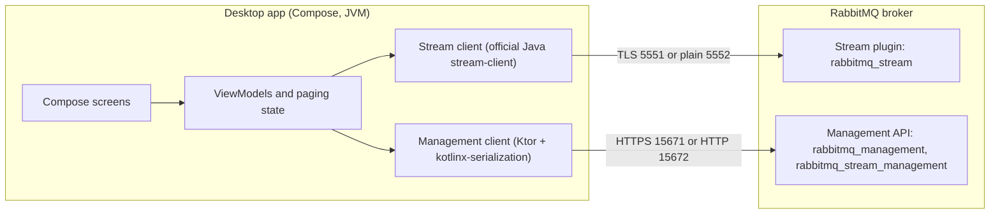

# Caerbannog – KMP Compose Desktop Plan

> Tagline: "behind the rabbit". Started on 2026-11-03 from the living plan doc: https://claude.ai/artifact/6ZMxom32HjSEDEzm4Xyhnh. This file is now the source of truth; the doc is a snapshot. UX sources live in `docs/ux/`.

## Goals and scope

Caerbannog ("behind the rabbit") is a free, desktop-only "Kafka UI for RabbitMQ Streams": connect to a broker, list streams, and page through messages by offset or timestamp. It also covers quorum queues, but only for topology and statistics, never for reading their messages. It is a Kotlin Multiplatform project using Compose Multiplatform, but v1 ships only the JVM desktop target and supports RabbitMQ 4.x and later.

**v1 features**

- Stream list with stats: message count, first/last offset, retention, publishers and consumers; super streams appear as one entry with their partitions. Size in bytes is not available from the broker (M2-02 spike); the Size column is shown blank until M3 (product decision N1 (c), 2026-11-04). First offset is shown in M2 (decision D5 (b)).
- Publishers and consumers per stream: who is connected, consumer offsets and how far behind they are, and publisher message counters, read from the management API.
- Message browser with paging: start from first, last, a numeric offset or a timestamp; page size; next, previous and jump to offset.
- Search and filter plus payload viewer: text, JSON (pretty-printed) and hex views; filter by properties and application properties.
- Publish and manage: publish a test message to any stream, exchange or queue; create and delete streams, view consumer offsets.
- Quorum queue topology and statistics: list queues, exchanges and bindings; see message counts, consumers, leader and members; declare, edit (policies, bindings) and delete them where the connection's permissions allow; apply or export topology as versioned JSON migrations.
- Global search: one box that finds streams, queues and exchanges by name (substring or regex), with the type of each result; names only, never message contents.

**Non-goals for v1**

- Android, iOS and Web targets (the stream client is JVM-only; these need a backend, see Architecture).
- Browsing or consuming messages from quorum or classic queues; reading would remove messages and change the data flow, so for queues the app handles topology, statistics and test publishing only.
- Live tailing at high throughput; v1 browses, it does not replace a consumer.

**Quality requirement**

- Every feature is built test-first (TDD), and its behavior is also written as BDD scenarios in plain Given/When/Then language that run automatically. See Testing.

## Architecture

The app talks to RabbitMQ directly over two channels, with no backend of our own.



The stream protocol (default port 5551 with TLS, 5552 without) carries message reads, publishes and stream create/delete. The management HTTP API (default port 15671 over HTTPS, 15672 over plain HTTP) supplies the stream list, message counts, publishers and consumers, plus all quorum queue topology and statistics. First offsets come only from the stream protocol (`queryStreamStats`); there is no byte size per stream anywhere (see "Management API facts").

**Why JVM-only:** the official RabbitMQ stream client is a Java library, so it runs on desktop JVM (and Android) but not on iOS or in a browser. Adding those later means a small Ktor gateway that holds the stream connection and exposes a paged REST API; the UI and view models stay shared.

**Broker requirements:** the `rabbitmq_stream` and `rabbitmq_stream_management` plugins must be enabled, TLS is on by default and a profile can turn it off (decision D9a); with it off the user's password and all messages travel in clear text, and the app says "Not encrypted" wherever the connection is shown. The app never falls back from TLS to plain or the other way: the profile switch is the only source of the mode. For browsing, use a dedicated user with read-only permissions where possible.

## Connection lifecycle (M2 decisions D1, D2, D6, D7)

"Connected" means an explicit, held connection (product decision D1 (b), 2026-11-04). The user presses Connect and Disconnect; Connect opens and holds the broker clients, Disconnect closes them. Rules:

- **State per connection:** Disconnected, Connecting, Connected, Failed(reason). Disconnect is immediate (clients are closed in the background), so there is no visible Disconnecting state.
- **One held connection at a time.** Connect on another profile disconnects the held one first. The held connection is the session's current connection; a profile that is only selected in the edit panel is not held. Reason: one set of clients, one stream `Environment`, no hidden connections to other brokers, and the permission rules stay per current environment.
- **Connect = select, permission check, then open the clients.** The permission check of M2-01 runs first and is part of Connect. Connect fails (Failed(reason)) when the broker cannot be used: not reachable, TLS refused (only with TLS on), no stored password. An Unreadable permission result that only means "a non-admin cannot read permissions" is the normal case and still ends Connected in safest mode. A stream-protocol failure does not fail Connect: first offsets become "unavailable". A management 401 whose reason is exactly `Not management user` ends Connected with visibility NONE (message, no lists, decision S3a); any other 401 on `/api/whoami` or `/api/overview` is Failed("Credentials were refused") (the two bodies differ, see "Management API facts", M2-03a).
- **Who owns the clients:** a per-connection holder in `data-rabbit`, created on Connect. It holds the management HTTP client (profile CA, host name not verified, see D7), the stream `Environment` (created lazily on the first first-offset call) and the password, read from `SecretStore` once when the holder is created (D6) and kept only in the holder's memory; it never enters `SessionState`, logs or error strings. `core` sees only interfaces (`ConnectionGateway.open(profile)` returning a held connection that exposes `StreamCatalog` and `StreamOffsets` and can be closed); the composition root wires the `data-rabbit` implementation.
- **Closed when:** the user presses Disconnect; Connect on another profile; the profile is deleted; the profile is edited or renamed (the holder has the old host, CA or password, so it is closed and the state is Disconnected with the note "Connection settings changed. Connect again."; the permission check runs again as before); the window closes (composition root, `onCloseRequest`); a Connect fails (partial clients closed). Closing is idempotent.
- **Lost connection (D2, decided 2026-11-04):** a data call that fails with unreachable or timeout moves the state to Failed("Connection lost") and closes the clients; the screen keeps the last rows, marks them stale and offers Retry (Connect again). No automatic reconnect in M2. A 401 on a data call is Failed("Credentials were refused").
- **TLS switch (D9a, product owner 2026-11-05):** each connection profile has a "Use TLS" switch, default on, that can be turned off for any host (no localhost-only rule, no confirmation dialog; the warning is visible only). With it off: plain stream protocol (default port 5552), plain HTTP management (default port 15672), the CA is ignored (the saved path is kept but unused), and the panel, the app bar chip and the chip popup row say "Not encrypted". The ports follow the switch while the user has not edited them. `connections.json` always writes `"tls"`; a file without the key, or with a value that is not a boolean, loads as TLS on. This replaces the earlier rule "TLS only". **Connect hint (M2-14c, 2026-11-05):** with TLS on, a Connect that fails because the broker does not answer the TLS handshake (a plain broker; classified as an `SSLException` without a `CertificateException` in its cause chain) says "The broker did not answer the TLS handshake. It may not use TLS; turn off 'Use TLS' in this connection's settings if that is intended." (one shared constant with the Check text). A certificate failure keeps "The certificate was not trusted" and a host name mismatch is not a failure (D7). The hint only tells: the app never turns TLS off, never retries without TLS and sends no credential before the handshake.
- **With TLS on (D7 (a)):** the CA is honoured; the host name is not verified (same as the M1 probe). Management (corrected 2026-11-05, M2-14c): `endpointIdentificationAlgorithm = ""` on the JDK HttpClient has NO effect (the client forces its own host name check; measured on JDK 21), so the management client gets a trust manager that validates the chain against the profile CA only and skips the host name check (an `X509ExtendedTrustManager` wrapping the default one, in `TlsSupport`); no JVM flag, no new dependency. The reachability check's stream-port `SSLSocket` honours the empty algorithm and keeps it. Stream client (M2-03a, verified): `Environment.builder().tls().sslContext(SslContextBuilder.forClient().trustManager(<TrustManagerFactory over a KeyStore holding only the profile CA>).endpointIdentificationAlgorithm(null).build())`. The explicit `endpointIdentificationAlgorithm(null)` is kept as the intent and as protection against a future default: Netty 4.2 verifies the host name by default, but on stream-client 1.12.0 dropping the call was not observable in any test (M2-03 verification, mutation b, equivalent), so do not rely on it alone; `StreamHostNameToleranceTest` pins the observable behaviour. A wrong CA is still refused with verification off, so this is not trust-all. No extra dependency (Netty comes with the stream client). The connection panel shows the one-line note "Host name is not verified." A per-profile "Verify host name" switch is the M5 task `M5-verify-host-name`.
- **Interim Connect button (M2-01):** the edit-panel Connect calls `ConnectionsViewModel.connect(name)` (select plus check); under this model it also opens the clients and disconnects the previously held connection. The edit panel's "Check connection" stays a check only (holds nothing). In M2-05 the edit-panel Connect is removed and the connection control below takes over.
- **Connection control (UX1, product owner 2026-11-04, M2-05):** a fixed chip at the right end of the app bar on every screen shows the current connection's name, state (No connection, Connecting, Connected, Failed, Disconnected) and the permission pill; it opens a popup listing the saved connections with state and Connect, Disconnect or Retry, the stream list refresh interval (D3), "Refresh now" and "Updated N s ago". It replaces the drawer's Connection card (removed) and the sidebar picker idea. Design in `docs/tasks/M2-05-stream-list-screen.md`, mockup `docs/ux/Streams.dc.html`.
- **Stream list refresh (D3, decided by the product owner 2026-11-04):** the interval is in seconds and set in the connection control, next to manual Refresh. Allowed values: Off, 5, 10, 30, 60 seconds. Scope: per app, kept in `settings.json` next to the profiles file (key `streamListRefreshSeconds`; 0 = Off; a missing file, a missing key or an unknown value reads as the default) behind an `AppSettings` interface in `core` (file implementation in `data-rabbit`, M2-05). The default interval is 5 seconds (decided by the product owner 2026-11-04: "try with that, after we can change"; one constant, to be revisited after trying it). With the default, polling starts once connected and the list is shown, so each connected user costs one list call plus the statistics calls every 5 s. See `docs/tasks/M2-04-stream-list-core.md`.

## Module layout and tech stack

One Gradle project (Kotlin Multiplatform and Compose Multiplatform Gradle plugins, one `build.gradle.kts` per module — see Packaging below for why Gradle over Kotlin Toolchain) with a shared core and a thin desktop app, so Android or iOS can be added later without rewriting logic.

| Module | Source set | Holds |
| --- | --- | --- |
| `core` | commonMain | Domain models (Stream, Page, StreamMessage), paging logic, repository interfaces, view models |
| `data-rabbit` | jvmMain | Stream client wrapper, management API client, connection profile storage |
| `ui` | commonMain | Compose screens, theme, payload viewers (text, JSON, hex) |
| `desktopApp` | jvmMain | `main()`, window, menus, packaging |
| `mcp-server` | jvmMain | Headless Model Context Protocol (MCP) server over stdio for AI agent tool integrations |

| Concern | Choice |
| --- | --- |
| UI | Compose Multiplatform (Desktop) with Material 3 |
| Async and state | Kotlin coroutines, `StateFlow`, unidirectional data flow |
| Stream access | `com.rabbitmq:stream-client` (official Java client) |
| Management API | Ktor client with kotlinx-serialization |
| Navigation | A simple sealed-class screen stack to start; Decompose only if it grows |
| Settings and secrets | Connection profiles in a JSON file; passwords in the OS keychain via `com.github.javakeyring:java-keyring` — a write/read/delete round trip passed on macOS in the M1 spike; Windows is unverified until run on Windows hardware or CI |
| Packaging | Gradle with the Compose Multiplatform Gradle plugin (`org.jetbrains.compose`); `./gradlew :desktopApp:run` opens the window and `:desktopApp:packageDmg` / `:desktopApp:packageMsi` (jpackage under the hood) are the installer tasks — chosen over Kotlin Toolchain because the M1 spike found the installed CLI has no `new`, `run` or `package` subcommands at all (see `docs/tasks/M1-01-skeleton-and-spike.md`'s Status section for the captured command output). Only `packageDmg` has actually been run and produced a working installer (macOS dev machine); `packageMsi` cannot be cross-built from macOS and stays unverified until run on Windows or in CI |
| Testing | JUnit 5 (+ `kotlinx-coroutines-test` once there is async code to test) for TDD, Cucumber-JVM (`cucumber-junit-platform-engine`) with Kotlin step definitions for Gherkin scenarios, Testcontainers for a real broker, Compose Multiplatform UI test API — all four wired and proven together in the M1 spike |
| Local dev commands | `Taskfile.yml` at the repo root (go-task, https://taskfile.dev) wraps the Gradle commands above — `task test`, `task test:broker`, `task test:keychain`, `task test:screenshots`, `task run`, `task package:dmg`, `task package:msi` — as thin one-line aliases (`task test:keychain` touches the real OS keychain and may prompt, so it is run on demand: before a release, or after changing `JavaKeyringSecretStore`, on a machine with an unlocked keychain; the default `task test` never touches it; `task test:screenshots` writes Connections screen PNGs to `ui/build/screenshots/` for a by-eye comparison with the UX mockup and is excluded from `task test`), so developers do not need to recall exact `./gradlew` invocations. `task test` must run every module's fast tests, including the Kotlin Multiplatform modules `core` and `ui` (their tests are `jvmTest`; a `test` task registered in each of those modules delegates to `jvmTest`, so plain `./gradlew test` reaches them; see `M1-TASKFILE-02-test-task-runs-all-modules`). Installed separately (e.g. `brew install go-task` on macOS); not used by any CI pipeline, since none exists yet (project is local-development-only for now) |

The `data-rabbit` module sits behind repository interfaces in `core`, so a future gateway-backed implementation can replace it without touching the UI.

### Model Context Protocol (MCP) server & architectural rule

The `:mcp-server` module exposes Caerbannog's connection profiles, stream catalogs, and topology inspection to external AI developer agents (such as Antigravity and Claude Code) via the Model Context Protocol over `stdio`.

**Architectural rule:** For every new capability introduced to the product (such as browsing messages in M3, payload inspection in M4, or publishing and migrations in M5), the **solution architect is responsible for evaluating** whether the capability should be exposed to AI agents as an MCP tool. If yes, the architect must specify the tool schema, permissions, and safety scenarios in the task brief; if no, the brief must explicitly record why. The MCP server must always uphold Caerbannog's safety rules: no queue message reading, ephemeral stream reads, and no secret leakage.

## Paging model

Streams have no random-access API, so each page is a short-lived read: open an unnamed consumer at a start offset, collect up to the page size, then close it. An unnamed consumer stores no offset, so browsing never affects real consumers. **Safety rule (M2-02c):** the browsing consumer must be unnamed, or named with `noTrackingStrategy()`. A named consumer with the client's default or manual tracking makes the client write an offset tracking chunk into the stream (the manual strategy's safety net stores a default offset about 1 s after consuming): that changes the stream's `messages`, takes an offset, and can reset a real consumer's resume point if the reference is reused. That would break "browsing never changes anything on the broker". A test must assert `tracking.offsets` stays empty and `messages` unchanged after a browse. `queryStreamStats` is a read query; the M2-03 test must confirm it writes nothing.

1. Ask the broker for the stream's bounds (`queryStreamStats`: first offset and committed offset).
2. Resolve the start: `first`, `last page`, a typed offset, or a timestamp (`OffsetSpecification.timestamp`).
3. Open the consumer at that offset; collect messages until the page is full or a short idle timeout (about 2 s) passes.
4. Close the consumer and render the page with each message's offset and timestamp.

**Next** starts at the last offset shown plus one. **Previous** starts at the first offset shown minus the page size, clamped to the first offset. **Jump to offset** and **Jump to time** restart at step 2.

**Caveats to design for**

- Delivery is chunk-based, so a read may begin before the requested offset; the app drops messages below the start offset.
- Retention can move the first offset while a user is paging; the app re-reads the bounds and shows a notice instead of failing.
- Message count is the management API's `messages` (exact for the stream's offsets, M2-02 spike; it includes the tracking entries of other applications' named consumers, which is the cause of the `@gate-M2` tolerance), not committed minus first plus one: `committedChunkId` is the start offset of the last chunk, so that formula undercounts when messages were published in batches. The count can exceed the number of user messages, because offset tracking entries occupy offsets in the stream; RabbitMQ's own Management UI shows the same number. The app still labels it approximate (statistics refresh about every 5 s).
- Search and filter run client-side over a bounded scan (for example the next 10,000 messages) with a visible scan limit and a Cancel button; v1 does not rely on broker-side filtering.
- Super streams: each partition is a regular stream, so the browser reads one partition at a time. Order exists only within a partition, so v1 does not merge partitions into one sequence.

## Management API facts (M2-02 spike)

Measured on RabbitMQ 4.4.0 (single node, TLS fixture, `rabbitmq_stream` and `rabbitmq_stream_management` enabled) by `StreamManagementApiSpikeTest` (tag `broker`). Full detail, field tables and the unanswered items are in `docs/tasks/M2-02-management-api-spike.md` (Status). Real bodies for fakes and parser tests are in `data-rabbit/src/test/resources/fixtures/m2-02/`. Everything here was measured on one node and one version; it is not verified on clusters, other 4.x versions or 3.x.

| Need | Source | Notes |
| --- | --- | --- |
| Stream list | `GET /api/queues` (also `/api/queues/{vhost}`, `/api/queues/{vhost}/{name}`) | No stream-specific listing (`/api/streams` is 404). A stream is a queue with `type` `stream`. Without paging parameters the body is a bare array; with `page` it is an object `{items, page, page_size, page_count, item_count, filtered_count, total_count}` |
| Fields per stream | `name`, `vhost`, `type`, `state` (strings); `messages`, `messages_ready`, `consumers`, `segments`, `first_timestamp` (ms), `memory` (numbers); `arguments`, `leader`, `node`, `members`, `online` | `messages` may be missing for about 5 s after creation. `arguments.x-max-age` is a string and comes back exactly in the form the stream was created with: "7D" when declared as text (management API or `x-max-age` argument), `604800s` when created through the stream client with `maxAge(Duration)` (M2-03 build); the app shows it in the compact natural form (D9: `604800s` as `7D`, the largest whole unit in Y, M, D, h, m, s; a value that does not divide evenly keeps the smaller unit), and the data layer keeps the broker text unchanged; `x-max-length-bytes` and `x-stream-max-segment-size-bytes` are numbers. `policy` only in the single-queue call or with `columns=policy` (null when none) |
| Absent for streams | `message_bytes`, `publishers`, any first, last or committed offset, any last-message timestamp | There is no size in bytes. `memory` is Erlang process memory, not disk size |
| Message count | management `messages` | Exact; includes offset tracking entries |
| First offset | stream protocol `queryStreamStats` only (`firstOffset`) | Management has none. Last written offset = first offset + `messages` - 1 (next offset to be written = first + `messages`). Never use `committedChunkId` as the last offset |
| Publishers | `GET /api/stream/publishers[/{vhost}[/{stream}]]` | Row (right after a client attaches, `connection_details` is `{}` and the counters are zero for some seconds, M2-03 build: the connection name is then unknown, not an error): `reference`, `publisher_id`, `published`, `confirmed`, `errored`, `queue{name,vhost}`, `connection_details{name,node,user,peer_host,peer_port}`. 200 `[]` when none. The queue object has no publisher count |
| Consumers | `GET /api/stream/consumers[/{vhost}]` | Row: `subscription_id`, `consumed`, `credits`, `offset`, `offset_lag`, `active`, `activity_status`, `properties` (consumer reference in `properties.name`), `queue`, `connection_details`. No per-stream path (400): filter on `queue.name`. `offset_lag` counts the tracking entries written after the consumer's position: 1 in one case, 2 and 3 for a consumer that stored 3 times (M2-06 spike S-A); 0 for unnamed and non-storing consumers even when another application stores; no per-consumer store count in the API. `offset` shows the next offset (10 for 10 messages) with lag 0 until the first stats refresh, then the last delivered one (9): wait for the refresh. A named client consumer writes a tracking entry (the Java client's manual tracking stores 0 when the app never stored); an unnamed or no-tracking consumer writes none (M2-02c) |
| Tracking | `GET /api/stream/{vhost}/{stream}/tracking` | `{writers:{ref:n}, offsets:{ref:n}}` |
| Plugin missing | `GET /api/stream/publishers` (or consumers, connections) | 404 `{"error":"not_found","reason":"Not Found"}`. Per-stream paths give 400 with an empty body, so use only the top-level paths as the detection call. The 400 of the per-stream consumers path is not a plugin signal: `/api/stream/consumers/{vhost}/{stream}` answers 400 with an empty body on a healthy broker too (it does not exist; confirmed again on the dev broker, F-E spike), whereas `/api/stream/publishers/{vhost}/{stream}` answers 200. `/api/extensions` lists `stream_management` when on |
| Search | `GET /api/queues?name=..&use_regex=true\|false&page=..&page_size=..&sort=..&columns=..` | Name only, server side. Max `page_size` 500 (501, 0 and `page=0` give 400; a page past `page_count` gives 400 `page_out_of_range`); an invalid regex gives 200 and no match; `type=stream` is ignored, so a page can hold fewer streams than `page_size`. Case-sensitivity of `name` not tested |
| Super stream | exchange of type `direct` with `arguments.x-super-stream` = true; bindings from `GET /api/exchanges/{vhost}/{name}/bindings/source` | Partitions are the binding destinations (`<name>-0..` or `<name>-<binding key>`), ordered by `arguments.x-stream-partition-order`. The partition queues carry no marker, so grouping a flat queue list needs extra calls; do not infer from names. **M2-07 (spikes S-A and S-B, built and verified 2026-11-05):** the layout is read with `GET /api/exchanges/{vhost}` (unpaged plain array, `arguments` on every exchange, marker is the JSON boolean `true` on a `direct` exchange; `false`, the string `"true"` and a `fanout` exchange are not super streams) and, only when a marker exchange exists, `GET /api/bindings/{vhost}` (all bindings of the vhost in one unpaged call, same fields as the per-exchange path), so 1 call per full load without super streams and 2 with (55 calls per tick on 1000 queues with one, 54 without). The broker lists bindings by destination name, not by order, so `x-stream-partition-order` must be read (numbered first, numerically; a non-number counts as none; then routing key, then destination; a queue bound twice appears once). `monitoring` and `management` users see all exchanges and bindings of a vhost they may use; a user without a management tag gets 401. The grouping call is a GET, and a failure never fails the stream list or counts as a lost connection (the last grouping is kept, or the list is flat with a notice) |
| Statistics lag | management stats interval, default 5 s | Observed 0.8 s to 4.7 s after a publish. Tests poll on the value (bounded), never sleep |

**Visibility by user tag (S3, measured with throwaway users that have permissions on one vhost).** No tag: HTTP 401 `Not management user` on everything, including `/api/overview`. `monitoring`: all queues and streams of the vhosts where the user has any permission (name patterns do not hide anything), stream publishers, consumers and connections of the whole broker; `/tracking` needs permission on the stream (401 otherwise); a stream in a vhost without permission looks like 404. `management`: the same queue visibility, but stream publishers, consumers and connections only on the user's own connections. Stream protocol (M2-03a, real broker 4.4.0): a user with no tag can connect and call `queryStreamStats` on a stream it has read permission on, same as `monitoring` and `management`; without permission on the stream the call fails with `com.rabbitmq.stream.StreamException` "Error while querying stream stats: 16 (ACCESS_REFUSED)." and the `Environment` stays usable. Browsing for a no-tag user is not tested (M3). Decided 2026-11-04 (S3a, S3b): a user without the management tag gets a clear message ("This user cannot read stream statistics. Ask for the monitoring tag.") and no lists; a user with only the `management` tag gets the publishers and consumers lists with a fixed notice that they cover only the user's own connections (the tag is read from `GET /api/whoami`). **Virtual host list (M2-08a spike S-E, `GET /api/vhosts`, dev broker 4.4.0):** an administrator or `monitoring` user is listed every virtual host, including ones it has no permission on (those answer 404 on queues, exchanges and bindings); `management` and one-vhost users are listed only their permitted virtual hosts; a user with no tag gets 401. The app cannot tell the first group's unpermitted virtual hosts apart in advance, so the switch does not mark them; the 404 text explains.

**Publishers and consumers tab (decided in the M2-06 brief, 2026-11-05).** Opened from the stream list (the name cell is a link); it polls with the app-wide refresh interval (D3) only while the tab is shown. "Messages behind" is `offset_lag` as the broker reports it; "Caught up" only at 0 behind; above 0 the status reads "N behind" (the broker's number, neutral style) with a tooltip that stored offsets count towards the number: every stored offset (tracking entry) occupies an offset, so a consumer that stores often reads a few behind when it has read everything (real broker, M2-06 spike: 2 and 3 for three stores, varying between runs, not derivable from the API; no tolerance constant, no subtraction). A row with an empty `connection_details` (a client that has just attached) shows the connection as "unknown" and its counters, offset, behind and status as "updating", never as 0. The connection cell is `connection_details.name` with the user; no second broker call for a client-provided name (decision D10 in `docs/tasks/README.md`). The jump to a consumer's offset in the browser is M3. **Connection cell (D10, product owner 2026-11-05, decided (a)):** the socket pair (`connection_details.name`) with the user under it; no client-provided name, no extra call per tick, no name-on-request. Revisit name-on-request in M3 or M4 only if the owner's own services set connection names.

**Definitions files (M2-12 spike, measured on `rabbitmq:4-management`).** A super stream can be declared completely in a definitions file: a direct exchange with argument `x-super-stream: true`, the partition streams (`x-queue-type: stream`), and bindings with `routing_key` N and argument `x-stream-partition-order` N; the stream client treats it as a super stream (publishing through `superStream(...)` spread messages over the partitions). `load_definitions` accepts a directory and loads its files in sorted file-name order; each file may be a partial document. A user may carry a plain `password` (the broker hashes it). When definitions load, the broker creates no `guest` user and no `/` vhost, so the first file must define them. Definitions are re-applied on every boot.

**Stream client in production.** `com.rabbitmq:stream-client:1.12.0` is in `data-rabbit` test scope only. Its transitive tree is about 14.8 MB of jars (zstd-jni 7 MB, snappy 2.4 MB, lz4, Netty 4.2.19, proton-j, gson); licences Apache 2.0, MPL 2.0 (dual), BSD 2-Clause. No clash with Ktor 3.0.3, coroutines 1.9.0 or serialization 1.7.3. Product decision D5 (b), 2026-11-04: the M2 stream list shows first offset, so the stream client is a production `implementation` dependency from M2-03. The version must pass the two-week age rule when added (1.12.0 was accepted for the spike; 1.13.1 was published 2026-11-03, re-check the age when M2-03 starts). Cost: about 10 MB of compression jars in the installer, and one `queryStreamStats` call per visible row. Verified by M2-03a: any user with read permission on the stream may call it, and it writes nothing (20 calls from 4 users left `messages` and `/tracking` unchanged); when the call fails or is denied, the row keeps its counts and the first and last offset cells read "unavailable".

**Stream client facts (M2-03a spike, `docs/tasks/M2-03a-stream-stats-permissions.md` Status; `rabbitmq:4-management` floated to 4.4.0, stream-client 1.12.0).**

| Topic | Fact |
| --- | --- |
| `queryStreamStats` outcomes | Permitted stream: `StreamStats` (3 messages published as 3 chunks gave `firstOffset` 0, `committedChunkId` 2). Denied: `StreamException` "...: 16 (ACCESS_REFUSED)." at the call. Missing stream: `StreamDoesNotExistException` ("does not exist"). Empty stream: the call returns, but `firstOffset()` throws `NoOffsetException` ("No first offset for stream <name>"): call the accessors inside the try and map this to "empty" (no first offset yet), not to unavailable and not to a failure |
| Writes nothing | Messages and `/tracking` unchanged after 20 calls (control: one extra publish moves `messages` by exactly one). A management publish leaves one `tracking.writers` entry per publish, so "writers empty" is not a baseline; compare before and after. `messages` is absent on a brand-new stream until the first stats tick |
| Credentials, stream client | Wrong password or unknown user: `AuthenticationFailureException` "... 8 (AUTHENTICATION_FAILURE)" thrown by `Environment.build()`, no password in the chain. A no-tag user does not fail |
| Credentials, management | `/api/whoami` and `/api/overview` 401 bodies differ: no management tag `{"error":"not_authorised","reason":"Not management user"}`; wrong password or unknown user `{"error":"not_authorized","reason":"Not_Authorized"}` (note the spelling). Match on the `reason`. The permissions endpoint answers `Access refused.` for both (M1-03), so it cannot tell them apart |
| Unreachable | Closed port: `ConnectionStreamException` (package-private, match by class name; it is a `StreamException`) thrown by `Environment.build()` after about 1.1 s, cause `ConnectException`. The builder has no connect timeout; `rpcTimeout` default 10 s; Netty's connect timeout default is 30 s (`TimeoutStreamException` after 30000 ms on a non-routable address). Set it explicitly: `.netty().bootstrapCustomizer { it.option(ChannelOption.CONNECT_TIMEOUT_MILLIS, n) }`; at 1000 ms a non-routable address failed after about 2.1 s (two attempts, so budget about twice the value) |
| One Environment | `build()` connects the locator (17-32 ms); 20 sequential calls 0.45-2 ms each; 20 calls on 4 threads 4-7 ms total. After the broker connection is closed (`DELETE /api/connections/{name}`) the same `Environment` answers over a new connection: it reconnects on demand |
| Not covered | A host name mismatch with a DNS SAN (only an IP SAN mismatch was exercised); the TLS proofs (a) and (b) skip on machines with no second reachable name; the virtual host the `Environment` uses (default `/`; a stream in another vhost needs an `Environment` built with that vhost, see M2-03); the floating image tag |

**Testcontainers.** The warning is the Kotlin compiler's "'fun withPluginsEnabled(vararg p0: String!): RabbitMQContainer!' is deprecated. Deprecated in Java." (compile time, not runtime; the Javadoc says use `execInContainer`). Trial of 2.0.5 (scratch, discarded): artifacts renamed, all then-existing broker tests passed and the `api.version` pin was unnecessary, but 2.x deprecates the class we use too (more warnings, not fewer). Conclusion: no bump now; a 2.x move is its own small optional task (`docs/tasks/M2-10-testcontainers-2x-migration.md`).

## Screens and UX

Four screens cover v1's core flow, laid out like Kafka UI: a left sidebar for connections and streams, a main pane for the selected stream. Static Material 3 mockups of every screen are in `docs/ux/`.

| Screen | What the user does |
| --- | --- |
| Connections | Add, edit and test broker profiles: host, stream port, management port, vhost, user, TLS settings (TLS switch, default on), and a permission check that runs before the first connection |
| Stream list | Sort and filter streams (name, and kind chips All, Streams, Super streams); see first and last offset, approximate message count, publishers, consumers (Size column left blank until M3, no data source); a super stream is one entry (M2-07) with summed messages, publishers and consumers (attachments, not distinct clients), retention `mixed` when its partitions differ, no offsets, expandable to its partitions, each a normal row that opens its own Publishers and consumers tab; a plain stream and a super stream may share a name and are two entries; create or delete a stream |
| Message browser | Pick start (first, last page, offset, timestamp) and page size; use next, previous and jump; filter within a bounded scan |
| Message detail and publish | Side panel with offset, timestamp, properties, application properties and the body as text, pretty JSON or hex; a dialog to publish a test message to any stream, exchange or queue |
| Topology and queues | List quorum queues, exchanges and bindings with statistics (messages, consumers, leader, members); declare and delete them, edit policies and bindings; apply migrations to the broker, or export and import them as JSON files. **M2 (task M2-08, read only, decided by the product owner 2026-11-05):** three tabs (Queues, Exchanges, Bindings) for one virtual host at a time, chosen with a virtual host switch that starts on the connection's own and offers the virtual hosts the broker lists for the user (`GET /api/vhosts`); no control that changes anything (no row menu, edit, delete, bind, add to migration or new migration), no control that reads, gets or purges queue messages; a banner says why the screen is read-only (no configure permission on the connection's virtual host, declared but not confirmed, the connection's level is Read-only, or permissions only checked on another virtual host); one virtual host's data refreshes while the screen is shown (D3) and stays stale on a lost connection (D2); a virtual host that answers 404 reads "Virtual host <name> is not available to this user. It may have been deleted, or the user may have no permission on it."; a user without a management tag gets "This user cannot read topology. Ask for the management tag."; bindings are a table with the default exchange hidden behind a switch, and a graph view is planned (M2-08d, design and drawing approach open: hand-drawn, no dependency) |
| Publishers and consumers | Tab on the stream detail screen: publishers with connection and message counters; consumers with connection, offset and messages behind; jump the browser to a consumer's offset |
| Global search | Search box at the top of the sidebar opens a search view: results grouped as streams, queues and exchanges, filter chips with counts, a regex toggle, Enter opens the first result. Queue and exchange lookups use the management API's server-side name filter with paging (default 100 per page, maximum 500, confirmed on RabbitMQ 4.4.0 by the M2-02 spike: 501 gives HTTP 400). Streams are queues with `type` `stream`, so the same call finds them; the server has no streams-only filter, so the app filters on `type` itself |

**UX rules**

- Destructive actions (delete stream) need the stream name typed to confirm.
- Every read shows what it did: "offsets 1,200 to 1,299 of about 48,000".
- The body viewer never assumes UTF-8: detect text or JSON, fall back to hex, and cap very large bodies with a "show all" action.
- Copy buttons for offset, body and a ready-made consumer snippet.

## Topology migrations and permission guardrails

Topology changes are versioned JSON files applied in order, like a database migration tool, and each connection is its own environment (one broker, one user and one default virtual host: the stream list, the stream screen, test publishing and, from M5, topology changes work on the connection's virtual host; the read-only Topology screen may show any other virtual host the user can see): before the first connection the app checks what the connection's user may do, and limits itself to that. On top of that broker-read check, the user also sets their own ceiling for the connection — a self-constraint level — and the app enforces whichever of the two is stricter.

A migration lists the changes to make: streams, super streams, quorum queues, exchanges, bindings and policies. The app applies pending files in version order, tracking applied versions per machine and per connection profile, and can export a broker's current topology as a new file, so one format covers both apply and export/import. The format below is a proposal to refine.

```json
{
  "version": "0003",
  "description": "Add orders queue and binding",
  "up": [
    { "action": "declareQueue", "vhost": "/", "name": "orders", "type": "quorum" },
    { "action": "declareBinding", "vhost": "/", "exchange": "events", "queue": "orders", "routingKey": "order.created" }
  ]
}
```

### Self-constraint level

Each connection profile carries its own `topologyControlLevel`, a ceiling the user sets explicitly for that connection, independent of what the broker would otherwise allow. It defaults to Read-only for every new profile, so a freshly added connection never unlocks topology changes by surprise. Three levels, each strictly containing the one before it:

| Level | What the app allows on this connection, regardless of broker permission |
| --- | --- |
| Read-only (default) | No topology changes at all: no declare, no edit, no delete, no migration applied. Topology and statistics stay readable. |
| Declare and edit | Declare new topology (streams, super streams, queues, exchanges, bindings, policies) and edit existing items (policies, bindings); deleting is still blocked. |
| Full control | Everything Declare and edit allows, plus delete; migrations may include destructive actions. |

The level is chosen on the connection form, both when the profile is created and when it is edited, and applies when the form is saved. Choosing Full control asks for a confirmation first (a dialog stating that this is the user's own ceiling and that the broker's permissions still apply); cancelling keeps the previous selection. The confirmation is a UI step only and is not part of the stored profile.

This is the app's own rule, layered on top of the broker's. It resolves what was previously an open question: RabbitMQ's configure permission covers both creating and deleting, so a broker-only check cannot allow one without the other — the self-constraint level is where the app draws that line instead, by reserving delete for Full control specifically.

### Broker-read permission

Before the first connection, and again whenever the profile is saved with changes, the app reads the connection user's permissions on the virtual host from the management API (`GET /api/permissions/{vhost}/{user}`, HTTPS with TLS on, port 15671; HTTP, port 15672 with TLS off). The answer is an object with `configure`, `write` and `read` patterns; an empty pattern (`""`) means no permission, any non-empty pattern counts as permission present (the broker has the final say, so `^$` also counts as present). **Per virtual host (decision V1, 2026-11-05):** the check reads the permission on the connection's own virtual host only, and configure permission is per virtual host. So a result says nothing about any other virtual host: the read-only Topology screen shows another virtual host with the note that permissions were checked on the connection's virtual host only, and from M5 topology changes (declare, edit, delete, migrations) are limited to the connection's own virtual host.

| Permission found for the connection's user | What the broker-read half allows |
| --- | --- |
| Configure permission on the virtual host | Declare, edit and delete topology, apply migrations |
| No configure permission | Read topology and statistics; edit, validate and export migration files; no topology changes |
| No write permission | Test publishing is disabled |

**Who can read permissions (spike result, real RabbitMQ 4 broker, `docs/tasks/M1-03-permission-check.md` Status).** Only an administrator can. Users with no tag, `management` or `monitoring` get 401 on `GET /api/permissions/{vhost}/{user}` and `GET /api/users/{user}/permissions`; `GET /api/whoami` works for `management` and `monitoring` but returns only name and tags, no permissions, and gives 401 for a user with no tag. So the check returns "could not be read" for almost every real stream user, and a 401 cannot tell "not an administrator" from "wrong password".

**Safest mode (default).** If permissions cannot be read, the app falls back to topology locked, test publishing disabled, streams still listable and browsable (see `tests/bdd/features/02_permission_check.feature`, "Permissions cannot be read for this user"). A new profile has no declaration, so it always starts in safest mode.

**Declared permissions (product decision D).** So that a non-administrator stream user is not locked out, the profile may carry an optional declaration of what the user may do: configure yes/no and write yes/no (read is not needed, reading is always allowed). The declaration is the user's own claim; the app cannot verify it and the broker still enforces every action (see "The broker has the final say"). Rules:

- The real check always runs first. When it can read the permissions, the broker's answer wins and the declaration is ignored, even if it claims more (or less).
- The declaration applies only when the result is "could not be read", for any cause except a missing stored password (without a password nothing can connect, so the app stays in safest mode).
- A declaration can claim more than the safest mode (unlock topology, enable publishing) or less (for example declare no write to keep publishing off).
- The result says where it came from: read from the broker, or declared by the user after the read failed. The UI must show which, in plain words ("You declared that svc-explorer can change topology; the broker could not confirm it and still enforces its own permissions"), and must never present a declared result with the same wording or "verified" styling as a broker-read result.
- Wording and colour (product decision, task `M1-07`): the connection pill reads "Can change topology" (green) or "Topology locked" (red) for a broker-read result, "Can change topology (declared)" or "Topology locked (declared)" (warning colour) for a declared one, "Topology locked" (red) when nothing could be read, and "Not checked" (neutral) before any check. When the broker answered although the profile has a declaration, the panel shows the verified banner plus one dim line: "Your declaration is not used, because the broker answered."
- The declaration is independent of the self-constraint level; the effective permission below still takes the stricter of the self-constraint level and this half. No additional secret or credential is asked for.
- Stored on the connection profile in the profile JSON as an optional field; a file without it loads as "no declaration" (see task `M1-06`).

### Effective permission

An action is allowed only when both halves allow it — the stricter of the self-constraint level and the broker-read permission wins:

- **Declare or edit:** needs self-constraint at Declare and edit or above, and the broker's configure permission.
- **Delete:** needs self-constraint at Full control, and the broker's configure permission.
- **Apply a migration:** each action inside it is checked individually against the same two rules; a migration that only reads (dry run, export) never needs either.
- **Test publishing:** governed solely by the broker's write permission. The self-constraint level is topology-only and has no effect on it.

## Testing: TDD and BDD

Every feature is built test-first, and its behavior is written as BDD scenarios that run automatically; both are requirements, not extras. The `core` module has no RabbitMQ imports and talks to the stream and management clients through interfaces, so most tests run against fakes without a broker.

| Layer | What it covers | Tooling (confirmed in the M1 spike) |
| --- | --- | --- |
| Unit (TDD) | Paging math, offset resolution, migration ordering and idempotency, permission guardrails, payload detection | JUnit 5, coroutines test, fakes behind the `core` interfaces |
| BDD scenarios | User-visible behavior as Given/When/Then, such as paging at stream edges and blocked topology edits without configure permission | Gherkin features with Cucumber-JVM and Kotlin step definitions |
| Integration | Real stream and management calls against a RabbitMQ 4.x broker over TLS and over plain | Testcontainers RabbitMQ module (needs Docker) |
| UI | Screens render and respond: stream list, message browser, publish dialog | Compose Multiplatform UI test API on desktop |

```gherkin
Feature: Permission guardrails
  Scenario: Deleting a queue is blocked without configure permission
    Given a connection whose user has no configure permission
    And a quorum queue "orders" exists
    When I try to delete the queue "orders"
    Then the app refuses and says topology is locked
    And no request is sent to the broker

Feature: Message paging
  Scenario: Next page at the end of a stream
    Given a stream "events" with 250 messages
    And the page size is 100
    When I open offset 200
    Then I see offsets 200 to 249
    And "next" is disabled
```

The two scenarios are examples of the style, one per milestone area; the full list grows with each milestone.

## Milestones, risks and open questions

The plan has five milestones in order; each ends with a gate that must pass before the next starts. Durations are not estimated yet. Each gate also requires that milestone's tests to pass: unit tests written first, plus its BDD scenarios.

| Milestone | Scope | Gate |
| --- | --- | --- |
| M1 Skeleton and connection | Modules, test setup, profiles, installer spike | Connects to a local broker |
| M2 Stream list and stats | Management client, lists, stats, publishers and consumers | Stats match the Management UI |
| M3 Message browser | Paged reads by offset and timestamp, next and previous | Pages correct at stream edges |
| M4 Payload viewer and filter | Text, JSON and hex views; bounded client-side filter | Large bodies stay responsive |
| M5 Publish, manage, package | Publish, create and delete, topology edits, installers | Installers run on macOS and Windows |

**Milestone status**

- M1 Skeleton and connection: accepted by the product owner on 2026-11-04 ("merge, accept, start M2"), after the team's task reports and architect reviews (tasks `M1-01` to `M1-12b`, `M1-TASKFILE-01/02`, index in `docs/tasks/README.md`). The acceptance rests on those reports and the automated tests; it does not mean the items below were checked. Carried forward, never run by the team and not reported run by the product owner, so still open and unverified: (1) a manual `:desktopApp:run` against a real broker and the real OS keychain (the Connections screen, the permission pill and the save flow have only been exercised by automated tests and the opt-in screenshot task); (2) the Windows keychain (Credential Manager) and `:desktopApp:packageMsi`, which cannot be built from macOS; (3) the `:desktopApp:packageDmg` installer size check after the icon library was added (about 38 MB jar, see `docs/tasks/M1-12b-connections-icons.md`). They are to be done before the M5 gate (installers run on macOS and Windows); item (1) should be done as early as M2 has a screen worth looking at.
- M2 Stream list and stats: in progress, started 2026-11-04. Tasks in `docs/tasks/README.md`. M2-02 spike accepted with follow-ups on 2026-11-04 (not merged); its findings are in "Management API facts".

**Risks**

- Opening a consumer per page adds latency; measure it on a real broker, then consider keeping one consumer open and prefetching the next page.
- The stream client is JVM-only, which caps v1 at desktop (and later Android) until a gateway exists.
- Very large or compressed messages can make pages slow; the body viewer caps display size.
- Secret storage differs per OS; `java-keyring`'s write/read/delete round trip passed on macOS in the M1 spike. Windows (Credential Manager) and Linux (libsecret, not a v1 packaging target) are still unverified until run on that hardware or in CI.
- Kotlin Toolchain was evaluated in the M1 spike and ruled out: the installed CLI (Homebrew, v2.4.21) has no `new`, `run` or `package` subcommands at all, so there is nothing resembling the project/run/installer workflow the spec originally described (see `docs/tasks/M1-01-skeleton-and-spike.md`'s Status section for the captured command output). The project uses Gradle with the Compose Multiplatform Gradle plugin instead; `:desktopApp:packageDmg` already produces a working dmg on macOS (`:desktopApp:packageMsi` is unverified — cannot be cross-built from macOS).
- Testcontainers' RabbitMQ module (`RabbitMQContainer.withPluginsEnabled`, used in the M1 spike's container-start proof) emits a deprecation warning on the version pinned in M1-01 (1.21.3); harmless today. Checked in the M2-02 spike (2026-11-04): it is a Kotlin compile warning on the Java-deprecated method; Testcontainers 2.0.5 deprecates the whole class as well, so bumping does not fix it. Decision: stay on 1.21.3 for now; the 2.x move is the optional task `M2-10-testcontainers-2x-migration`.
- Testcontainers' own Docker connectivity probe (`org.testcontainers.dockerclient.DockerClientProviderStrategy`) falls back to a hardcoded Docker API version (1.32) when none is otherwise configured; very new Docker Desktop engines (confirmed here: 29.8.2, API 1.56, `MinAPIVersion` 1.40) reject that version with HTTP 400, so every provider strategy fails even though Docker is installed and working. Worked around locally by pinning a supported API version on the test JVM (`data-rabbit/build.gradle.kts`, `brokerTest` task); worth re-checking whenever Testcontainers or Docker Desktop is upgraded. Re-confirmed 2026-11-03 (`M1-TASKFILE-01-local-dev-commands`, wiring `task test:broker`): Docker Desktop still 29.8.2 on this machine, the `api.version=1.43` pin still resolves and `brokerTest` still starts a real RabbitMQ container. The project is local-development-only for now (no CI pipeline), so there is no CI runner Docker Desktop version to separately confirm.
- Resolved in `M2-01-connection-session` (architect review 2026-11-04): `ConnectionSession` now keeps only the result of the latest started check per profile name (token), `forget` invalidates a running check, and the session holds the current connection. `open` returns its own check's result even when superseded, so callers must read session state, never the return value, for what is current. The earlier waiver (a private `StateFlow` implementation in `ConnectionsViewModel`) is resolved in `M2-01b-session-single-state`: the session has one atomic public `state`, the view model exposes a plain `StateFlow`, and no `ExperimentalForInheritanceCoroutinesApi` opt-in is left.
- The stream client brings about 10 MB of compression libraries (zstd-jni, snappy, lz4) into the installer when it moves from test to production scope (M2-02 spike); check the installer size when it does (decision D5, task M3).
- Migration history is kept per machine, so two people can apply the same migration to one broker; every action must be idempotent (declaring something that already exists with the same settings is a no-op).

**Open questions**

- [ ] Not answered by the spike: browsing (consuming) for a user without a management tag (M3); unnamed-producer and super-stream-producer publisher rows; cluster fields; `first_timestamp` after retention; case-sensitivity of `name`; what `offset_lag` means for a caught-up named consumer (understood in M2-02c: lag 1 per tracking entry written after its last read, 0 if it never stored; decided in M2-06: Caught up only at 0, otherwise "N behind" with a hint).

Resolved (spike M2-03a, 2026-11-04): a user without the management tag can call `queryStreamStats` on a stream it has read permission on, and the call writes nothing; host name verification can be switched off on the stream client with the profile CA still enforced (D7 (a) needs no product change).

Resolved (product owner, 2026-11-04): N1 Size column left blank until M3; D4 count is management `messages` and first offset comes only from the stream protocol; D5 the M2 list shows first offset, so the stream client is a production dependency from M2-03; S3a users without the management tag get a message and no lists; S3b `management`-tag users get the lists with a fixed own-connections notice.

Resolved (M2-02 spike, 2026-11-04): the exact fields of the stream publisher and consumer endpoints, where first offset and message count come from, whether streams are found by name through the queue list, and the maximum page size (500). See "Management API facts (M2-02 spike)".

Resolved: how the app reads the user's own permissions. Only administrators can read them through the management API (M1-03 spike, real RabbitMQ 4); the default for everyone else is safest mode, and the user may declare their rights on the profile (decision D, see Broker-read permission). Rejected: a separate admin credential (more secrets) and probing by attempting an operation (changes broker state).

Resolved: RabbitMQ's configure permission covers both creating and deleting, so a broker-only check could not allow one without the other. Resolved by the self-constraint level (see "Topology migrations and permission guardrails" / Self-constraint level): the app adds its own rule on top, reserving delete for the Full control level.
