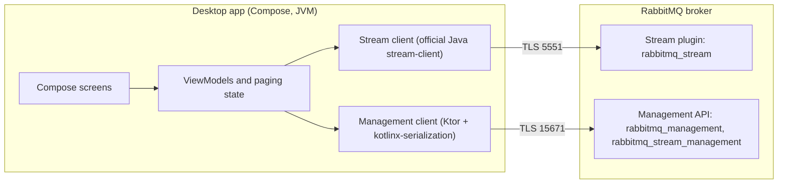

# Caerbannog – KMP Compose Desktop Plan

> Tagline: "behind the rabbit". Started on 2026-11-03 from the living plan doc: https://claude.ai/artifact/6ZMxom32HjSEDEzm4Xyhnh. This file is now the source of truth; the doc is a snapshot. UX sources live in `docs/ux/`.

## Goals and scope

Caerbannog ("behind the rabbit") is a free, desktop-only "Kafka UI for RabbitMQ Streams": connect to a broker, list streams, and page through messages by offset or timestamp. It also covers quorum queues, but only for topology and statistics, never for reading their messages. It is a Kotlin Multiplatform project using Compose Multiplatform, but v1 ships only the JVM desktop target and supports RabbitMQ 4.x and later.

**v1 features**

- Stream list with stats: size, first/last offset, message count (derived), retention, publishers and consumers; super streams appear as one entry with their partitions.
- Publishers and consumers per stream: who is connected, consumer offsets and how far behind they are, and publisher message counters, read from the management API.
- Message browser with paging: start from first, last, a numeric offset or a timestamp; page size; next, previous and jump to offset.
- Search and filter plus payload viewer: text, JSON (pretty-printed) and hex views; filter by properties and application properties.
- Publish and manage: publish a test message to any stream, exchange or queue; create and delete streams, view consumer offsets.
- Quorum queue topology and statistics: list queues, exchanges and bindings; see message counts, consumers, leader and members; declare, edit (policies, bindings) and delete them where the connection's permissions allow; apply or export topology as versioned JSON migrations.
- Global search: one box that finds streams, queues and exchanges by name (substring or regex), with the type of each result; names only, never message contents.

**Non-goals for v1**

- Android, iOS and Web targets (the stream client is JVM-only; these need a backend, see Architecture).
- Browsing or consuming messages from quorum or classic queues; reading would remove messages and change the data flow, so for queues the app handles topology, statistics and test publishing only.
- Live tailing at high throughput; v1 browses, it does not replace a consumer.

**Quality requirement**

- Every feature is built test-first (TDD), and its behavior is also written as BDD scenarios in plain Given/When/Then language that run automatically. See Testing.

## Architecture

The app talks to RabbitMQ directly over two channels, with no backend of our own.



The stream protocol over TLS (default port 5551) carries message reads, publishes and stream create/delete. The management HTTP API over HTTPS (default port 15671) supplies the stream list, sizes, publishers and consumers, plus all quorum queue topology and statistics.

**Why JVM-only:** the official RabbitMQ stream client is a Java library, so it runs on desktop JVM (and Android) but not on iOS or in a browser. Adding those later means a small Ktor gateway that holds the stream connection and exposes a paged REST API; the UI and view models stay shared.

**Broker requirements:** the `rabbitmq_stream` and `rabbitmq_stream_management` plugins must be enabled, and both listeners must use TLS; the app does not connect without it. For browsing, use a dedicated user with read-only permissions where possible.

## Module layout and tech stack

One Gradle project (Kotlin Multiplatform and Compose Multiplatform Gradle plugins, one `build.gradle.kts` per module — see Packaging below for why Gradle over Kotlin Toolchain) with a shared core and a thin desktop app, so Android or iOS can be added later without rewriting logic.

| Module | Source set | Holds |
| --- | --- | --- |
| `core` | commonMain | Domain models (Stream, Page, StreamMessage), paging logic, repository interfaces, view models |
| `data-rabbit` | jvmMain | Stream client wrapper, management API client, connection profile storage |
| `ui` | commonMain | Compose screens, theme, payload viewers (text, JSON, hex) |
| `desktopApp` | jvmMain | `main()`, window, menus, packaging |

| Concern | Choice |
| --- | --- |
| UI | Compose Multiplatform (Desktop) with Material 3 |
| Async and state | Kotlin coroutines, `StateFlow`, unidirectional data flow |
| Stream access | `com.rabbitmq:stream-client` (official Java client) |
| Management API | Ktor client with kotlinx-serialization |
| Navigation | A simple sealed-class screen stack to start; Decompose only if it grows |
| Settings and secrets | Connection profiles in a JSON file; passwords in the OS keychain via `com.github.javakeyring:java-keyring` — a write/read/delete round trip passed on macOS in the M1 spike; Windows is unverified until run on Windows hardware or CI |
| Packaging | Gradle with the Compose Multiplatform Gradle plugin (`org.jetbrains.compose`); `./gradlew :desktopApp:run` opens the window and `:desktopApp:packageDmg` / `:desktopApp:packageMsi` (jpackage under the hood) are the installer tasks — chosen over Kotlin Toolchain because the M1 spike found the installed CLI has no `new`, `run` or `package` subcommands at all (see `docs/tasks/M1-01-skeleton-and-spike.md`'s Status section for the captured command output). Only `packageDmg` has actually been run and produced a working installer (macOS dev machine); `packageMsi` cannot be cross-built from macOS and stays unverified until run on Windows or in CI |
| Testing | JUnit 5 (+ `kotlinx-coroutines-test` once there is async code to test) for TDD, Cucumber-JVM (`cucumber-junit-platform-engine`) with Kotlin step definitions for Gherkin scenarios, Testcontainers for a real broker, Compose Multiplatform UI test API — all four wired and proven together in the M1 spike |
| Local dev commands | `Taskfile.yml` at the repo root (go-task, https://taskfile.dev) wraps the Gradle commands above — `task test`, `task test:broker`, `task run`, `task package:dmg`, `task package:msi` — as thin one-line aliases, so developers do not need to recall exact `./gradlew` invocations. Installed separately (e.g. `brew install go-task` on macOS); not used by any CI pipeline, since none exists yet (project is local-development-only for now) |

The `data-rabbit` module sits behind repository interfaces in `core`, so a future gateway-backed implementation can replace it without touching the UI.

## Paging model

Streams have no random-access API, so each page is a short-lived read: open an unnamed consumer at a start offset, collect up to the page size, then close it. An unnamed consumer stores no offset, so browsing never affects real consumers.

1. Ask the broker for the stream's bounds (`queryStreamStats`: first offset and committed offset).
2. Resolve the start: `first`, `last page`, a typed offset, or a timestamp (`OffsetSpecification.timestamp`).
3. Open the consumer at that offset; collect messages until the page is full or a short idle timeout (about 2 s) passes.
4. Close the consumer and render the page with each message's offset and timestamp.

**Next** starts at the last offset shown plus one. **Previous** starts at the first offset shown minus the page size, clamped to the first offset. **Jump to offset** and **Jump to time** restart at step 2.

**Caveats to design for**

- Delivery is chunk-based, so a read may begin before the requested offset; the app drops messages below the start offset.
- Retention can move the first offset while a user is paging; the app re-reads the bounds and shows a notice instead of failing.
- Message count is approximate (committed minus first offset, plus one); RabbitMQ's own Management UI can also show a slightly higher count, because offset tracking data is stored in the stream.
- Search and filter run client-side over a bounded scan (for example the next 10,000 messages) with a visible scan limit and a Cancel button; v1 does not rely on broker-side filtering.
- Super streams: each partition is a regular stream, so the browser reads one partition at a time. Order exists only within a partition, so v1 does not merge partitions into one sequence.

## Screens and UX

Four screens cover v1's core flow, laid out like Kafka UI: a left sidebar for connections and streams, a main pane for the selected stream. Static Material 3 mockups of every screen are in `docs/ux/`.

| Screen | What the user does |
| --- | --- |
| Connections | Add, edit and test broker profiles: host, stream port, management port, vhost, user, TLS settings (TLS is always on), and a permission check that runs before the first connection |
| Stream list | Sort and filter streams; see size, first and last offset, approximate message count, publishers, consumers; create or delete a stream |
| Message browser | Pick start (first, last page, offset, timestamp) and page size; use next, previous and jump; filter within a bounded scan |
| Message detail and publish | Side panel with offset, timestamp, properties, application properties and the body as text, pretty JSON or hex; a dialog to publish a test message to any stream, exchange or queue |
| Topology and queues | List quorum queues, exchanges and bindings with statistics (messages, consumers, leader, members); declare and delete them, edit policies and bindings; apply migrations to the broker, or export and import them as JSON files |
| Publishers and consumers | Tab on the stream detail screen: publishers with connection and message counters; consumers with connection, offset and messages behind; jump the browser to a consumer's offset |
| Global search | Search box at the top of the sidebar opens a search view: results grouped as streams, queues and exchanges, filter chips with counts, a regex toggle, Enter opens the first result. Queue and exchange lookups use the management API's server-side name filter with paging (default 100 per page, maximum 500) |

**UX rules**

- Destructive actions (delete stream) need the stream name typed to confirm.
- Every read shows what it did: "offsets 1,200 to 1,299 of about 48,000".
- The body viewer never assumes UTF-8: detect text or JSON, fall back to hex, and cap very large bodies with a "show all" action.
- Copy buttons for offset, body and a ready-made consumer snippet.

## Topology migrations and permission guardrails

Topology changes are versioned JSON files applied in order, like a database migration tool, and each connection is its own environment: before the first connection the app checks what the connection's user may do, and limits itself to that.

A migration lists the changes to make: streams, super streams, quorum queues, exchanges, bindings and policies. The app applies pending files in version order, tracking applied versions per machine and per connection profile, and can export a broker's current topology as a new file, so one format covers both apply and export/import. The format below is a proposal to refine.

```json
{
  "version": "0003",
  "description": "Add orders queue and binding",
  "up": [
    { "action": "declareQueue", "vhost": "/", "name": "orders", "type": "quorum" },
    { "action": "declareBinding", "vhost": "/", "exchange": "events", "queue": "orders", "routingKey": "order.created" }
  ]
}
```

| Permission found for the connection's user | What the app allows |
| --- | --- |
| Configure permission on the virtual host | Declare, edit and delete topology, apply migrations |
| No configure permission | Read topology and statistics; edit, validate and export migration files; no topology changes |
| No write permission | Test publishing is disabled |

## Testing: TDD and BDD

Every feature is built test-first, and its behavior is written as BDD scenarios that run automatically; both are requirements, not extras. The `core` module has no RabbitMQ imports and talks to the stream and management clients through interfaces, so most tests run against fakes without a broker.

| Layer | What it covers | Tooling (confirmed in the M1 spike) |
| --- | --- | --- |
| Unit (TDD) | Paging math, offset resolution, migration ordering and idempotency, permission guardrails, payload detection | JUnit 5, coroutines test, fakes behind the `core` interfaces |
| BDD scenarios | User-visible behavior as Given/When/Then, such as paging at stream edges and blocked topology edits without configure permission | Gherkin features with Cucumber-JVM and Kotlin step definitions |
| Integration | Real stream and management calls against a RabbitMQ 4.x broker over TLS | Testcontainers RabbitMQ module (needs Docker) |
| UI | Screens render and respond: stream list, message browser, publish dialog | Compose Multiplatform UI test API on desktop |

```gherkin
Feature: Permission guardrails
  Scenario: Deleting a queue is blocked without configure permission
    Given a connection whose user has no configure permission
    And a quorum queue "orders" exists
    When I try to delete the queue "orders"
    Then the app refuses and says topology is locked
    And no request is sent to the broker

Feature: Message paging
  Scenario: Next page at the end of a stream
    Given a stream "events" with 250 messages
    And the page size is 100
    When I open offset 200
    Then I see offsets 200 to 249
    And "next" is disabled
```

The two scenarios are examples of the style, one per milestone area; the full list grows with each milestone.

## Milestones, risks and open questions

The plan has five milestones in order; each ends with a gate that must pass before the next starts. Durations are not estimated yet. Each gate also requires that milestone's tests to pass: unit tests written first, plus its BDD scenarios.

| Milestone | Scope | Gate |
| --- | --- | --- |
| M1 Skeleton and connection | Modules, test setup, profiles, installer spike | Connects to a local broker |
| M2 Stream list and stats | Management client, lists, stats, publishers and consumers | Stats match the Management UI |
| M3 Message browser | Paged reads by offset and timestamp, next and previous | Pages correct at stream edges |
| M4 Payload viewer and filter | Text, JSON and hex views; bounded client-side filter | Large bodies stay responsive |
| M5 Publish, manage, package | Publish, create and delete, topology edits, installers | Installers run on macOS and Windows |

**Risks**

- Opening a consumer per page adds latency; measure it on a real broker, then consider keeping one consumer open and prefetching the next page.
- The stream client is JVM-only, which caps v1 at desktop (and later Android) until a gateway exists.
- Very large or compressed messages can make pages slow; the body viewer caps display size.
- Secret storage differs per OS; `java-keyring`'s write/read/delete round trip passed on macOS in the M1 spike. Windows (Credential Manager) and Linux (libsecret, not a v1 packaging target) are still unverified until run on that hardware or in CI.
- Kotlin Toolchain was evaluated in the M1 spike and ruled out: the installed CLI (Homebrew, v2.4.21) has no `new`, `run` or `package` subcommands at all, so there is nothing resembling the project/run/installer workflow the spec originally described (see `docs/tasks/M1-01-skeleton-and-spike.md`'s Status section for the captured command output). The project uses Gradle with the Compose Multiplatform Gradle plugin instead; `:desktopApp:packageDmg` already produces a working dmg on macOS (`:desktopApp:packageMsi` is unverified — cannot be cross-built from macOS).
- Testcontainers' RabbitMQ module (`RabbitMQContainer.withPluginsEnabled`, used in the M1 spike's container-start proof) emits a deprecation warning on the version pinned in M1-01 (1.21.3); harmless today but worth resolving — or re-checking against whatever version M1-02 pins — before `data-rabbit`'s real `@broker` integration tests are built on top of it, so the warning is not inherited silently.
- Testcontainers' own Docker connectivity probe (`org.testcontainers.dockerclient.DockerClientProviderStrategy`) falls back to a hardcoded Docker API version (1.32) when none is otherwise configured; very new Docker Desktop engines (confirmed here: 29.8.2, API 1.56, `MinAPIVersion` 1.40) reject that version with HTTP 400, so every provider strategy fails even though Docker is installed and working. Worked around locally by pinning a supported API version on the test JVM (`data-rabbit/build.gradle.kts`, `brokerTest` task); worth re-checking whenever Testcontainers or Docker Desktop is upgraded. Re-confirmed 2026-11-03 (`M1-TASKFILE-01-local-dev-commands`, wiring `task test:broker`): Docker Desktop still 29.8.2 on this machine, the `api.version=1.43` pin still resolves and `brokerTest` still starts a real RabbitMQ container. The project is local-development-only for now (no CI pipeline), so there is no CI runner Docker Desktop version to separately confirm.
- Migration history is kept per machine, so two people can apply the same migration to one broker; every action must be idempotent (declaring something that already exists with the same settings is a no-op).

**Open questions**

- [ ] How does the app read the user's own permissions? The management API lists permissions for administrators; confirm whether a non-administrator user can see their own, and what the fallback is.
- [ ] RabbitMQ's configure permission covers both creating and deleting, so the check cannot allow additive changes while blocking deletes. Is that acceptable, or should the app add its own rule on top?
- [ ] Confirm the exact fields returned by the stream publisher and consumer endpoints (offset, messages behind, counters) on a real broker; the API reference does not list them.
